# About SeisDesk

SeisDesk is an interactive seismic data processing system for 2D land and marine lines and moderate 3D surveys. It takes
raw field records (SEG-Y, Seismic Unix or SEG-2 shot files) through geometry, quality control, first-break and
refraction analysis, reflection and horizon picking, editing, gain, filtering, deconvolution, statics, velocity
analysis, NMO, multiple attenuation, DMO, stacking, and time and depth migration. It ends with exportable sections,
velocity models, refraction layer models and pick tables.

SeisDesk uses its own NumPy/SciPy processing engine and can launch installed Seismic Unix programs on a local
host or Windows WSL. The SU workbench discovers installed programs, shows their documentation and runs file
pipelines. Explicit shell scripts can be run as pipeline stages when they read stdin and write stdout.

The main workflow is managed from one window. Each processing step can be run on its own on a dataset, combined into saved
processing flows, tested first on the gather on screen, and repeated in batch from the command line.

## The processing sequence at a glance

A typical **land** line with refraction and reflection interest:

1. Load the SEG-2 shot files of the line (chapter 3).
2. Build the geometry from the shot table and topography (chapter 4).
3. Inspect the shots, and find the usable frequency band with spectral analysis (chapters 5 and 6).
4. Pick first breaks, split them into the direct wave and the refracted branches, and read the velocities and layer
   depths (chapter 7).
5. Mute the first arrivals, apply gain, band-pass and deconvolution (chapter 8).
6. Apply elevation or refraction statics, then velocity analysis, NMO and residual statics (chapter 8).
7. Stack, migrate, convert to depth and export the final sections (chapters 8 and 10).

A typical **marine** line:

1. Load the SEG-Y file and set the streamer or 2D geometry.
2. Mute the direct wave, then apply band-pass, gain and deconvolution.
3. Pick velocities interactively (or start with automatic picking) on CMP gathers.
4. NMO, Radon demultiple, stack.
5. Time migration, depth model, depth migration.
6. Export SEG-Y sections and velocity files.

Chapters 11 and 12 walk through both cases click by click.

## Conventions used in SeisDesk and in this manual

- **Header names** follow Seismic Unix: `fldr` (field record or FFID), `ep` (shot point), `tracf` (channel), `cdp` (CMP
  number), `offset`, `sx`/`gx` (source and receiver x), `selev`/`gelev` (elevations), `sstat`/`gstat`/`tstat`
  (statics), `laga` (first-break time), `iline`/`xline` (3D bins), `cdpx`/`cdpy` (CMP coordinates). The full list
  is in Geometry > Header table of the dataset.
- **Units:**
  - Positions, offsets and elevations are in metres. SEG-Y scalars are applied on input and output, so headers always
    hold real values.
  - Times in parameter forms are in seconds; static, mute and first-break headers are in milliseconds.
  - Velocities are in m/s.
  - Depth sections have a sample interval in metres.
- **Offsets are signed:** an offset is negative when the receiver lies behind the source along the line (towed
  streamers, or the left side of a split spread).
- **Statics:** a positive static moves data later in time.
- **Menu paths** are written like **File > Open seismic file**. Keyboard shortcuts are given in brackets, e.g. (F5).

# Installation and first start

## Installing

1. Choose one edition: `SeisDesk-0.12.0-setup.exe` for CPU processing, or
   `SeisDesk-0.12.0-CUDA-setup.exe` for an NVIDIA CUDA workstation. The CUDA edition also supports CPU processing.
2. Run the installer on a 64-bit Windows 10 or 11 computer. Save projects and close SeisDesk before updating.
3. The development installer is not digitally signed. If SmartScreen appears, verify that you are using the trusted
   supplied copy before choosing **More info > Run anyway**.
4. Accept the default folder. Choose "only for me" for a normal installation without administrator rights, or
   "for all users" if you are an administrator. Tick **Create a desktop shortcut** if wanted, then launch SeisDesk.

The installer adds **SeisDesk** and **SeisDesk User Manual** (this document as a PDF) to the Start menu. Nothing else
needs to be installed for the native CPU tools: Python, Qt and their libraries are inside the program folder.
The CUDA edition additionally bundles its runtime libraries, headers and kernel compiler; it requires a compatible
NVIDIA driver, but no separate CUDA Toolkit installation. Check the selected GPU with
**Processing > Workstation CPU / CUDA devices > Run CUDA check**, then save the compute choice and project.
SU is installed separately in WSL on Windows. Dask remains an optional compute-host dependency.
To remove SeisDesk, use **Settings
> Apps** or the Start-menu entry **Uninstall SeisDesk**.

## The main window


- **Menus:** File, Geometry, Processing, Velocity, Picking, View, Help.
- **Project panel** (left):
  - The datasets of the project. Double-click one to display it; right-click it to rename, delete, export, show its
    header table or its history.
  - The pick sets.
  - The state of the velocity picks and the depth model.
- **Tabs** (centre):
  - **Viewer** displays a dataset.
  - **Flow editor** (F5) builds and runs processing sequences.
  - **Velocity analysis** (F6) holds the interactive semblance picking.
  - More viewer tabs can be opened to compare datasets side by side.
- **Log** (bottom): messages from processing steps. Show or hide it from **View**.
- **Status line:** short hints and progress messages.

Each processing result becomes a new dataset in the Project panel, so the input of a step is never overwritten. You
can always go back one step.

### Workspace and navigation (v0.12)

The **Home** tab provides import, open-project, flow-editor and example-data actions, project counts and recent
projects. Use **Ctrl+1 / 2 / 3 / 4** to switch to Home, Viewer, Flow editor and Velocity analysis.
The toolbar keeps import, project saving, compute preferences and appearance within reach.

- Press **Ctrl+K** to search menu commands, datasets and every registered processing step. Type several words,
  use the arrow keys to select a result, then press Enter. **Add to flow** inserts a process after the selected
  step; it does not run it. Esc closes the search.
- Filter the Project panel by dataset name. Double-click a dataset, or select it and press Enter, to display it.
  Right-click for export, rename, deletion, headers and history.
- **Light** is the default appearance; switch to **Dark** using the toolbar if preferred. Appearance and dock layout are remembered on this
  workstation. **View > Reset workspace layout** restores the Project panel and Home tab. The activity log is
  available from **View > Log**.
- In the Viewer, **Display options** expands colour, gain, clipping, sorting, axis and reduction controls.
  Display gain changes the view only; use a processing step to change trace amplitudes.
- Drag seismic files from Windows Explorer onto the application to open the usual import controls. A saved
  project folder can also be dropped onto the window to reopen it.
- In the Flow editor, search the process library by name, category or description. Drag a process from the library
  to its desired position in the flow, or double-click it to add it. Drag flow steps to reorder them, uncheck a step to bypass it, or use the Up/Down buttons. Delete removes
  the selected step when the step list has focus.
- **Undo / Redo** restores flow structure, parameters, bypass states and notes (up to 100 edit states). Ctrl+Z /
  Ctrl+Y performs the same actions when the step list has focus; text fields retain their normal text undo.
  Opening another project resets this edit history. Undo does not delete or recompute previous output datasets.
- **Run flow** becomes available with an input dataset and an enabled step. Editing is locked while processing;
  the status line reports progress, completion, cancellation or failure. Cancellation takes effect at a process
  cancellation check. Save unsaved flow changes with **Ctrl+S**, including flows with no datasets yet.
- **Compute** shows the configured preference, not proof of GPU use. Open the device dialog to inspect devices
  or run the CUDA check; each processing job records its actual device.


## Getting help inside the program

- **Help > User guide** (F1): this manual inside SeisDesk, with its screenshots.
- **Help > User manual (PDF):** this manual as a PDF.
- **Help > Process and parameter reference:** every processing step with every parameter, its default and its allowed
  values (also printed as the appendix of the PDF manual).
- Every parameter form shows a description of the step at the top. Some parameters show more help when you hover
  over them.

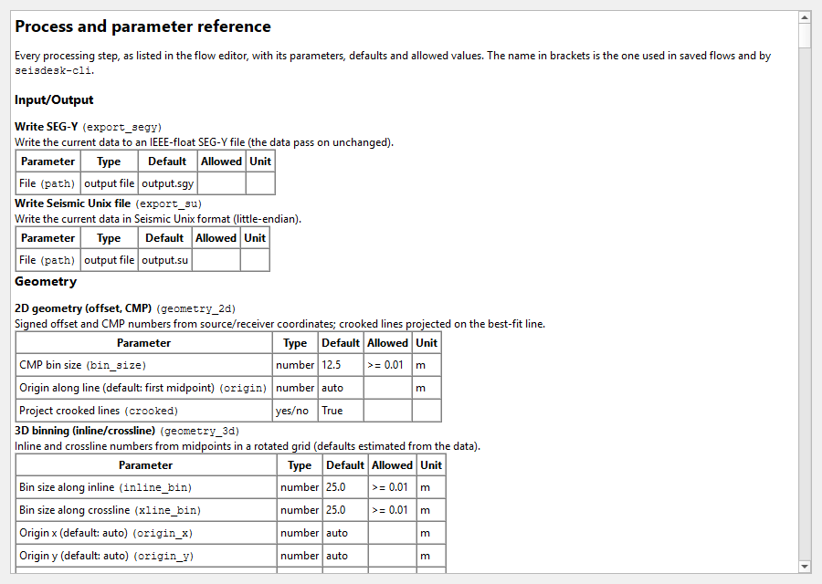

# Projects and data loading

## Projects

A project holds your datasets, velocity picks, depth model, pick sets and the current flow.

- **File > Save project** (Ctrl+S) writes them to a folder. The first save asks you to choose or create an empty
  folder.
- **File > Open project** reopens a project folder.
- **File > New project** starts empty. You are asked to save changes first.

The project folder contains `project.json`, `datasets/*.npz` (one file per dataset), `velocity.txt`,
`depth_model.npz` and `picks/*.json`. Keep the folder together when you copy it to another computer.

When nothing is saved yet, relative file names in parameters (for example a table file) are looked for in
`Documents\SeisDesk`. After the first save they are looked for in the project folder.

## Loading SEG-Y files

1. **File > Open seismic file** (Ctrl+O). Select one or more `.sgy` / `.segy` files.
2. In the **Import seismic data** dialog:
   - **Byte order:** big-endian is the SEG-Y standard; choose little-endian only for files written that way by PC
     software.
   - **Sample interval:** leave "from file" unless the binary header is wrong.
   - **Name:** the dataset name in the project (the file name by default).
3. Click **OK**. The file is read in the background, and the summary appears in the log.

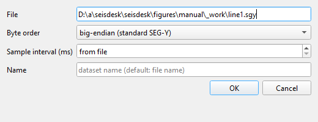

How SEG-Y is read:
- Every trace and all standard trace headers are read (bytes 1-180, plus the CDP x/y, inline, crossline and shot-point
  fields of rev 1).
- The coordinate and elevation scalars are applied.
- The recording delay (`delrt`) becomes the start time of the data.
- The textual header is kept and shown by right-clicking the dataset > **Summary and history**.
- IBM and IEEE float data are both read.

## Loading Seismic Unix files

Open `.su` files the same way. They are little-endian by default, as written by the SU programs on PCs.

## Loading SEG-2 shot files (engineering seismographs)

Most land refraction and shallow reflection seismographs (Geometrics, OYO, ABEM and others) write one SEG-2 file per
shot, often named like `1001.dat`.

1. **File > Open SEG-2 shot files of a line** (Ctrl+Shift+2).
2. Select **all the shot files of the line at once** (Ctrl+A in the file dialog) and click **Open**.
3. Review the timing options. Normally keep **Align each trace to shot time zero** enabled. Only enable
   **Add SKEW to DELAY** when the instrument's timing convention requires it.
4. The files load as one dataset named after the first file and the number of shots.

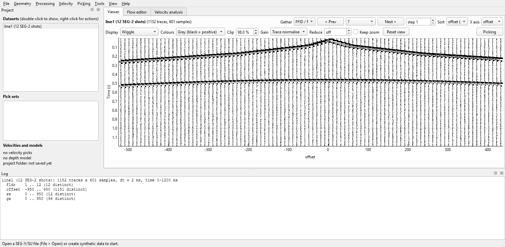

What happens on loading:
- **FFID:** each file becomes one field record (`fldr`). Its FFID is the SHOT_SEQUENCE_NUMBER stored in the file or,
  if that is missing, the number in the file name. If two files give the same number, the files are numbered 1, 2, 3
  ... in the order of their names.
- **Delay:** DELAY is checked separately for each trace. Negative delays remove pre-trigger samples; positive
  delays pad the start with zeros. Integer sample shifts preserve the recorded values exactly. Fractional shifts
  use a 16-sample-half-width Lanczos sinc kernel. Unequal sample intervals are rejected. With alignment disabled,
  all traces and files must share one start time.
- **SKEW:** original DELAY, SKEW and descriptor fields remain in the project. SKEW is not added automatically,
  because instrument timing conventions can already include it in DELAY. The import dialog exposes this choice.
- **Channel and positions:** the channel number becomes `tracf`. Receiver and source locations stored in the files
  become `gx` and `sx`.
- **Record length:** records are cut to the shortest file.
- **Formats:** all five standard encodings are read, including packed 20-bit samples, in either byte order.
  Truncated blocks, malformed sample counts and invalid timing values are rejected.

SEG-2 files are also recognised by **File > Open seismic file**, whatever their extension.

## Synthetic test data

**File > New synthetic dataset** makes a complete test line in a second, so you can practise every step:
- **Marine streamer line:** four reflectors, water-bottom multiples, a direct wave, a point diffractor and noise.
- **Land refraction line:** a direct wave at 800 m/s, refractors at 2000 and 3500 m/s, a reflection, random source
  and receiver statics, and noise.

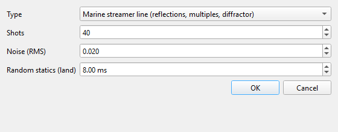

## Checking what was loaded

- The log lists the number of traces and samples, the sample interval, and the ranges of the main headers.
- **Geometry > Header table of the dataset** shows every trace header in a table. Untick or tick "show headers that
  are zero everywhere" to hide or show unused headers.
- Right-click the dataset > **Summary and history** shows the summary, every processing step applied so far, and the
  SEG-Y textual header.

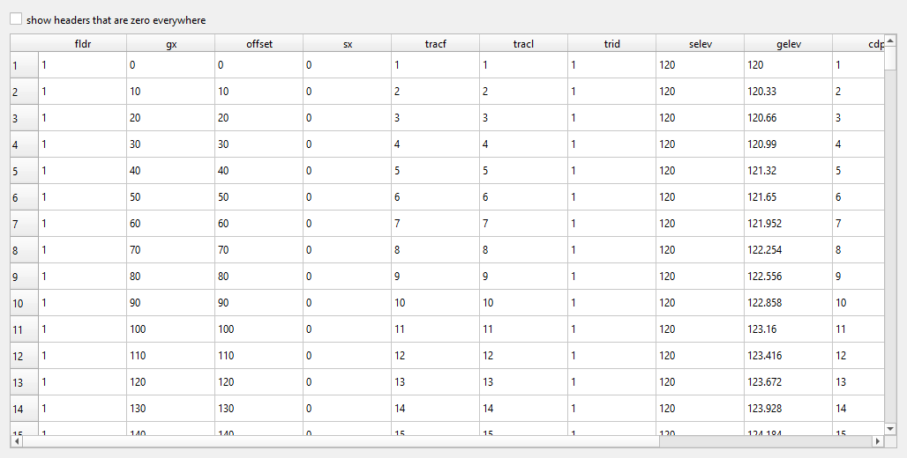

## Exporting data

- **File > Export dataset as SEG-Y** writes IEEE-float SEG-Y rev 1, with the headers re-scaled and the textual header
  kept.
- **File > Export dataset as Seismic Unix** writes SU.
- Inside a flow, the steps **Write SEG-Y** and **Write Seismic Unix file** save an intermediate result while the flow
  continues.

# Geometry

Most processing needs the source and receiver positions, the source-receiver offset and the CMP (common midpoint)
number of every trace. Use one of the steps below once, right after loading. Each one opens a form, and its result
replaces the dataset: geometry steps update headers only.

## 2D geometry from coordinates

Use this when the file already holds source and receiver coordinates (`sx`, `sy`, `gx`, `gy`).

1. Select the dataset, then **Geometry > 2D geometry: offsets and CMPs**.
2. **CMP bin size:** normally **half the receiver (group) interval**. For example, 12.5 m for 25 m groups, or 2.5 m
   for 5 m geophone spacing.
3. **Origin along line:** leave the default (the first midpoint) unless you need fixed CMP numbering.
4. **Project crooked lines:** on, for lines that are not straight. Midpoints are projected on the best-fit line.
5. Click **OK**.

The step sets `offset` (signed), `cdp`, `cdpx`/`cdpy` (bin centres) and `cdpt` (trace number within the CMP).

## Land geometry from a shot table and topography

Use this for land lines recorded without coordinates, such as SEG-2 shots. You describe each shot in one row of a
CSV table, and give the surface elevation in a two-column topography file.

**The shot table** (CSV with a header row; positions in metres along the line):

```
file,ffid,shot_x,shot_z,first_rec_x,rec_dx,nchan
line1_seg2/1001.dat,1,-1.0,,0.0,2.0,48
line1_seg2/1002.dat,2,11.0,,0.0,2.0,48
line1_seg2/1003.dat,3,23.0,,0.0,2.0,48
```

| Column | Meaning |
|---|---|
| `ffid` | Field record number of the shot (matches `fldr` of the dataset) |
| `shot_x` | Shot position along the line |
| `shot_z` | Shot elevation; leave empty to take it from the topography file |
| `first_rec_x` | Position of channel 1 |
| `rec_dx` | Geophone spacing; negative if channel 1 is at the far end of the spread |
| `nchan` | Number of channels (optional) |
| `file` | The SEG-2 file of the shot (optional) |

If the table has a `file` column, rows are matched to the loaded SEG-2 files by file name and take the table's FFIDs.
That way the table you already use for other software works unchanged.

**The topography file** (two columns, x and elevation; the same file Refrapy uses):

```
x z
-10 101.2
0 101.5
50 102.8
...
```

Steps:

1. **Geometry > Land geometry from shot table (CSV) and topography**.
2. **Shot table (CSV):** click **...** and choose the table.
3. **Topography file x z:** choose the file, or leave it empty for a flat line at elevation 0.
4. **CMP bin:** leave 0 for half the receiver spacing.
5. Click **OK**.

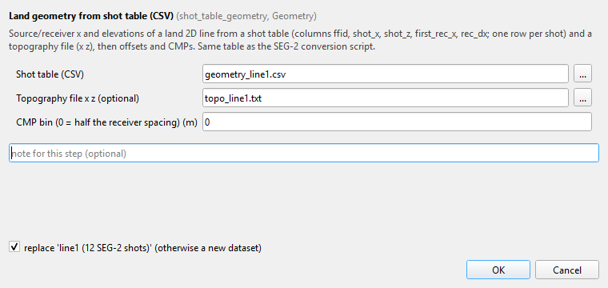

The step sets `sx`, `gx`, `selev` and `gelev`, the signed `offset`, and the CMP numbers. If a shot in the data is
missing from the table, the step stops and lists the missing FFIDs.

## Towed-streamer geometry without coordinates

For marine data whose headers hold only shot and channel numbers:

1. **Geometry > Streamer geometry from shot and channel numbers**.
2. Enter the **first shot x**, the **shot interval**, the **near offset** (the distance from the source to channel 1)
   and the **group interval**. Tick **Streamer behind the source** for normal towing.
3. Then run **2D geometry** with the bin size equal to half the group interval.

## 3D binning

**Geometry > 3D binning: inlines and crosslines**:
- Give the inline and crossline bin sizes.
- Leave the origin and azimuth at "auto" to have them estimated from the midpoints, or enter the survey grid
  definition.
- The step sets `iline`, `xline`, a running bin number in `cdp`, and the bin centres.

## Setting headers with a formula

**Geometry > Header formula** sets `key = (a + b*key2 + c*key3) / d`, like Seismic Unix `suchw`. Examples:

- Shot point from FFID: key `ep`, b = 1, key2 `fldr`, a = -1000 (so FFID 1001 becomes shot point 1).
- Receiver station from x: key `tracf`, b = 1, key2 `gx`, d = 2 (2 m stations).

## Checking the geometry

- In the viewer, choose Gather **CMP** and step through the CMPs. A CMP gather should show reflections as symmetric
  hyperbolas, with offsets increasing smoothly.
- Choose X axis **offset** on shot gathers. The direct wave and first breaks must start at zero offset at the shot
  position, and reach the same time at equal distances on both sides of a split spread.
- In the header table, check that `offset` = `gx` − `sx` along the line, and that elevations look like the
  topography.

# Viewing data

## Gathers

The **Gather** list in the viewer chooses how traces are grouped:

| Gather | Header | Typical use |
|---|---|---|
| FFID / field record | `fldr` | Shot records as recorded |
| Shot point | `ep` | Shot records by shot-point number |
| Source x | `sx` | Common-source gathers by position |
| Receiver x | `gx` | Common-receiver gathers (receiver statics, noise checks) |
| Channel | `tracf` | One channel across all shots (bad channel checks) |
| CMP | `cdp` | CMP gathers for velocity analysis and stacking |
| Offset | `offset` | Common-offset sections |
| Inline / crossline | `iline` / `xline` | 3D lines |
| All traces (section) | none | Stacked and migrated sections |

Any other header with more than one value is also offered.


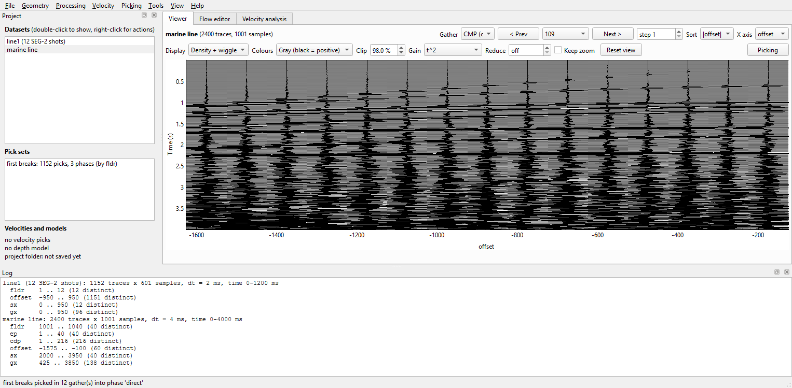

## Navigating

- **< Prev** and **Next >** (or Page Up and Page Down) step through the gathers. The list in between jumps to any
  gather. **step** skips several gathers at a time.
- **Sort** orders the traces inside a gather: file order, signed offset, |offset|, receiver x, channel, and so on.
- **X axis** chooses the horizontal axis: trace number, offset, receiver x, CMP and others.
- Choosing Gather **CMP** sets sort |offset| and X axis offset automatically.

## Display settings

- **Display:** Density (variable density), Wiggle (wiggles with positive fill), or Density + wiggle. Wiggles are left
  out above 1000 traces.
- **Colours:** grey with black or white positive, red-white-blue, or seismic.
- **Clip:** the percentile of |amplitude| shown at full colour. 98% is a good start; lower it to brighten weak data.
- **Gain** (display only, the data are not changed):
  - None.
  - AGC 0.25, 0.5 or 1 s.
  - t-squared.
  - Trace normalise.
  - For depth sections, the AGC window is in metres (0.5 s becomes 500 m).
- **Keep zoom** keeps the zoom when you change gather. **Reset view** shows everything again.

## Zoom, pan and read-out

- **Drag** with the left mouse button to pan, and use the **mouse wheel** to zoom. To zoom one axis only, drag with the
  right mouse button (horizontal for x, vertical for time).
- The line under the display reads out the trace under the cursor: its number, the main headers (FFID, channel, CMP,
  offset, positions), and the time or depth and amplitude.

## Several viewers

**View > Open the dataset in a new viewer tab** (or right-click a dataset > **Show in a new viewer tab**) opens
another viewer, for example to compare a gather before and after a filter. Close extra tabs with the cross on the
tab.

## Saving an image of the display

**File > Save display as image (PNG)** (Ctrl+Shift+S) saves what is on screen to a PNG or JPEG file, for reports and
presentations. In the Viewer it saves the plot. In the Velocity analysis or Flow editor tab it saves the whole tab.

# Spectral analysis

Spectral analysis tells you the frequency content of the data. It shows the dominant frequency, the usable band
above the noise, the low-frequency noise (ground roll, swell) and the high-frequency noise floor, and from those the
band-pass filter to use. The autocorrelation tells you how to set deconvolution, and the f-k spectrum shows linear
noise for the f-k filter.

## Step by step

1. Display a typical gather, for example a shot in the middle of the line.
2. **Zoom to the part you want to analyse.** The analysis uses only the traces and the time window on screen. To
   compare shallow and deep data, zoom to the shallow window, analyse it, then zoom to the deep window. Exclude the
   first arrivals and ground roll when you want the reflection band.
3. Press **F8** (View > Spectra of the displayed traces).
4. Read the summary line at the top of the dialog. It gives:
   - **Peak:** the dominant frequency.
   - **-6 dB band:** where the amplitude is at least half of the peak.
   - **Usable (-20 dB) band:** where the amplitude is at least one tenth of the peak. That is the frequency range to
     keep.
   - **Suggested band-pass corners** f1, f2, f3, f4 for the Ormsby band-pass filter. The pass band is the -20 dB band,
     with tapers of 30% below it and 20% above.
   - **Autocorrelation first zero crossing:** see below.


## Reading the amplitude spectrum

- The curve is the average amplitude of all traces in view, in dB relative to its maximum.
- Energy rising strongly below about 10-15 Hz on land data is usually ground roll. In marine data it is swell noise.
  Put f2 above it.
- The curve flattening into a horizontal floor at high frequency marks where noise takes over. Put f3 where the signal
  meets the floor.
- Narrow spikes are monochromatic noise, for example 50 Hz power lines. Remove them with the **Notch filter** rather
  than a narrow band-pass.

## Autocorrelation (for deconvolution)

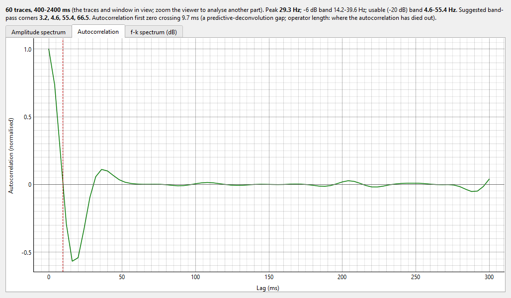

- The **first zero crossing** is a good **prediction gap** for predictive deconvolution, since it keeps the wavelet's
  main lobe. Spiking deconvolution uses a gap of one sample.
- The lag where the autocorrelation has died out to small values is the minimum **operator length**.
- A repeating peak at lag T (for example the water-bottom two-way time in shallow water) shows a multiple period. A
  predictive operator with a gap just below T and a length beyond T attenuates it.

## f-k spectrum (for f-k filtering)

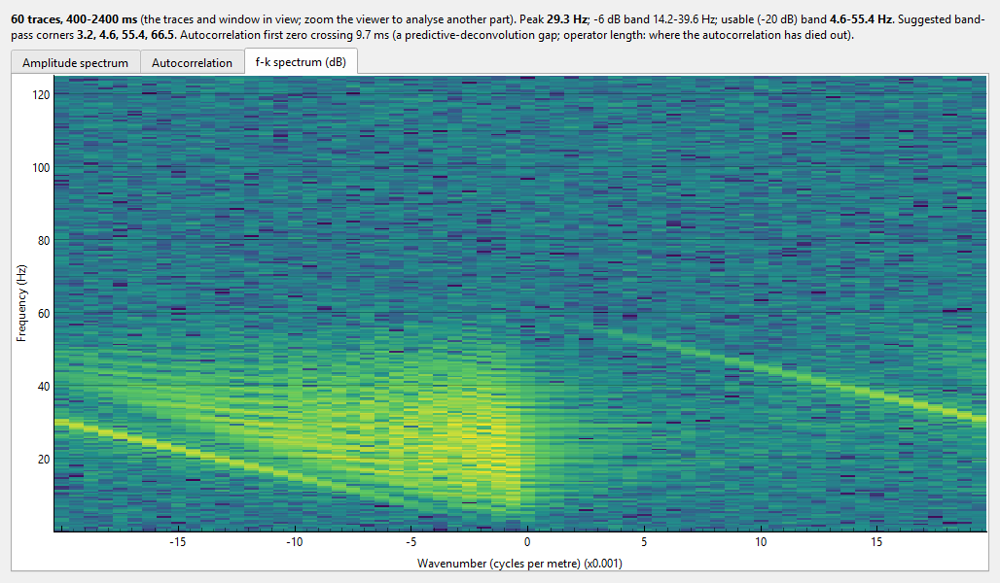

- Energy is shown against frequency and wavenumber (cycles per metre).
- Reflections from flat layers sit near zero wavenumber. Steep linear events form sloping fans: ground roll, direct
  waves, guided waves.
- The apparent velocity of a fan is frequency divided by wavenumber. Use it as the **Maximum |apparent velocity|** of
  the f-k filter in reject mode.

## Checking a filter

Apply the filter, display the result, zoom to the same window and press F8 again. The band outside f1-f4 must have
dropped, and the band inside must keep its shape.

# Picking: first breaks, refraction phases, reflection phases, horizons and mutes

## Pick sets and phases

All picking in SeisDesk uses one tool, opened with the **Picking** button in the viewer (or **Picking > Picking tool**,
F7). The panel on the right of the viewer holds:

- **Pick sets.** A named collection of picks, for example "first breaks", "reflections", "top mute" or "horizons". A
  pick set is organised by the gather type that was shown when you created it: shots by FFID, CMPs, or a whole section.
  Each pick stores the gather, the trace's offset (or its CMP on a section) and the time.
- **Phases.** Inside a pick set, every gather can hold several phases, each with its own colour. **New phase / break**
  (key **N**) is the *break*: it ends the current phase and starts the next one.
  - **Refraction:** pick the direct wave near the shot as phase 1. Press N where the first refracted arrival overtakes
    it, and pick that branch. Press N again at the next crossover, and so on, moving away from zero offset.
  - **Reflection:** each reflection is its own phase.
  - **Mutes:** the top mute and the bottom mute are two phases.

## Picking with the mouse

| Action | What it does |
|---|---|
| Left click | Adds a pick on the active phase at the nearest trace. A new pick on the same trace replaces the old one. |
| Right click, or Shift + left click | Deletes the nearest pick of the active phase (or of any phase if the active one has none nearby). |
| N (or B) | New phase: the break. |
| Page Up / Page Down | Previous / next gather (picks are kept per gather). |
| Drag / mouse wheel | Pan and zoom while picking. |

**Snap to** moves each click to a feature of the trace within the search window (± ms):
- *peak* (maximum), *trough* (minimum) or *zero crossing*, refined between samples;
- *energy onset*: the energy-ratio first break near the click.

Use *energy onset* or *peak* for first breaks, depending on your picking convention, and *peak* or *trough* to follow a
reflection consistently. Untick **Pick with the mouse** to navigate without adding picks by accident.

## Automatic first breaks

1. Show the shots (Gather: FFID), open the Picking tool and create a pick set with **New...** (for example
   "first breaks").
2. In **Automatic first breaks**, set:
   - **Fastest velocity** and **Slowest velocity:** a guide window. The picker searches between |offset|/v_fast
     and |offset|/v_slow, plus the margin. For shallow land work, 300-6000 m/s covers almost everything; narrow it if
     noise before the first arrivals is picked.
   - **Energy window:** about one period of the first arrival (10-30 ms).
   - **Margin:** extra search time on both sides of the guide window.
3. Click **Pick this gather** to test, then **Pick all gathers**.
4. Check every shot with Page Down. Correct wrong picks by clicking at the right place (the new pick replaces the old
   one), or delete them with a right click.

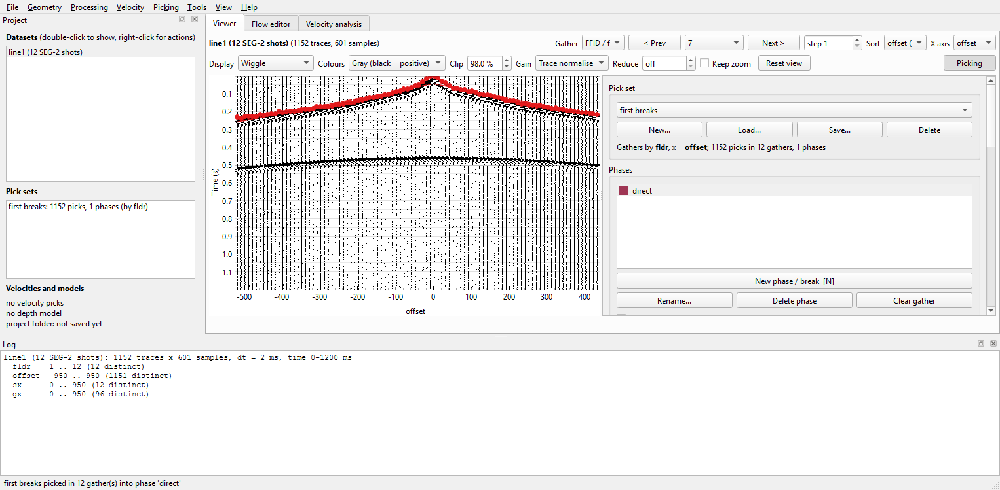

The picker uses the modified energy ratio and marks the **onset** of the first arrival. In a flow, the step
**Automatic first-break picking** does the same and also writes each first-break time into the `laga` header (ms).

## Refraction phase picking and the layer model, step by step

1. Pick the first breaks, automatically or by hand, as above.
2. Look at a shot and find the **crossover distances**, where the slope of the first breaks changes. Near the shot,
   the direct wave is slowest (steepest slope). Farther out, each faster refracted branch overtakes the previous one.
3. Split the picks into phases:
   - **By hand:** select phase 1 and rename it "direct" with **Rename...**. Pick the direct wave from the shot out to
     the first crossover. Press **N**, rename the new phase "refractor 1" and pick out to the next crossover. Press N
     again for "refractor 2", and so on. On a split spread, pick both sides of the shot in the same phases.
   - **From automatic picks:** create the phases with N, then re-pick the branches on the active phase. Clicking a
     trace adds the pick to the active phase; delete the old pick of the other phase with a right click where needed.
4. In **Fits and layers** choose **Fit: straight lines: refraction (intercept time)**:
   - **Offsets:** "|offset|, both sides" pools both sides of the shot. Use "positive offsets" or "negative offsets"
     to fit one side only, which you need for dipping refractors.
   - **Pool all gathers:** fits each phase over every shot together (a line average). Untick it to see the fit of the
     shot on screen and follow lateral changes from shot to shot.
   - **Draw fitted lines:** shows the fits as dashed lines labelled with velocity and intercept time.
5. Read the tables:
   - **Fit table:** for each phase, the apparent velocity (1/slope), the intercept time, the RMS misfit of the picks
     (ms) and the number of picks.
   - **Layer table** (intercept-time method, phases ordered by velocity): for each layer, its velocity, thickness and
     base depth, and the crossover distance to the next branch.
6. **Copy tables** puts both tables on the clipboard for a spreadsheet or report.


For the synthetic line, built with 800, 2000 and 3500 m/s and layers 17.5 m and 57.9 m thick, the automatic picks with
two breaks give 750, 1982 and 3493 m/s and thicknesses of 16.0 and 58.1 m.

**What the refraction results are used for:**
- **The near-surface model:** weathering velocity and thickness, depth to bedrock or the water table.
- **Refraction statics:** the delay of the slow near-surface layer at each source and receiver position. Compute an
  x-static table from the layer model or from tomography, and apply it with **Statics from an x-static table** (chapter
  8).
- **A top mute:** cut the first arrivals before stacking reflections.

**Limits of the intercept-time method:**
- It assumes flat layers that are continuous under the spread, with each layer faster than the one above.
- Dipping refractors give different apparent velocities in the two directions. Fit the positive and negative offsets
  separately, from shots at both ends; their mean slowness gives the true velocity.
- A layer slower than the one above it (a velocity inversion), or a layer too thin to produce a first-arrival branch
  (a hidden layer), does not appear. Keep this in mind when you interpret depths.
- For laterally varying near-surface conditions, export the picks (below) and use refraction tomography.

## Reflection phase picking

Reflections on a shot or CMP gather are **hyperbolas**, t² = t0² + x²/v². Picking them gives the stacking (NMO)
velocity and the zero-offset time of each reflector. From these, Dix's equation gives interval velocities and depths.

1. Display a CMP gather (Gather: CMP), or a shot over roughly flat layers. Use display gain t-squared or AGC so deeper
   reflections are visible.
2. Open the Picking tool and create a pick set, for example "reflections".
3. Set **Snap to** *peak* or *trough*, following the polarity of the event, so all picks sit on the same phase of the
   wavelet.
4. Pick the first reflection across the offsets (at least three picks; ten or more spread over the offsets is better).
   Press **N** and pick the next reflection, and so on, from top to bottom.
5. In **Fits and layers** choose **Fit: hyperbolas: reflection (NMO velocity, Dix)**:
   - **Fit table:** for each reflection, the NMO velocity, t0, the RMS misfit and the number of picks.
   - **Layer table:** the layers between consecutive reflections, with their interval velocity (Dix), thickness, base
     depth and the t0 of the reflector at their base.
   - **Draw fitted lines:** overlays the fitted hyperbolas, so you can check that each pick follows its event.


Use this to check velocities quickly at a few locations, to get a first velocity-depth model, or to confirm the
velocity analysis. Over dipping layers use CMP gathers: shot gathers then give apparent velocities.

## Horizon picking on stacked and migrated sections

1. Display the stack or migrated section (Gather: All traces, X axis: CMP).
2. Create a pick set. On a section it is keyed by CMP instead of offset.
3. Name the phase after the horizon, and pick along the reflector every few CMPs, with Snap to *peak* or *trough*.
   Each horizon is a phase.
4. **Export picks (CSV)** writes the horizons as CMP-time tables for interpretation software or depth conversion.

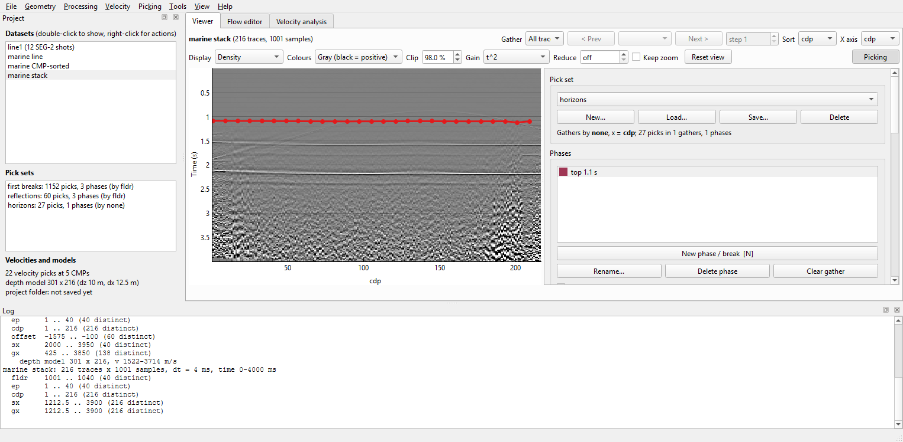

## Picking a mute

1. On shots or CMP gathers, create a pick set "mute".
2. Pick a few points along the line above which everything should be zeroed (a top mute), on a few gathers across the
   line. A bottom mute is a second phase.
3. In a flow, or with Processing > Apply one step, run **Mute (picked phase)** with that pick set and phase, kind *top*
   (or *bottom*), and a taper of 20-30 ms.

The mute is interpolated along |offset| inside each picked gather, and between picked gathers. Gathers beyond the
first and last picked ones use the nearest picked gather.

## Saving, loading and exporting picks

- **Save...** and **Load...** keep a pick set as a JSON file, with its phases and colours. Pick sets are also saved
  with the project.
- **Export picks (CSV)...** writes one row per pick: gather, phase, x (offset or CMP), time in ms and, when the traces
  carry them, `sx`, `gx`, `selev`, `gelev` and `cdp`. That is the input of refraction tomography programs such as
  Refrapy or pyGIMLi, and of interpretation software for horizons.

## Refraction analysis inside a flow

The step **Refraction analysis (intercept time)** fits the phases of a pick set, in picking order or in the order you
list, and writes the velocities, intercept times and layer thicknesses to the log. That gives a record of the
analysis inside a processing flow.

# Processing steps

## Two ways to run a step

- **One step at a time:** select the dataset, then **Processing > Apply one step to the dataset**, and choose the
  step. A form opens with every parameter and a description. Click OK and the result becomes a new dataset, or
  replaces the input if you tick "replace". Geometry and statics steps are also in the **Geometry** and
  **Processing** menus, and the Processing menu lists the other steps in submenus (wavelet and deconvolution,
  vibroseis, noise attenuation, interpolation, datuming, time and depth migration, attributes, multicomponent,
  modelling). The **Tools** menu opens the MASW, time-frequency and well-log windows.
- **In a flow:** build a sequence in the **Flow editor** (chapter 9) and run it in one go. Steps are listed there by
  category: Input/Output, Geometry, Editing, Vibroseis, Gain, Filtering, Deconvolution, Wavelet, Multiples, Statics,
  Datuming, Interpolation, Velocity, Moveout, Stack, Time migration, Depth migration, Conversion, Attributes,
  Multicomponent, Modelling, Picking, Utility.

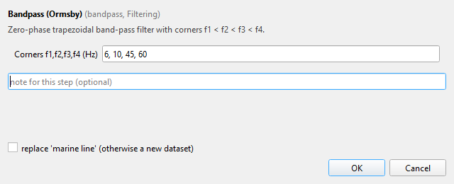

**Test before you commit.** In the Flow editor, tick **displayed gather only (parameter test)** and run. Only the
gather shown in the viewer is processed, which takes seconds; compare it with the input in a second viewer tab.
Run the whole line when the parameters are right.

## Quality control and automatic editing

**Survey QC** (View > Survey QC, F9) checks the selected dataset in three tabs:
- **Geometry:** source (red) and receiver (blue) positions. For a 2D line this is the elevation profile, so you can
  check the topography. Next to it is the **stacking chart**, one point per trace (source x against receiver x).
  Missing shots, wrong receiver positions and spread errors show up as gaps or broken lines.
- **Fold and offsets:** the fold of every CMP, and the offset coverage (offset against CMP).
- **Amplitudes:** the RMS amplitude of every trace, in dB relative to the median, arranged by FFID (rows) and channel
  (columns), with the average per shot and per receiver position.
  - The axes show the FFID and channel numbers (plain row and column numbers if these are not evenly spaced).
  - The colour scale is fixed at ±20 dB around the median, so normal traces sit in the middle colours.
  - A dead channel is a cold (dark blue) vertical stripe.
  - A weak shot is a cold row.
  - A noisy trace is a hot (dark red) spot.

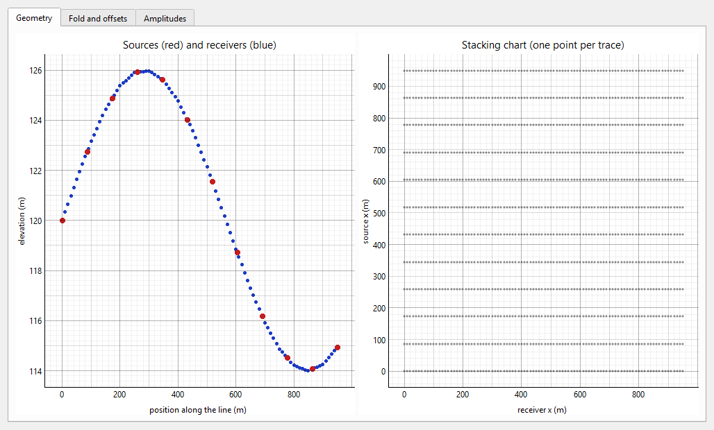


**Automatic trace editing (dead / noisy traces)** (Processing menu, or in a flow):
- It compares the RMS amplitude of each trace, in a time window, with the median of its gather.
- Traces below **low** × median are dead or weak (0.05 is a good start). Traces above **high** × median are noisy (3-5).
- **Action:** *zero* the traces (they keep their place and get `trid` = 2), *remove* them, or *flag only*. The RMS is
  written to header `qc_rms`, the flag (1 dead, 2 noisy) to `qc_flag`, and the edited FFID/channel pairs are listed in
  the log.

**Despike / noise-burst suppression** removes short high-amplitude bursts, spikes and swell noise, which ruin
deconvolution, filters and stacks:
- It compares the short-window RMS envelope of each trace with the running median of its neighbours (same gather, same
  time). Where the envelope exceeds **threshold** × median (3-5), the samples are scaled down to the median level.
- Coherent events are the same on neighbouring traces, so they are kept.
- Envelope window: 20-100 ms. Neighbours: 5-11 traces.
- Run it **after ground-roll removal**, or with a higher threshold. Steep, strong events such as ground roll differ
  from trace to trace at a given time, so a spatial median sees them as bursts and clips them.


## Trace editing

| Step | Use | Key parameters |
|---|---|---|
| **Kill traces** | Zero or remove bad traces | Header key (e.g. `tracf` for channels, `fldr` for shots); values as a list with ranges, e.g. `12, 45-47`; action zero (keeps the trace, sets `trid` = 2) or remove |
| **Reverse polarity** | Fix reversed channels | Header key and values; empty values = all traces |
| **Select traces (header range)** | Work on part of a line, or every n-th CMP | Header key, minimum, maximum, keep every n-th value |
| **Time window** | Cut the record length | Start and end time (s) |
| **Sort** | Change the trace order | Keys, primary first: `cdp,offset` for CMP gathers, `fldr,tracf` for shots |
| **Resample** | Change the sample interval | New interval (s); an anti-alias filter is applied when decimating |

Find bad channels by displaying Gather **Channel**: a dead or noisy channel stands out across all shots.

## Mutes

- **Mute (linear velocity):** zeroes everything above t = t0 + |offset|/v (top) or below it (bottom). It removes the
  direct wave (marine: v = 1500 m/s), refractions or ground roll. Add a taper of 20-30 ms.
- **Mute (picked phase):** follows a picked phase (chapter 7).
- **Surgical mute (between two phases):** zeroes the zone between two picked phases, or keeps only that zone (mode
  *keep inside*). Pick the upper and lower edges of the zone as two phases of one pick set. Use it for an air wave, a
  ground-roll cone with curved edges, or a noise train.
- **Ground-roll cone mute:** zeroes the cone between t = t0 + |offset|/v_fast and t = t0 + |offset|/v_slow, where the
  slow surface waves travel on land shots. Read the two velocities from the edges of the ground roll on a shot. The
  **tau-p filter** (below) removes ground roll without zeroing the reflections inside the cone.

## Gain (amplitude correction)

| Step | What it does | Typical setting |
|---|---|---|
| **t-power gain** | Multiplies by t^n to compensate for geometrical spreading and absorption | n = 2 for raw shots, 1-1.5 if the data already have some gain |
| **Spherical divergence** | g(t) = t v(t)^2 / (t_ref v_ref^2), using the velocity picks | Needs velocities (constant, a function or the project picks) |
| **AGC** | Divides by the RMS amplitude in a sliding window | 0.3-0.5 s for display and velocity analysis; avoid it before amplitude studies |
| **Trace balance** | Scales every trace to unit RMS or maximum in a window | Equalises shots and channels |
| **Scale / clip** | Multiplies by a constant and clips at a percentile | Clips noise bursts, e.g. 99.9% |
| **Exponential gain** | Multiplies by exp(a·t), with a given in dB/s, to compensate for absorption | 3-10 dB/s, often after t-power |
| **Surface-consistent amplitude correction** | Splits the log RMS amplitude of every trace into source, receiver, offset and CMP terms (least squares) and removes the source and receiver terms: charge size, coupling, geophone plants | Window with reflections, offset class width (e.g. 50-100 m). The removed terms (dB) are in the log |

Remember the difference between **display gain** (viewer setting, data untouched) and **gain steps** (they change the
data).

## Filtering

| Step | Use | Parameters |
|---|---|---|
| **Bandpass (Ormsby)** | Keep the usable band | Corners f1, f2, f3, f4 (Hz): full pass between f2 and f3, cosine tapers f1-f2 and f3-f4. Take them from the spectral analysis suggestion |
| **Butterworth filter** | Low-cut, high-cut or band-pass with a given steepness | Low cut, high cut (0 = none), order (4 is common); zero phase |
| **Notch filter** | Remove one frequency (power line 50 or 60 Hz) | Frequency, quality factor (30 = narrow notch) |
| **f-k fan filter** | Remove or keep a range of apparent velocities: ground roll, direct waves, linear noise | Gather key (`fldr` for shots), trace position key (`offset`), minimum and maximum apparent velocity, reject or pass, taper |
| **Time-variant band-pass** | A pass band that narrows with time, following absorption | Entries `time: f1,f2,f3,f4` separated by `;`, e.g. `0.0: 8,12,80,100; 1.0: 6,10,60,80; 2.5: 4,8,40,55`; the filters are blended linearly between the times. Take the bands from spectral analysis of shallow and deep windows |
| **Spectral whitening** | Flattens the spectrum inside a band (phase kept); widens the band like spiking deconvolution, without the minimum-phase assumption | Band corners, smoothing width (Hz), stabilisation (%) |
| **f-x deconvolution (random noise)** | Predicts every frequency across the traces (forward and backward complex Wiener filters) in overlapping windows. Laterally coherent events are kept; random noise is removed | Gather key (empty for a stacked section), time window (0.3-0.6 s), trace window (20-40), filter length (3-6 traces), damping (0.5-5%), frequency band. The output is limited to the band (tapered above fmax) unless "outside the band" is *keep* |
| **Median filter** | Running median across traces or along traces | *filter* removes spikes and random noise and keeps flat events; *subtract* removes what is flat across the traces, such as a flattened multiple or a horizontal noise train |
| **Linear tau-p (slant-stack) filter** | Least-squares linear Radon transform: models events slower than the cut velocity (ground roll, guided and direct waves) and subtracts them | Gather key, cut velocity (e.g. 600-1500 m/s), slowest velocity modelled (e.g. 150-300 m/s), number of p values, damping (0.05-0.2), band. Signed offsets: both sides of a split spread are handled. For ground roll, set the highest frequency to the top of the ground-roll band (15-25 Hz): ground roll is low-frequency, and above v/(2·trace spacing) it is spatially aliased (17 Hz for 350 m/s at 10 m), so it cannot be modelled there. Reflections above that band are left untouched |
| **Trace mixing (spatial smoothing)** | Weighted running average of neighbouring traces | Weights such as `1,2,1` or `1,1,1,1,1`; raises lateral coherence on stacks but smears steep dips |

All filters are zero phase, so they do not shift events in time.

Typical land use:
1. Run spectral analysis on shots (chapter 6).
2. Band-pass with the suggested corners, e.g. 8-12-60-80 Hz.
3. f-k reject 0 to 800-1500 m/s against ground roll. Read the ground-roll velocity from the f-k spectrum, or from the
   slope of the ground roll on a shot.

**Eigenimage (SVD) filter** splits windows of traces into eigenimages by singular value decomposition. An event that
is flat across a window (the same waveform on every trace) goes into the first eigenimage; random noise and dipping
events spread over all of them.
- *pass* keeps the first **k** eigenimages: a strong coherence filter for flat events, e.g. NMO-corrected CMP
  gathers (k = 1-3) or flattened horizons.
- *reject* removes them: for example, on CMP gathers corrected with the multiple velocity the multiples become flat
  and *reject* removes them while keeping the (curved) primaries.
- Events that are not flat can be flattened first with a **linear moveout velocity** (|offset| / v, for linear noise
  or refractions in shot gathers) or a **dip** in ms per trace (for a dipping horizon in a section); the flattening is
  undone after filtering.
- On sections with dipping or curved events use small **trace windows** (7-15 traces) and **time windows**
  (0.2-0.5 s), so the events are close to flat inside each window.

| Parameter | Meaning and choice |
|---|---|
| Number of eigenimages (k) | 1-3; more keeps more detail and more noise |
| Mode | *pass* (keep flat events) or *reject* (remove them) |
| Gather key | Empty for a section, `cdp` for CMP gathers, `fldr` for shots |
| Trace window, time window | 0 = whole gather and whole trace; otherwise overlapping windows blended with tapers |
| Flatten by linear moveout, by a dip | 0 = off |

**Signal/noise separation (Harlan, local slant stacks)** separates laterally coherent signal from random noise
(after Harlan, Claerbout and Rocca, 1984):
- In overlapping windows of traces the data are slant-stacked (local tau-p, dips up to the **largest dip**). Linear
  events focus into a few strong values, random noise spreads evenly over the tau-p panel.
- The noise level is estimated from the median absolute value of the panel. Values below **threshold** × noise level
  are set to zero (*hard*) or all values are shrunk towards zero by that amount (*soft*), and the panel is
  transformed back.
- *signal* outputs the coherent part; *noise* outputs what was removed. Always look at the noise output: it should
  contain no reflections.

| Parameter | Meaning and choice |
|---|---|
| Output | *signal* (the filtered data) or *noise* (data minus signal, for QC) |
| Gather key | Empty for a section; a key to work gather by gather |
| Trace window, time window | 12-24 traces, 0.2-0.5 s: events should be nearly straight inside a window |
| Largest dip | ms per trace; steeper events are treated as noise |
| Threshold | 1.5-3 × noise level; higher removes more noise and weakens weak events |
| Shrinkage | *soft* (smooth result, slightly weaker amplitudes) or *hard* (keeps amplitudes, more residual noise) |
| Highest frequency | The signal is band-limited to this frequency |

**Deghosting (source/receiver ghost)** removes the sea-surface ghost of marine data. A source or receiver at depth z
records every wave twice: directly, and 2 z cos(θ) / v later reflected from the sea surface with opposite
polarity. The ghost makes notches in the spectrum at 0 Hz and at multiples of v / (2 z cos θ) (for example 94 Hz for
a streamer at 8 m) and weakens the low frequencies.
- **Ghost to remove:** *receiver*, *source* or *both*.
- **Depths** come from the headers: `sdepth` for the source and minus `gelev` for the receivers (negative elevation
  below the sea surface). Type them in when the headers are empty.
- *vertical incidence* treats every trace as if the waves arrived vertically (cos θ = 1): good for near offsets,
  stacks and deep targets.
- *angle-dependent (tau-p)* works on shot gathers in the linear tau-p domain, where every slowness p has its own ghost
  delay (cos θ = sqrt(1 - p² v²)); better for long offsets and shallow targets. Source and receiver are given the
  same slowness, which is exact for flat layers.
- The **water level** (1-5 %) limits the gain in the ghost notches; raise it if the output becomes noisy or rings.

| Parameter | Meaning and choice |
|---|---|
| Ghost to remove | *receiver*, *source* or *both* |
| Mode | *vertical incidence* or *angle-dependent (tau-p)* |
| Source depth, receiver depth | 0 = from the headers |
| Water velocity | 1480-1540 m/s |
| Sea-surface reflection coefficient | 0.9-1.0 (a rough sea reflects less) |
| Water level | 1-5 % |
| Shot gather key, number of p values, lowest and highest frequency | tau-p mode only; 0 = Nyquist for the highest frequency |


**Noise attenuation, which tool for which noise:**

| Noise | First choice | Alternatives |
|---|---|---|
| Ground roll (slow, low frequency, land) | Linear tau-p filter | Ground-roll cone mute, f-k fan filter, low-cut band-pass |
| Direct and refracted waves | Linear-velocity or picked mute | Tau-p or f-k filter |
| Random noise | f-x deconvolution (on gathers or stacks) | Trace mixing on stacks, median filter |
| Spikes and noise bursts | Despike | Median filter, Scale / clip |
| Dead and noisy traces | Automatic trace editing | Kill traces |
| Power-line noise | Notch filter | |
| Multiples | Radon demultiple on NMO-corrected CMPs | Predictive deconvolution (short-period), median filter *subtract* on flattened multiples |
| Noise | First choice | Alternatives |
| Random noise on sections with gentle dips | f-x deconvolution | Harlan separation, eigenimage filter (small windows) |
| Random noise on NMO-corrected CMP gathers | Eigenimage filter, *pass*, k = 1-3 | f-x deconvolution |
| Sea-surface ghost (marine) | Deghosting | Spectral whitening (partial) |


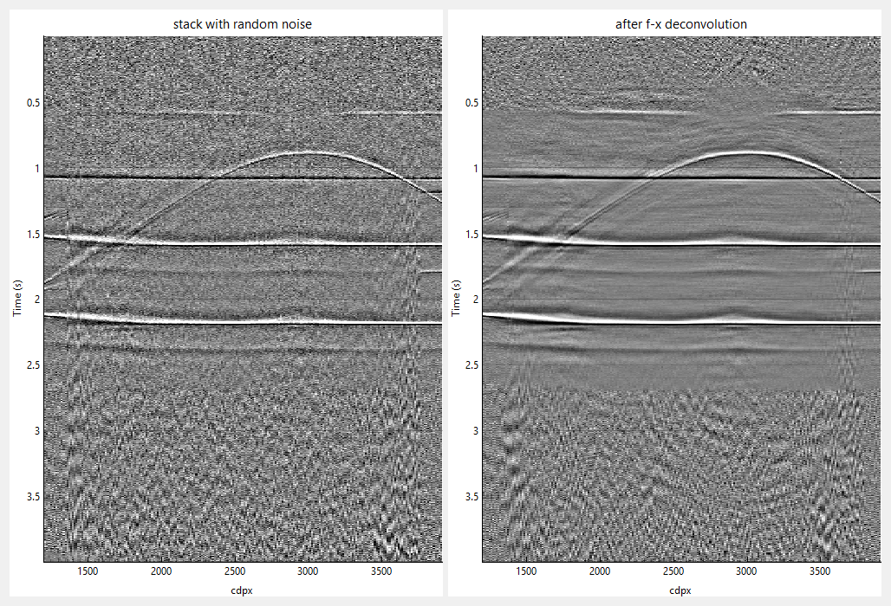


## Deconvolution

**Deconvolution (spiking / predictive)** designs a Wiener-Levinson prediction-error filter for each trace inside a
design window and applies it to the whole trace.

| Parameter | Meaning and choice |
|---|---|
| Operator length | 100-250 ms; at least the length of the wavelet, or the lag where the autocorrelation has died out |
| Prediction gap | One sample (e.g. 4 ms) = **spiking** (compresses the wavelet, widens the spectrum). The autocorrelation's first zero crossing (e.g. 16-32 ms) = **predictive** (gentler, keeps the wavelet's main lobe; with a gap just below a multiple period it attenuates short-period multiples) |
| Pre-whitening | 0.1-1%; raise it if the output becomes noisy (it stabilises the filter) |
| Design window | A window with good reflections, below the first arrivals and above the deep noise, e.g. 0.3-2.5 s |

Apply gain (t-power) and the mute before deconvolution, and band-pass after it: spiking deconvolution also boosts
noise frequencies.

**Surface-consistent deconvolution** suits land data, where the wavelet changes from shot to shot (charge, hole,
coupling) and from geophone to geophone:
1. The amplitude spectra of all traces in the design window are split, by least squares on their logarithms, into
   source, receiver and offset terms.
2. Each trace is deconvolved with the minimum-phase inverse of the average spectrum times its source and receiver
   terms.
3. Wavelets become consistent along the line, and noisy traces cannot spoil their own operators.

Parameters:
- **Design window:** below the first arrivals.
- **Offset class width.**
- **Spectral smoothing:** 3-10 Hz; more smoothing means a shorter operator.
- **Pre-whitening:** 0.5-2%.
- **Highest frequency kept:** limits the boost of noise above the signal band.

Run surface-consistent amplitude correction first, and edit dead and noisy traces before both.

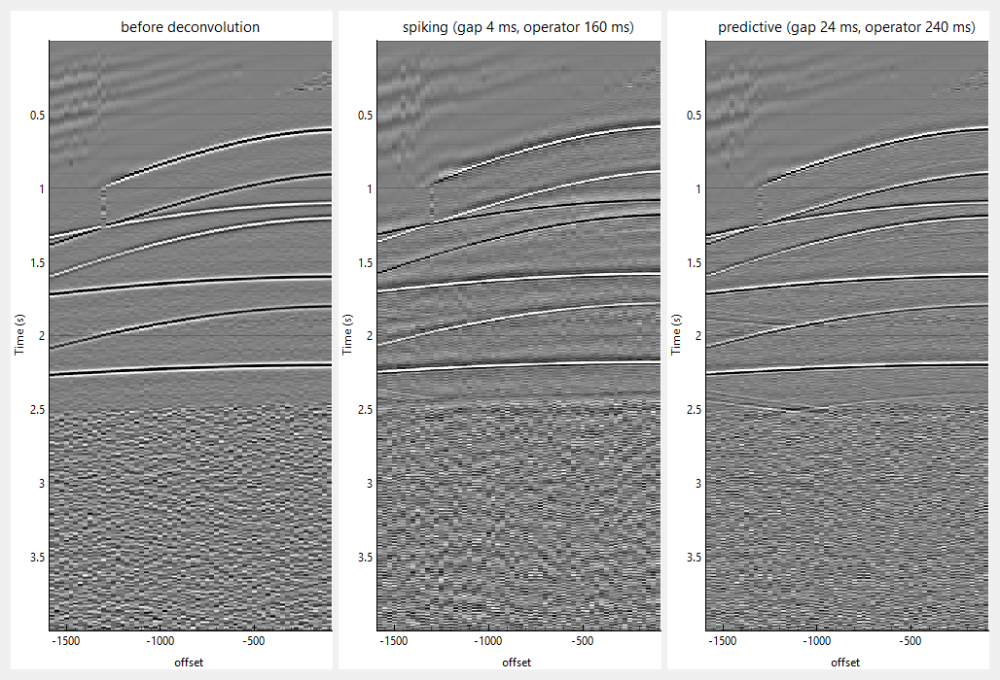

## Statics

| Step | Use | Parameters |
|---|---|---|
| **Elevation statics (to datum)** | Moves every trace to a flat datum through a replacement velocity, using `selev`, `sdepth` and `gelev` | Datum elevation (m), replacement velocity (m/s, the velocity below the weathering layer, e.g. from refractor 1 or 2), apply now. Writes `sstat`/`gstat` (ms) |
| **Apply statics from an x-static table** | Applies refraction (or other) statics given as a two-column table "x static_ms" | File; mode *remove* (shifts traces earlier by the table values, the usual case for delay times) or *add*. The value is interpolated at each source and receiver x |
| **Apply statics from headers** | Applies statics already in headers | Header keys (ms), e.g. `sstat,gstat`; sign +1 or -1 to undo |
| **Residual statics (surface consistent)** | After NMO, finds the remaining source and receiver time shifts by cross-correlating each trace with its CMP stack, splits them into source and receiver terms, applies them and iterates | Source and receiver position keys (`sx`, `gx`), correlation window with good reflections, maximum shift (less than half a period, e.g. 12-24 ms), 3-5 iterations |

**Refraction statics (delay-time inversion)** computes the near-surface statics from your first-break picks,
inside SeisDesk:

1. Pick the first breaks and split them into phases (chapter 7). You need the **direct wave** (for the weathering
   velocity V1) and one **refracted branch** from the base of the weathering layer (usually "refractor 1").
2. **Processing > Refraction statics (delay-time inversion)**. Set:
   - **Pick set** and **Refracted branch (phase).**
   - **V1:** 0 takes it from the straight-line fit of the direct-wave phase, or enter a value.
   - **V2:** 0 solves for the refractor velocity.
   - **Datum elevation:** a flat level, usually at or below the base of the weathering.
   - **Replacement velocity:** 0 uses V2.
   - **Station spacing:** 0 uses the receiver spacing.
   - **Smoothing of the delays:** 0.02-0.2.
3. The step solves, by least squares over all shots, t = delay(source) + delay(receiver) + |offset|/V2.
   - A delay time is found at every surface station, shared by the sources and receivers there. This is the
     least-squares generalisation of the plus-minus method.
   - From the delays it gets the weathering thickness z = delay · V1·V2 / sqrt(V2² − V1²) and the base-of-weathering
     elevation.
   - From those it gets the static to the datum: static = −(z/V1 + (base − datum)/Vr). Buried sources skip the
     weathering above them (`sdepth`).
4. The source and receiver statics go to `sstat`/`gstat` (ms) and are applied if "Apply the statics" is on.
5. The **Refraction statics** window opens. It shows the surface, base of weathering and datum, the delay times and
   the statics along the line, with V1, V2 and the misfit of the picks. It has two exports: the station table (CSV),
   and an x-static table for **Apply statics from an x-static table** (on another dataset of the same line, for
   example). **Processing > Refraction statics results** reopens it.

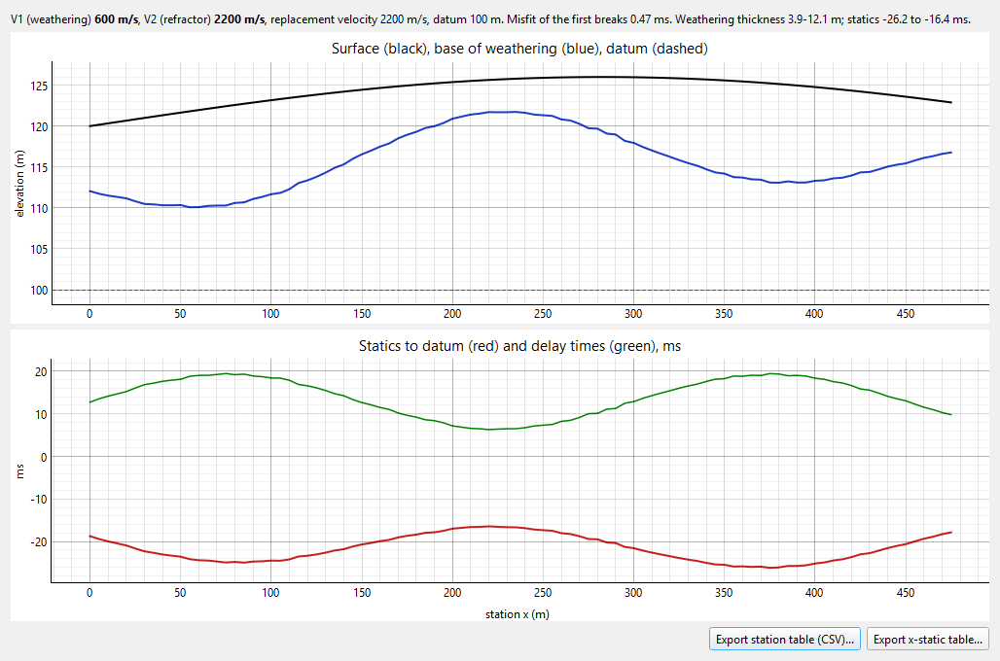

Checks:
- The misfit should be a few milliseconds.
- The base of weathering should vary smoothly.
- If the thickness jumps, look for wrong picks in the refracted phase, or a branch mixing two refractors.

Order on land:
1. Elevation or refraction statics before velocity analysis.
2. Then velocity analysis and NMO.
3. Then residual statics, a second velocity analysis if needed, and the stack.

Residual statics cannot resolve the very long-wavelength part of the statics (a slow bend along the line); that part
must come from the refraction statics.

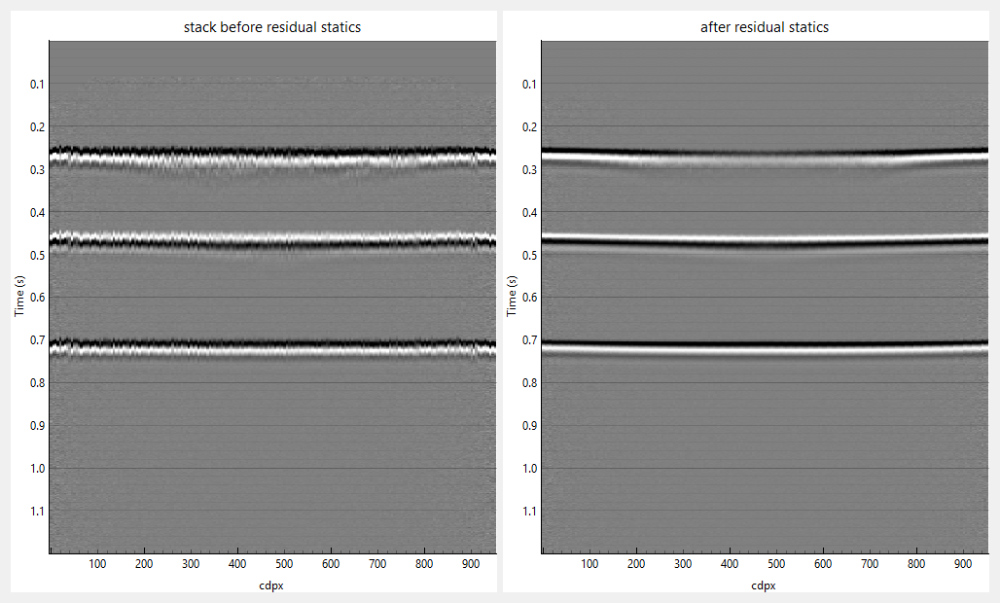

## Velocity analysis

Velocity analysis finds the stacking (RMS) velocity v(t) at selected CMPs. NMO, DMO, stacking, migration and depth
conversion all depend on it.

**Interactive picking** (**Velocity > Velocity analysis on the selected dataset**, F6) works on a dataset with
geometry, preferably after mute, gain, filter and deconvolution:

1. Choose the **CMP**. The tool shows three panels with a common time axis:
   - **semblance** (velocity against time; warm colours mean coherent energy along that hyperbola);
   - **the CMP gather** with the moveout curves of the picks;
   - **the gather after NMO** with the current picks.
2. Settings:
   - **Supergather:** adds ± n neighbouring CMPs for a stronger spectrum.
   - **v min / v max / n:** the velocity range scanned.
   - **window:** the semblance window (20-40 ms).
   - **stretch:** the NMO stretch mute in the NMO panel.
   - **gain:** display gain of the gathers.
3. **Left click** on a semblance maximum to pick (t, v); **right click** deletes the nearest pick.
4. Pick from shallow to deep, following the trend of increasing velocity. Avoid the slow maxima of multiples: at a
   multiple the velocity is close to that of the shallow layer that generated it.
5. Check the NMO panel: primaries must be flat. An event curving down at far offsets means the velocity is too high;
   curving up means too low.
6. Two guides are drawn on the semblance:
   - **magenta:** the Dix interval velocity of your picks, which must stay geologically sensible (no wild jumps);
   - **dashed white:** the picks of the nearest analysed CMP.
7. Move on with **Next >** (step 10-50 CMPs), and pick every 20-50 CMPs along the line, closer where the structure
   changes.
8. **Auto-pick** traces a smooth path of maximum semblance at the current CMP. The velocity may increase freely but
   decrease only slowly, which keeps the path off multiples. Check its picks and edit them.


**Anisotropy (VTI eta).**
1. Pick the velocities first with the near and middle offsets.
2. Switch **Mode** to **eta scan (VTI)**. The panel now shows semblance against eta, with the picked velocity held
   fixed.
3. Click at the eta maximum near each picked time to set eta there.
4. In the NMO step, tick **Use picked eta**. Far-offset events then flatten with the non-hyperbolic moveout of
   Alkhalifah and Tsvankin.

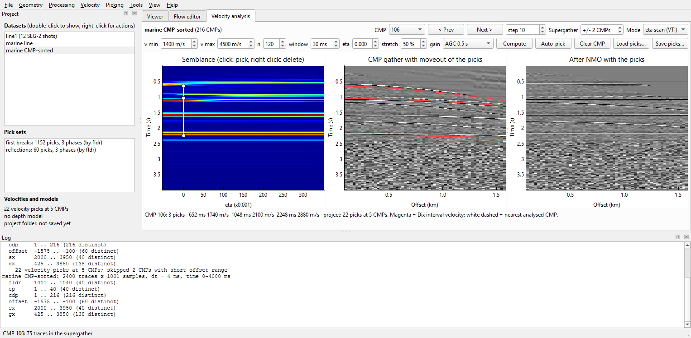

**Automatic velocity picking for the whole line:** the step **Automatic velocity picking** analyses every n-th CMP
(with supergathers) and writes picks to the project.
- CMPs whose offsets are too short to resolve velocity, such as the line ends, are skipped; the log gives how many.
- Use it as a starting point and refine the picks interactively.

**Other velocity tools:**
- **Constant-velocity stack panels:** stacks a CMP range at several constant velocities side by side. Choose the
  velocity at which each event is sharpest.
- **Constant-velocity gather panels:** one CMP (or supergather) NMO-corrected with a series of constant velocities,
  side by side. Each event is flat in the panel of its velocity, a direct check of a pick.

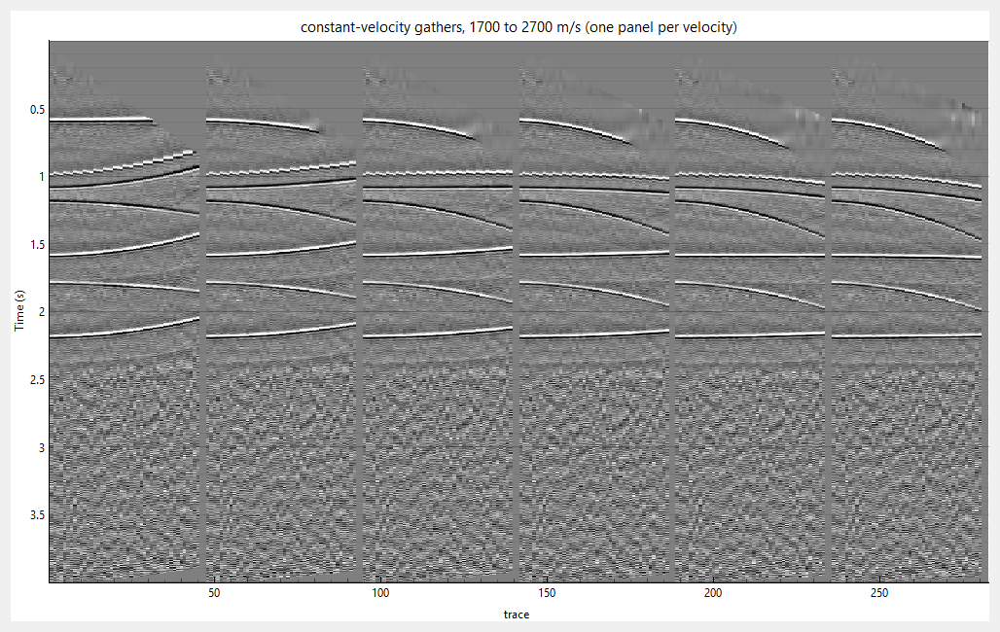

- **Smooth velocity field:** samples the picks on the CMP-time grid, smooths them along the line and in time, and
  replaces the project picks by the smoothed field every n CMPs and every dt seconds. Run it before migration and
  depth conversion to remove pick-to-pick jitter.
- **Velocity > Show velocity field:** shows the RMS and Dix interval velocity fields over the line, to check the
  picks for consistency. Jumps and stripes mean inconsistent picks.

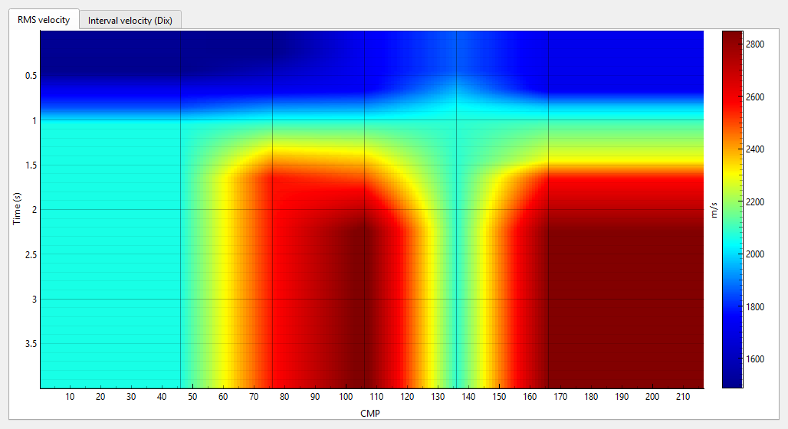

- **Velocity > Save / Load velocity picks:** text files with lines of CMP, time (ms), velocity (m/s) and eta.

## NMO correction

**NMO correction** flattens reflections using the velocities.
- **Velocity:** `project` (the picks), a constant, a function `t:v,t:v,...` (times in s), or a picks file.
- **Stretch mute limit:** 0.5 mutes samples stretched by more than 50% (shallow, far offsets).
- **Use picked eta** (or a constant eta): non-hyperbolic moveout.
- **Inverse NMO:** undoes NMO, for example after DMO or Radon, before a new velocity analysis.

## Multiple attenuation (Radon)

**Radon demultiple (parabolic)** works on NMO-corrected CMP gathers, NMO'd with the *primary* velocities:
- Primaries are flat (residual moveout near zero). Multiples are under-corrected and curve down.
- The step models the gather in the parabolic Radon domain and removes everything with moveout at the far offset
  above **q_cut**.

| Parameter | Choice |
|---|---|
| Minimum / maximum moveout at far offset | The range of residual moveout to model, e.g. -0.05 to 0.6 s |
| q_cut | Moveout above which energy counts as multiple, e.g. 0.03-0.06 s (between the primaries and the slowest multiples) |
| Number of q values, damping | 100-150 values; damping 0.01-0.05 |
| Frequency range | The signal band, e.g. 3-80 Hz |
| Output | *primaries* (normal), or *multiples* to see what is removed |

The far offset in q means the largest offset in the whole dataset, so q_cut has the same meaning in every CMP.

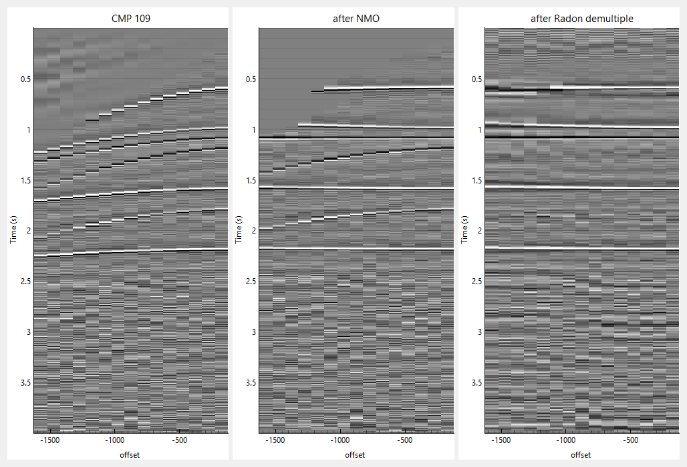

## DMO

**DMO (Hale f-k)** corrects NMO-corrected data for reflector dip, offset class by offset class, so that dipping and
flat events stack with the same velocity.

The classic sequence:
1. NMO with initial velocities.
2. DMO.
3. Inverse NMO.
4. New velocity analysis.
5. NMO.
6. Stack.

The flow template "DMO" sets this up. Offset bin width 0 uses the offset step of the fullest CMP.

## Residual moveout

**Residual moveout correction** scans each NMO-corrected CMP gather (or migrated image gather) for remaining
curvature, of order 2 (parabolic) or 4 (anisotropy-like), and removes it. Run it after NMO, or on image gathers after
prestack migration.

## Stacking

**CMP stack** sums each CMP gather into one trace:
- **Method:**
  - *live* (the default): the sum divided by the number of non-zero samples, so mutes do not dim the stack;
  - *sqrt* or *fold*;
  - *median*: robust to noise bursts;
  - *diversity*: each sample weighted by the inverse power of its trace in a sliding window, so noisy traces count
    less.
  - *phase-weighted* (Schimmel and Paulssen, 1997): the live stack multiplied by the coherence of the instantaneous
    phases of the traces, raised to the **phase-weighted stack power** (2 is usual; 0 gives the live stack). Where
    the traces agree the coherence is 1 and the stack is kept; where they do not (random noise) it is close to 0.
    Very strong noise suppression for low-fold or noisy data, at the price of non-linear amplitudes. The coherence
    can be smoothed over a short **window** (0.01-0.05 s).
- The fold goes to header `nhs`.
- The output is a section: display it with Gather **All traces**.

## Time migration

| Step | Input | Use |
|---|---|---|
| **Stolt migration (post-stack, constant v)** | Stack | Quick check with one velocity |
| **Phase-shift migration (post-stack, v(t))** | Stack | Accurate for velocity varying with time; uses the picks at one CMP (by default the middle of the picked CMPs), converted to interval velocity |
| **Kirchhoff time migration (pre- or post-stack)** | Prestack data with geometry (or a stack) | Uses v_rms(t, CMP) from the picks; prestack input gives a migrated stack directly |

Kirchhoff parameters:
- **Aperture:** the half width over which each output point sums. Make it larger than the lateral extent of the
  diffraction hyperbolas, e.g. 1-3 km.
- **Maximum angle:** limits steep, noisy contributions.
- **Output:** *image* gives a migrated section; *image gathers* gives offset-class image gathers, for checking the
  velocities (flat gathers mean correct velocities) and for residual moveout.

Diffractions collapse to points and dipping reflectors move to their true positions.


## Depth model and depth migration

1. **Build depth model** makes the interval-velocity depth model. It is stored in the project and listed in the
   Project panel.
   - **From** *picks (Dix):* Dix conversion of the velocity picks at each CMP, mapped to depth and smoothed laterally
     and vertically (smoothing 100-300 m removes Dix noise).
   - Or *constant* v0, or *gradient* v0 + k·z.
   - **Velocity > Save / Load depth model** keeps it as a file.
2. Depth migration:
   - **Split-step depth migration (post-stack):** migrates a stack in v(x, z). Velocity *project model*; depth step
     5-10 m; maximum depth; highest frequency.
   - **Kirchhoff depth migration (prestack):** migrates prestack data with traveltimes computed on the model grid.
     Traveltime grid spacing 10-25 m; aperture; output *image* or *image gathers*.
3. The result is a **depth section** (vertical axis in metres).

Check it:
- Flat events in image gathers mean the model is right.
- Reflector depths should match wells or refraction depths where available.

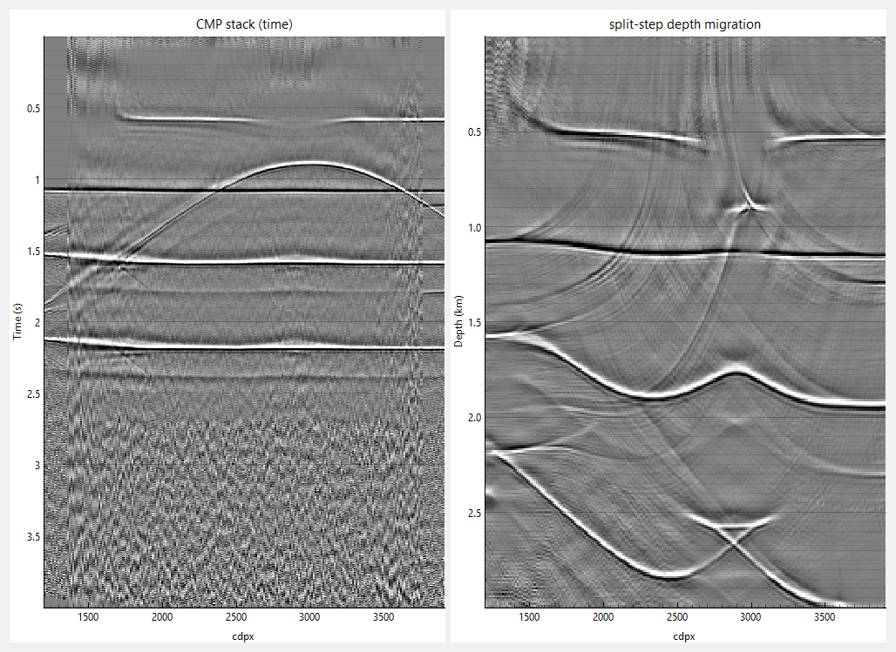

## Time-depth conversion

- **Time to depth conversion:** converts a time section to depth, using the velocity picks (Dix at each CMP) or the
  depth model. Set the depth step and maximum depth.
- **Depth to time conversion:** converts a depth section back to time, using the depth model.

# Wavelet processing, vibroseis and interpolation

## Wavelet phase: rotation, zero phase and minimum phase

The phase of the wavelet decides where a reflection's energy sits in time. A **zero-phase** wavelet is a symmetric
peak centred on the reflection time, which is what an interpreter wants. A **minimum-phase** wavelet has its energy
at the front; dynamite, air guns and most recording filters give one, and predictive deconvolution assumes one. The
**Wavelet** category of the flow editor has three tools for this (also under Processing > Apply one step).

**Phase rotation (constant phase)** rotates every frequency by the same angle: out = in cos(a) - H(in) sin(a), with
H the Hilbert transform.
- 180 degrees reverses the polarity.
- 90 or -90 degrees turns a zero-phase wavelet into an antisymmetric one (a zero crossing at the reflection time) and
  back.
- Use it to match the phase of two vintages, or of the stack and a well synthetic: try angles in steps of 15-30
  degrees and keep the one whose wavelet best matches.

**Zero-phase conversion** and **Minimum-phase conversion** keep the amplitude spectrum and replace the phase. Both
have three modes:

| Mode | What it does | Use it for |
|---|---|---|
| data wavelet | Estimates the wavelet's amplitude spectrum from the average autocorrelation of the traces in the design window. Zero-phase conversion takes the data wavelet as minimum phase; minimum-phase conversion takes it as zero phase. The filter is all-pass: amplitudes do not change, only the phase. | Zero phase: after spiking or predictive deconvolution (minimum-phase output), before interpretation. Minimum phase: correlated vibroseis or zero-phase processed data, before predictive deconvolution. |
| wavelet file | Uses a known wavelet from a text file and converts it, whatever its phase, to its zero- or minimum-phase equivalent (stabilised by the water level). | A measured air-gun or vibrator signature, a wavelet extracted at a well. |
| per trace | Treats every trace as a wavelet: the zero-phase result is centred on the trace's envelope peak, the minimum-phase result starts where the envelope first reaches 10 % of its peak. | Wavelet or signature traces only. On reflection data it destroys the timing of the events. |

| Parameter | Meaning and choice |
|---|---|
| Design window start / end | A window with good reflections and no first breaks, e.g. 0.2-2.0 s (data wavelet mode) |
| Spectral smoothing | Smooths the estimated amplitude spectrum, 3-10 Hz; more smoothing for short windows or few traces |
| Wavelet file | Text file: one amplitude per line (first sample at time zero, sampled at the data interval or at the given file interval), or two columns time and amplitude (seconds, or milliseconds when the times exceed 5) |
| Stabilisation (water level) | Percent of the peak power added before dividing by a wavelet spectrum; 0.1 % for a clean measured wavelet, 1 % or more for a noisy one |


**Pitfalls**
- Zero-phase conversion in the data wavelet mode is only right if the data wavelet really is minimum phase; run it
  after deconvolution, not on raw vibroseis data (those are already zero phase).
- Check the result on a well tie or on a strong isolated reflector: a correct zero-phase wavelet is symmetric.

## Wiener shaping filter, signature deconvolution and homomorphic deconvolution

**Wiener shaping filter** designs the least-squares filter that turns an input wavelet into a desired output wavelet
and applies it to every trace.
1. Choose the **input wavelet**: *estimated from the data* (minimum phase, from the average autocorrelation in the
   design window) or a *wavelet file*.
2. Choose the **desired output**: a zero-phase Ricker (peak frequency), a zero-phase Ormsby band-pass wavelet (four
   corners) or a file.
3. Set the operator length and the output delay. The delay (default: half the operator) lets the filter reach before
   the onset of the input wavelet, which a zero-phase output needs; it is removed again afterwards, so a zero-phase
   output is centred on the onset time of the input wavelet.

The log reports the relative error of the shaped wavelet; above about 10 % make the operator longer, the desired
wavelet broader or its band narrower.

| Parameter | Meaning and choice |
|---|---|
| Operator length | 0.1-0.3 s; at least the length of the input wavelet |
| Pre-whitening | 0.1-1 %; raise it if the output rings |
| Ricker peak frequency / band-pass corners | Inside the band of the data (look at the amplitude spectrum, F8); shaping cannot create frequencies the data do not have |
| Output delay | -1 = half the operator length |

**Signature (deterministic) deconvolution** removes a *known* source wavelet: each trace is divided in the frequency
domain by the wavelet spectrum (stabilised by the water level) and shaped to a spike or a zero-phase band-pass
wavelet.
- **Wavelet file:** the time origin in the file is honoured, so a two-column file with negative times (a zero-phase
  wavelet) works as well as a causal one.
- **Trace in the data:** the wavelet is a trace selected by a header value, for example a near-field hydrophone with
  trid = 9 or an auxiliary channel; with a gather key (fldr) every shot uses its own signature trace. The signature
  must start at the shot time (time zero of the record).
- Use it before statistical deconvolution: what is left afterwards is the earth's response.

**Homomorphic (cepstral) deconvolution** estimates a mixed-phase wavelet without assuming minimum phase (Ulrych
1971). The complex cepstrum (log amplitude and unwrapped phase) of all traces is averaged; the reflectivity differs
from trace to trace and averages out, the common wavelet remains at low quefrencies. The cepstrum is cut at the
**cepstral cut-off** (about the wavelet length, 0.02-0.05 s), turned back into a wavelet, and every trace is
deconvolved with it. The estimated wavelet is kept in the results. Its amplitude spectrum is reliable; its phase is
only an approximate estimate, because phase unwrapping of real traces is fragile. Compare the output with the input
before using it. The method needs many traces (50 or more) with good signal-to-noise ratio; on noisy data, or when
the phase matters, prefer spiking deconvolution followed by zero-phase conversion, or signature deconvolution with a
measured wavelet.


## Vibroseis data

A vibrator sends a sweep several seconds long, so every reflection in an **uncorrelated** record is a whole sweep.
Correlation with the sweep compresses each one into a short zero-phase **Klauder wavelet** (the autocorrelation of the
sweep). The **Vibroseis** category has three steps.

**Vibroseis correlation**
1. Choose where the sweep comes from:
   - **parametric:** start and end frequency, length, type (linear, or a boost in dB per octave, which spends longer
     at high frequencies to make up for their absorption) and the cosine tapers at both ends, as set on the vibrator
     controller;
   - **pilot trace:** a recorded sweep in the data, selected by a header value (SEG-Y trid 6 = sweep), one per
     gather of the gather key; the pilot traces are removed from the output unless you untick the option;
   - **sweep file:** a text file as for wavelets.
2. **Output length:** the listen time; 0 keeps the record length minus the sweep length.
3. Run it as the first step, before geometry and editing. The output is scaled by the sweep energy, so a reflection
   keeps its amplitude.

**Klauder wavelet to minimum phase** applies the all-pass filter W_min / K, which turns the zero-phase Klauder
wavelet K into its minimum-phase equivalent W_min (Gibson & Larner 1984). Run it after correlation, with the same
sweep, and before predictive deconvolution; then deconvolution sees the minimum-phase wavelet it assumes.

**Convolve with a sweep (uncorrelated records)** does the opposite of correlation: it turns reflectivity or correlated
data into uncorrelated records. Use it to test sweep parameters on synthetic data or for teaching.

| Parameter | Meaning and choice |
|---|---|
| Start / end frequency | As recorded, e.g. 8-80 Hz (an up-sweep); a down-sweep has a start above the end |
| Sweep length | As recorded, e.g. 8-16 s |
| Sweep type, boost | Linear, or dB per octave (3-6 dB per octave are common) |
| Start / end taper | As on the controller, 0.2-0.5 s |
| Pilot trace header and value | trid and 6 for a recorded sweep trace |


**Pitfalls**
- A wrong sweep (length, direction, taper) leaves smeared correlation noise; check the sweep parameters on one record
  and compare the correlated first breaks with those of a nearby dynamite record.
- Correlation must come before any filtering or gain that changes the uncorrelated record in time.

## Trace interpolation

**Trace interpolation (f-x, Spitz)** inserts a new trace midway between every pair of neighbouring traces of each
gather (factor 2; factor 4 repeats it). It predicts across the traces with f-x prediction filters: the filter of the
coarse traces at half the frequency is the filter of the refined gather at the full frequency (Spitz 1991). Steep,
spatially aliased events — ground roll, steep dips, refractions — therefore stay continuous, which simple averaging
of neighbours cannot do.
1. Pick the gather key (fldr for shot gathers, empty for a stacked section) and the order key (offset for shots,
   cdp or cdpx for a stack). The traces must be regularly spaced along the order key; the log warns if they are not.
2. Choose the time and trace windows: the events must be roughly straight inside a window (0.5 s and 24 traces suit
   most shot gathers).
3. New traces get interpolated positions (offset, source and receiver x, CMP x), header interp = 1 and renumbered
   tracf. Run the geometry step again afterwards, so the CMP numbers follow the finer spacing.

**Fill missing or dead traces (POCS)** puts each gather on a regular grid of the position key (spacing: the median
trace spacing, or the value you give), adds empty traces where positions are missing — for example skipped stations
or a gap at the near offsets — and, if asked, treats dead (all-zero) traces as missing. It rebuilds them by projection
onto convex sets: the f-k spectrum is thresholded with a threshold that falls from iteration to iteration, and the
recorded traces are put back after every iteration (Abma & Kabir 2006). Recorded traces do not change; filled traces
get interp = 1.

| Parameter | Meaning and choice |
|---|---|
| Gather key / order or position key | fldr and offset for shot gathers; empty and cdpx for a stack |
| Prediction filter length (Spitz) | 3-6 traces; at least the number of dips crossing a window |
| Damping | 1 %; more for noisy data |
| Lowest / highest frequency | The signal band; outside it the new traces are averages of their neighbours |
| Grid spacing (POCS) | 0 = median spacing of the gather |
| Iterations, final threshold (POCS) | 50-100 iterations; final threshold 0.1-1 % of the largest coefficient |


**Pitfalls**
- Interpolated traces contain no new information: they help migration, multiple attenuation and f-k filters that
  suffer from spatial aliasing, but they do not improve the signal-to-noise ratio.
- POCS fills scattered gaps of a few traces well; it cannot rebuild a gap much wider than the wavelength of the
  events across the traces.

---

# Near-surface tools: reduced time, refraction convolution, datuming and MASW

## Reduced time and linear moveout

Refraction work is easier in **reduced time**, t' = t - |offset| / v: a refracted branch whose apparent velocity equals
the reduction velocity becomes horizontal, its intercept time can be read directly, faster branches dip upwards and
slower ones downwards. SeisDesk offers it in two ways.

**In the viewer (display only).** Set **Reduce** in the display bar to the reduction velocity (for example the
velocity of the first refractor, 2000 m/s); "off" (0) returns to true time.
- Only the display changes; the data and the picks keep their true times.
- The read-out under the display shows both the reduced time and the true time of the point under the cursor.
- Picking pauses while reduced time is shown: switch it off to pick.

**As a processing step: Linear moveout (reduced time)** (flow editor, category Moveout):
- *forward* applies t' = t - |offset| / v + shift; *inverse* undoes it exactly. Use the pair around a step that works
  better on flattened events (for example a median filter across the traces, or an f-k or tau-p filter on linear
  noise).
- *dynamic (dispersion curve)* moves every frequency by its own phase velocity, from a dispersion curve
  `f:v, f:v, ...` (Hz, m/s; for example the picks of the MASW window). A dispersed surface-wave train collapses to a
  short pulse at the shift time: it can then be muted or filtered and the inverse step restores the rest
  (Seismic Unix sudlmo).

| Parameter | Meaning and choice |
|---|---|
| Reduction velocity | The apparent velocity that becomes flat: the refractor velocity, or the velocity of the linear noise |
| Time shift added | 0 for refraction displays; 0.1-0.2 s in dynamic mode, so that the collapsed pulse is not cut at time zero |
| Direction | forward, or inverse to restore the original times |
| Mode | one velocity, or dynamic with a dispersion curve |
| Dispersion curve | f:v pairs in Hz and m/s, used in dynamic mode; constant beyond its first and last frequency |
| Offset header | offset (the absolute value is used) |

Data shifted before time zero or past the end of the record are lost; keep the record long enough, or add a shift.


## Refraction convolution section

The **refraction convolution section** (Palmer 2001) images a refractor directly from the traces, without picking
every first break.
- At each receiver the trace of a forward shot (on one side) and the trace of a reverse shot (on the other side) are
  convolved. Convolution adds travel times, so the head waves give t_forward + t_reverse.
- Subtracting the reciprocal time (the time from the forward shot to the reverse shot) leaves twice the time-depth
  under the receiver (the GRM time-depth, i.e. the two-way delay time).
- The product of the two amplitudes cancels most of the geometric spreading, so amplitude changes along the
  refractor reflect the refractor itself (head coefficients, wavespeed contrasts).

Depth to the refractor at a receiver: z = (time on the section / 2) x V1 V2 / sqrt(V2^2 - V1^2), with V1 the
weathering velocity and V2 the refractor velocity (from the refraction analysis).

Run **Refraction convolution section** (Processing menu, or the flow editor, category Statics) on the shot gathers
with geometry (fldr, sx, gx). Step by step:
1. Look at the shots in reduced time and note the crossover distance beyond which the first arrival is the refractor
   you want.
2. Choose *automatic* pairs with **Minimum offset** just beyond that crossover distance: every receiver is paired with
   the nearest shot on each side at least that far away. With only two shots at the ends of a spread, use *two
   shots* and give their FFIDs.
3. Choose where the reciprocal time comes from: *first breaks of the traces* (measured automatically on the trace of
   each shot recorded at the other shot's position), *picks* (the picked refracted phase, best when you have picked
   it), or *value* (one known time, two-shot mode).
4. Optionally set **Keep after the first break** (for example 0.05 s) to convolve only the first-arrival part of the
   traces, which gives a cleaner image.

| Parameter | Meaning and choice |
|---|---|
| Shot pairs | automatic (nearest shot on each side) or two shots (given FFIDs) |
| Minimum offset | Beyond the crossover distance of the target refractor, so that its head wave is the first arrival |
| Reciprocal time from | first breaks of the traces, picks of the refracted phase, or a value |
| First-break energy window | Window of the automatic first-break measurement, about one period of the wavelet (0.01-0.03 s) |
| Keep after the first break | 0 = whole traces; 0.03-0.1 s keeps only the first arrival and its coda |
| Output length | Length of the section (0 = as the input records) |

The output has one trace per receiver (gx, cdpx = receiver x) and headers rcs_fwd, rcs_rev (the two FFIDs) and rcs_trec
(the reciprocal time in ms); the log and the results list the reciprocal time used for every pair. Measure the
reciprocal time the same way as the arrivals: onsets (first breaks) for onset-type data. A wrong reciprocal time moves
the whole section of that pair up or down by the error.


## Wave-equation datuming

Elevation and refraction statics move every trace by a vertical time shift. That is exact only for vertical rays; with
rough topography, a thick or fast near surface, or long offsets the shifts distort the moveout and smear the
diffractions. **Wave-equation datuming** (Berryhill 1979, 1984) instead extrapolates the recorded wavefield from the
topography to a flat datum with a constant velocity, following the real ray directions.

**Wave-equation datuming (Kirchhoff, prestack)** (Processing menu, or the flow editor, category Datuming):
- Receivers are moved first, in every common-shot gather (from their elevations, gelev), then sources, in every
  common-receiver gather (from selev minus sdepth). *receivers only* or *sources only* run one half.
- A datum below the surface is a downward continuation: give the velocity of the layer between the surface and the
  datum (for example the weathering velocity from the refraction analysis), and the step removes that layer. A datum
  above the surface is an upward continuation through a replacement medium: give the replacement velocity.
- Afterwards gelev and selev equal the datum and sdepth is 0, so the following steps see a flat recording surface.

| Parameter | Meaning and choice |
|---|---|
| Datum elevation | The flat datum (m), the same one you would use for statics |
| Near-surface velocity | Velocity of the medium between the surface and the datum (weathering or replacement velocity) |
| Move | receivers and sources, receivers only, or sources only |
| Aperture | Half width of the Kirchhoff sum (m); at least the largest horizontal distance of the rays between surface and datum, typically 2-4 times the elevation difference; 200-500 m |
| Maximum angle | Steepest ray taken into the sum, 60-75 degrees |
| Highest frequency | The output is limited to this frequency (the operator costs more and aliases more at high frequencies) |

Sampling matters. The Kirchhoff sum needs the traces closer together than the width of the operator: about
sqrt(v |dz| / f) for an elevation difference dz.
- With receivers every 5-10 m and elevation differences of tens of metres, the receiver side is well sampled.
- Sparse shots (every 50-100 m) are too coarse for the source side. There, and at frequencies where the operator
  cannot be sampled, the step falls back to the vertical-ray shift |dz| / v, which is what elevation statics would
  have done.
- At every frequency the steep parts of the operator that would alias are left out automatically.

**Wave-equation datuming (zero offset, stacked)** does the same for a stacked section: from a floating datum, the
elevation in a header (gelev by default) at every CMP, to a flat datum, with half the velocity because stacked times
are two-way.


## MASW: surface-wave dispersion and an approximate Vs profile

Ground roll is noise for reflection processing, but its dispersion (phase velocity changing with frequency) carries
the shear-wave velocity of the near surface. The **MASW window** (Tools > MASW dispersion analysis) computes the
dispersion image of one shot by the phase-shift method (Park, Miller & Xia 1998) and lets you pick the
fundamental-mode curve.

Step by step:
1. Select a shot gather dataset with offsets (raw shots: no AGC, no f-k filter, no mute of the ground roll), then open
   the window.
2. Choose the **Shot (FFID)** and the side: positive or negative offsets (one side of the source at a time; the side
   with more traces is preselected) or both sides with |offset|.
3. Set the offset range: leave out the nearest traces (near-field effects, about the first 5-10 m) and the farthest
   ones where the surface waves fade into noise. Set the frequency and velocity ranges to cover the ground roll
   (typically 3-60 Hz and 50-1000 m/s), then press **Compute**.
4. The image shows, at every frequency, how strongly each phase velocity adds up (normalised to 1 at every frequency).
   The fundamental mode is the lowest-velocity strong ridge; higher modes, if present, lie above it.
5. Press **Automatic picks**. The ridge is followed from the frequency where it is sharpest, keeping the
   lowest-velocity peak and continuity between frequencies. Correct the picks by hand: a click adds a pick (replacing
   one at the same frequency); a right click or Shift + click removes the nearest pick.
6. **Export picks (CSV)** writes frequency, phase velocity, wavelength, approximate depth and approximate Vs.

The right-hand plot is an **approximate Vs profile** by the wavelength rule. A wavelength lambda = v/f senses the
ground to about lambda/3, where Vs is about 1.09 times the phase velocity. It is a quick first look, not an inversion:
for layer velocities and thicknesses, invert the exported curve with a dedicated program.

Velocities below frequency x trace spacing are blanked in the image: there it would only show spatial-aliasing copies
of the real ridge. Short spreads give broad ridges at low frequencies; the longest wavelength you can trust is about
the spread length, which limits the depth of investigation to about a third of it.


# Wave-equation, anisotropic and 3D migration

## Wave-equation depth migration

These steps continue the recorded wavefield down through the depth model, one depth step at a time. They follow
strong lateral velocity changes (salt, basalt, karst, steep faults, channels) better than Kirchhoff migration with
straight rays or first-arrival traveltimes. Four methods migrate a stack (post-stack); one migrates the shot gathers
before stack (prestack). All of them are in the **Depth migration** category of the Flow editor and of
**Processing > Apply one step to the dataset...**.

| Method | Input | Dips | Lateral velocity changes | Cost |
|---|---|---|---|---|
| Split-step (since version 0.1) | stack | all, exact where the velocity is laterally constant | moderate | lowest |
| Finite difference, 45 or 65 degrees | stack | up to 45 or 65 degrees | strong | low |
| Fourier finite difference | stack | steep | strong | moderate |
| Phase shift plus interpolation (PSPI) | stack | all | strong, with enough reference velocities | grows with the velocity range |
| Gaussian beams | stack | up to the maximum ray angle | smooth model; caustics and several arrivals | grows with the number of beams |
| Prestack shot profile | shot gathers | steep | strong | highest (every shot is migrated) |

### Post-stack: finite difference, Fourier finite difference, PSPI and Gaussian beams

1. Build the depth model first (**Build depth model**, see *Depth model and depth migration*). It is the *project
   model*. Without one, the step builds a Dix model from the velocity picks.
2. Select the stacked section in the Project panel. It needs one trace per CMP and the 2D geometry (CMP x or the bin
   size).
3. Choose the step and set the parameters (table below). Run it on the whole section: these steps work on all traces
   together, so *displayed gather only* gives no useful test.
4. Compare the result with the split-step migration of the same stack. Check reflector depths against wells or
   refraction depths.

| Parameter | Meaning and choice |
|---|---|
| Velocity model | *project model* (recommended), the velocity picks (Dix) or a file |
| Depth step | 5-10 m. At most a quarter of the shortest wavelength, v_min / (4 f_max) |
| Maximum depth | Below the deepest reflector of interest. Run time grows with the number of depth steps |
| Highest frequency | The top of the useful band (spectral analysis), e.g. 40-60 Hz. Run time grows with it |
| Smoothing of a Dix model | 100-300 m; removes Dix noise |
| Dip accuracy (finite difference) | 65 degrees (default) or 45 degrees. Both cost the same; steeper dips are under-migrated |
| Maximum reference velocities (PSPI) | 8. More for strong velocity contrasts within one depth step |
| Lowest frequency (Gaussian beams) | 5 Hz. The band's centre frequency sets the beam width |
| Initial beam width (Gaussian beams) | 0 = automatic, about one wavelength at the centre frequency. Wider beams stay narrow deeper down |
| Maximum ray angle (Gaussian beams) | 60 degrees; up to 75 degrees for steep flanks |
| Model smoothing for the rays (Gaussian beams) | 300 m; at least one wavelength. Rays scatter in a rough model |

How the methods differ:
- **Finite difference** solves the 45-degree (Claerbout) or 65-degree (Lee and Suh) one-way wave equation in
  frequency and space. The velocity can change from trace to trace.
- **Fourier finite difference** (Ristow and Rühl) shifts the phase with the lowest velocity of each depth step,
  corrects the time shift for the true velocity, and adds a finite-difference correction for the rest. It is accurate
  for steeper dips than the finite-difference and split-step methods.
- **PSPI** (Gazdag and Sguazzero) continues the wavefield with a few reference velocities about 10 % apart and
  interpolates between them with the true velocity at each trace.
- **Gaussian beams** (Hill) split the stack into local plane waves under overlapping Gaussian windows. Each plane wave
  is sent down along a ray traced in the smoothed model and spread as a Gaussian beam. Beams handle caustics and
  several arrivals, which single-arrival Kirchhoff migration does not.

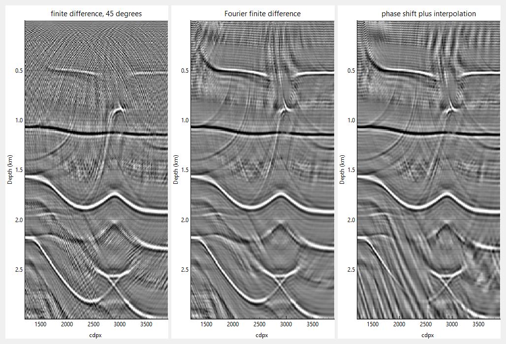


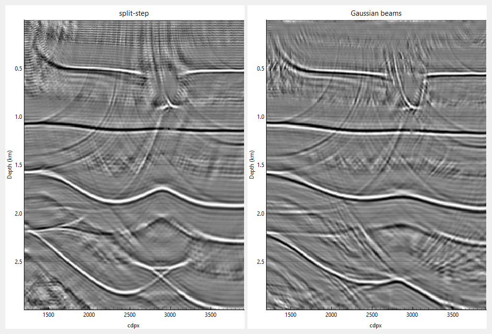

### Prestack: shot-profile wave-equation migration

**Prestack wave-equation depth migration (shot profile)** migrates each shot gather on its own:
- the source wavefield starts at the source position;
- the recorded wavefield starts at the receivers;
- both are continued down through the model, and their zero-lag correlation at each depth is the image of that shot.

The images of all shots are summed. Prestack migration handles events that a stack has already smeared (conflicting
dips, strong lateral velocity changes), at a much higher cost.

1. Use shot gathers with source and receiver x (any geometry step) and the recording time zero at the shot. Mute the
   direct wave and first arrivals. Do not apply NMO.
2. On land, apply elevation or refraction statics to a flat datum first: the recording surface is taken as flat, and
   depths are measured below it.
3. Run the step on the whole dataset; it migrates the shots one by one. For a first look, select every second or
   fourth shot (**Select traces**) and lower the highest frequency.

| Parameter | Meaning and choice |
|---|---|
| Extrapolator | *split-step* (fastest), *PSPI* or *FFD* (steepest dips in strong lateral velocity changes) |
| Depth step, maximum depth | As for the post-stack methods |
| Image trace spacing | 0 = the receiver spacing |
| Aperture beyond the spread | 500-2000 m: at least the lateral distance that dipping reflectors move |
| Lowest / highest frequency | 3-40 Hz. Run time grows with the number of frequencies, shots and depth steps |
| Source wavelet | *impulse*: the image keeps the wavelet of the data. *Ricker*: a smoother image |
| Divide by the source illumination | On (recommended): balances shallow and deep, and near and far, amplitudes |


Pitfalls:
- A velocity that is too slow under-migrates: diffractions are not fully collapsed and dipping events stay too
  shallow. Too fast over-migrates and draws smiles.
- Steep dips at high frequencies alias in space when the trace spacing exceeds v / (4 f sin(dip)). Lower the highest
  frequency, or interpolate traces first.
- About 20 traces of absorbing padding are added on each side, so energy leaving the section is not wrapped back.
  The outermost traces of a short line are therefore weaker.
- Run time grows with depth steps × frequencies × traces, and with the number of shots for prestack. Test with a
  coarser depth step and a lower highest frequency first.

## Anisotropy (VTI): eta in velocity analysis, NMO, DMO and migration

In shales and other finely layered rocks the velocity depends on the direction of travel. With a vertical symmetry
axis (VTI) the far offsets of a reflection arrive **earlier** than the NMO hyperbola predicts, and steep dips and
diffraction flanks migrate to the wrong place. Time processing describes such layers with two numbers per time:
the NMO velocity and the anellipticity **eta** (Alkhalifah & Tsvankin 1995). Eta = 0 is the isotropic case; values of
0.03-0.2 are common in shale sequences.

Eta can only be measured where the offsets are at least as large as the depth (offset / depth above about 1). At
shorter offsets it trades off with the NMO velocity, so pick the velocity first and eta second.

Step by step:
1. Pick velocities in the velocity analysis (Velocity > Velocity analysis, F6) as usual.
2. At a few CMPs, run the eta scan of the velocity analysis and pick eta where the far offsets bend upwards after
   hyperbolic NMO.
3. Check the result with **Residual moveout semblance scan (anisotropic)** in mode *eta (VTI)* on hyperbolically
   NMO-corrected gathers (below): the brightest eta at each time should match your picks.
4. NMO with **Use picked eta** ticked flattens the far offsets.
5. Instead of NMO + DMO, use **Anisotropic DMO (migration to zero offset, eta)** on gathers *without* NMO.
6. Migrate with **Phase-shift migration for VTI media (eta)** (post-stack) or **Kirchhoff time migration** with
   *Use picked eta* (pre- or post-stack).

**Phase-shift migration for VTI media (eta)** migrates a stacked section with Alkhalifah's acoustic VTI dispersion
relation. The RMS velocities at one CMP are Dix-converted to interval NMO velocity. The picked (effective) eta is
converted to interval eta with Alkhalifah's Dix-type formula. With eta = 0 the result is identical to the isotropic
phase-shift migration.

| Parameter | Meaning and choice |
|---|---|
| Velocity | Project picks (default), a constant or a function; RMS (stacking) velocities |
| CMP for the velocity function | -1 = the middle picked CMP; the migration uses one v(t) and one eta(t) for the whole line |
| Eta | *picked*: effective eta from the velocity picks; *constant*: the interval eta below |
| Constant eta (interval) | 0.05-0.15 for most shales; 0 = isotropic |
| Highest frequency | The top of the signal band (60-90 Hz) |

**Kirchhoff time migration** has two new parameters, **Use picked eta** and **Constant eta**. With eta, each leg of
the double-square-root traveltime uses the non-hyperbolic time of Alkhalifah & Tsvankin (1995). The velocity and eta
can vary along the line. With both parameters left off, the migration is unchanged.


### Anisotropic DMO (migration to zero offset)

**Anisotropic DMO (migration to zero offset, eta)** does NMO and DMO in one step, also in VTI media:
- The input is prestack traces without NMO, with source and receiver x (any sort order).
- The traces are sorted into offset classes.
- Each class is Kirchhoff time-migrated with v_rms and eta, then demigrated (modelled back) to zero offset with the
  same v_rms and eta.
- The output is one corrected trace per CMP and offset class, ready for CMP stack (or the stack itself).
- Dipping events and diffractions then stack at their zero-offset times whatever their dip, and eta also flattens the
  far offsets of anisotropic layers.

| Parameter | Meaning and choice |
|---|---|
| Velocity | Project picks; the result is much less sensitive to velocity errors than a migration |
| Use picked eta / Constant eta | As in NMO; off and 0 = isotropic DMO |
| Offset class width | About the shot interval or 2-4 group intervals; each class must cover the line evenly |
| Aperture | At least the lateral move of the steepest dip: about depth x tan(dip), plus half the largest offset |
| Maximum angle | 60 degrees; lower it to suppress steep migration noise |
| Output | *gathers* (check flatness, then stack) or *stack* (average of the classes) |

Pitfalls:
- Do **not** apply NMO after this step: its output is already NMO- and DMO-corrected.
- The cost is one prestack time migration plus one zero-offset modelling per offset class. Take a few hundred CMPs
  at a time on a laptop.
- The amplitude of each class is matched to its input RMS, which keeps the classes comparable before stacking.
- A coarse CMP spacing aliases steep dips in both the migration and the demigration. Keep the CMP spacing at
  half the receiver interval.

### Residual moveout semblance scan

**Residual moveout semblance scan (anisotropic)** checks whether flattened gathers really are flat. Use it on
NMO-corrected CMP gathers, or on image gathers from Kirchhoff time or depth migration (output *image gathers*).
- At each selected CMP it computes the semblance across the offsets for a range of trial residual moveouts.
- The scan comes out as a dataset with one panel per CMP and one trace per trial value (header `rmo_r`); view it like
  any gather.
- A bright band at r = 0 means the gather is flat.
- A band at positive r means events still curve downwards at the far offsets (velocity too high, or multiples).
- The best value at each time is kept in the project results. The Residual moveout correction step then measures and
  applies a parabolic correction CMP by CMP.

| Parameter | Meaning and choice |
|---|---|
| CMPs | A comma-separated list; empty = three CMPs at a quarter, half and three quarters of the line |
| Residual term | *parabolic*: shift r (x / xmax)^2; *fourth order*: r (x / xmax)^4, for the far-offset hockey stick; *eta (VTI)*: the non-hyperbolic term left after hyperbolic NMO |
| Minimum r, Maximum r | Shift at the far offset in seconds (metres for depth image gathers), e.g. -0.05 to 0.05 s |
| Minimum eta, Maximum eta | Eta mode only, e.g. 0 to 0.3 |
| Number of trial values | 41-81 |
| NMO velocity | Eta mode only: the velocity the gathers were NMO-corrected with (project picks) |
| Semblance window | 20-40 ms, about one wavelet length |


## 3D migration of small volumes

Three steps migrate 3D data on the inline/crossline grid of **3D binning** (headers `iline`, `xline`, `cdpx`, `cdpy`):
- **3D phase-shift migration (post-stack, v(t))**: Gazdag's phase shift with one RMS velocity function, converted to
  interval velocity by Dix's formula. Accurate for steep dips in v(t).
- **3D Stolt migration (post-stack, constant v)**: fast f-k migration for checks.
- **3D Kirchhoff time migration (pre- or post-stack)**: straight-ray double-square-root traveltimes in v_rms(t)
  varying from bin to bin. Prestack input gives the migrated stack.

Step by step:
1. Geometry > 3D binning. Check the bin sizes in the log; they are stored with the data.
2. For the post-stack methods, NMO and CMP stack (the stack has one trace per bin).
3. Run the migration from the Flow editor or Processing > Apply one step.
4. View the result with gather key `iline` (one inline per page) or `xline`.

| Parameter | Meaning and choice |
|---|---|
| Velocity | Project picks, a constant or a function (Stolt: one constant) |
| CMP bin for the velocity function | Phase shift: -1 = the middle picked bin |
| Bin size along an inline / along a crossline | 0 = taken from the 3D binning; give them for data binned elsewhere |
| Aperture (radius) | Kirchhoff: the lateral reach of the steepest dip, e.g. 1000 m |
| Maximum angle | Kirchhoff: 60 degrees |

Pitfalls:
- **Small volumes only.**
  - The post-stack methods hold the cube and its spectrum in memory, padded to 1.5 times each side, as complex
    numbers.
  - For example, 60 inlines x 60 crosslines x 1000 samples needs roughly 1 GB.
  - The Kirchhoff migration visits every bin within the aperture for every input trace.
- Empty bins count as zero traces. A survey with big holes migrates them into smiles, so fill or crop it first.
- Dip and velocity errors in the crossline direction matter as much as inline: pick velocities on both.


## Depth migration from topography

On land lines with rough topography, correcting the data to a flat datum by static shifts assumes vertical rays
through the near surface. Below hills and valleys this distorts the image. **Kirchhoff depth migration** with
**Recording surface = topography** migrates from the real source and receiver positions instead:
- Sources are placed at `selev - sdepth` and receivers at `gelev`.
- Depth is measured below the **highest ground elevation** of the line (reported in the log and stored with the
  section).
- The velocity model starts at that elevation. Cells above the ground take the velocity just below it, and nothing
  is imaged above the ground.

Step by step:
1. Load the geometry with elevations, for example Geometry > Land geometry from shot table and topography.
2. Do **not** apply elevation or refraction statics to a flat datum before this migration. Short-wavelength residual
   statics are fine.
3. Build a velocity model whose top is the highest elevation:
   - a constant or gradient model for a first look;
   - or a depth model built for the line (Velocity > Load depth model).
4. Run Kirchhoff depth migration with Recording surface = topography.
5. To read elevations off the section: elevation = reference elevation - depth.

| Parameter | Meaning and choice |
|---|---|
| Recording surface | *flat*: sources and receivers at z = 0 (data already at a flat datum); *topography*: at their elevations |
| Traveltime grid spacing | Fine enough to follow the topography: no more than the elevation change over two stations, e.g. 5-10 m |
| Image depth step, Maximum depth | Depth below the highest elevation |
| Aperture | As for flat-surface migration |


# Seismic modelling

## Modelling: synthetic data with the geometry of your line

The four **Modelling** steps replace the samples of a dataset with modelled data. They record at the same sources and
receivers (the `sx`, `gx`, elevation and source-depth headers) and keep every header, so the result can be shown, picked
and processed like field data. Typical uses:
- Test a processing flow on data whose answer is known.
- Check a velocity or depth model against the field records: refraction branches, reflection times and moveout.
- Plan a survey: offsets, record length, where reflections and ground roll interfere.
- See what each wave type looks like before you try to remove or enhance it.

| Step | What it models | Speed | Use it for |
|---|---|---|---|
| Acoustic finite-difference modelling (2D) | Every P wave: direct, head (refracted), reflected and diffracted waves, multiples; with the free surface also ghosts and surface multiples | Slow | Realistic shot records; tests of demultiple, refraction analysis and imaging |
| Elastic finite-difference modelling (2D) | P and S waves, converted waves, ground roll (with the free surface) | Slowest | Land noise studies, converted waves |
| Kirchhoff modelling from a depth model | Primary reflections with their diffraction tails | Fast | Checking a depth model, dipping and curved reflectors, migration tests |
| Ray-traced reflection synthetics | Primary reflection times and amplitudes, optionally the first arrivals | Fastest | Comparing a layered model with picks; velocity-analysis and NMO tests |

### Describing the model

Type one of three things in the **Model** field:

1. **Flat layers** as P velocities, a slash, and the depths of the interfaces below the first layer:
   `1500, 2000, 2600 / 300, 700` is 1500 m/s down to 300 m, 2000 m/s down to 700 m, and 2600 m/s below. S velocities
   and densities may follow after two more slashes: `1500, 2000, 2600 / 300, 700 / 0, 1150, 1500 / 1000, 2100, 2300`.
   - Without them, vs = vp / 1.73 and the density follows Gardner's rule (310 vp^0.25 kg/m3).
   - Write vs = 0 for water.
   - Give the density of water (1000) yourself: Gardner's rule is meant for rocks.
2. **A model file**: a text file in the project folder (type its name) or anywhere (type its full path). It has one
   line per layer from the top down: `vp vs rho : x1 z1, x2 z2, ...`. The polyline is the top of the layer; a single
   number after the colon is a flat top. Write `-` for vs or rho to use the defaults. Lines starting with `#` are
   comments. The first line's polyline is the surface, so topography goes there:

   ```
   # vp   vs   rho : top of the layer (x z, x z, ...)
   1800   -    -   : 0 10, 500 0, 1000 -10
   2400   1300 2200 : 0 300, 300 380, 600 330, 1000 250
   3000   -    -   : 0 520, 1000 420
   ```

3. **`project model`**: the project's depth model (from the Build depth model step, or loaded with Velocity > Load
   depth model). It gives the P velocity on a grid. S velocity is vp / 1.73 and density follows Gardner's rule.
   Ray-traced synthetics cannot use it; the other three steps can.

Depths are in metres, positive down from a reference level. A point belongs to the deepest layer whose top lies above
it, so an interface that runs below the next one pinches its layer out. Layers are homogeneous: describe a velocity
gradient with several thin layers, or use the project model.

**Sources, receivers and topography**
- The x positions come from `sx` and `gx`, so run a geometry step first.
- Sources sit `sdepth` (header) below the surface. Receivers sit at the **Receiver depth** below it, for example 8 m
  for a streamer.
- **Surface** = *model surface* uses the top of the first layer.
- **Surface** = *from elevation headers* builds the topography from `selev` and `gelev` (land lines). Depths then
  count from the highest station, including the interface depths of flat layers.

### Step by step

1. Load the line and run its geometry, so that `sx`, `gx` and, for land, `selev` and `gelev` are set.
2. Try one shot first: extract it with **Select traces (header range)** on `fldr`. Finite-difference runs take a
   while on a whole line.
3. Open the step: **Processing > Apply one step to the dataset...**, then a *Modelling* step. In the flow editor the
   steps are under **Modelling**.
4. Fill in the model and the parameters below, and run. The log shows the grid size and the number of grid points per
   shortest wavelength.
5. The output dataset (for example *line1 FD acoustic*) keeps all headers. Display it next to the field data. You can
   pick it, process it or export it as SEG-Y.


**Parameters of all four steps**

| Parameter | Meaning and choice |
|---|---|
| Model | Flat layers, a model file, or `project model` (see above) |
| Surface | *model surface*, or *from elevation headers* for a land line with topography |
| Receiver depth | Depth of the receivers below the surface (0 for land, the cable depth for a streamer) |
| Ricker peak frequency | Dominant frequency of the source wavelet. Match the field data (Spectral analysis); a higher frequency makes finite differences slower |
| Record length, sample interval | 0 keeps the input's record length and sample interval |
| Model depth | 0 = 20 % below the deepest interface plus 100 m. Give it for the project model, whose grid may be much deeper than you need |
| Grid spacing | 0 = automatic: six points (finite differences) or four points (Kirchhoff) per shortest wavelength, taken at 2.5 times the peak frequency; about 1/400 of the model size for ray tracing |

**Finite differences**

| Parameter | Meaning and choice |
|---|---|
| Free surface | Acoustic: off by default (the top absorbs). On adds the source and receiver ghosts and the surface multiples; sources and receivers are then moved two cells below the surface, because the pressure there is zero. Elastic: on by default, with vacuum above the surface; it is needed for ground roll |
| Absorbing borders (acoustic) | PML (default) or sponge |
| Absorbing border width | 30 cells (acoustic) or 40 cells (elastic); widen it if reflections from the model edges appear |
| Recorded component (elastic) | *vertical* (land geophones), *horizontal*, or *pressure* |
| 2D to 3D waveform correction | On (default): a half-derivative filter that turns the waveform of the 2D model (a line source) into the point-source Ricker wavelet, with events centred on their traveltimes. Turn it off only to compare with other 2D codes |

The time step is set automatically for stability, and the result is resampled to the output sample interval.
Runtime grows with the number of grid cells times the number of time steps: halving the grid spacing makes a run
about eight times longer. A warning in the log means fewer than five grid points per shortest wavelength. Expect
numerical dispersion then (high frequencies arrive late and ring): use a smaller grid spacing or a lower frequency.


**Kirchhoff modelling**
- Every reflector point of the model, on a depth grid, contributes its normal-incidence reflection coefficient at the
  traveltime source to point to receiver.
- The traveltimes are first arrivals through the model. The contributions are weighted for spreading and obliquity,
  then convolved with the Ricker wavelet.
- **Aperture** (half width around the midpoint, default 2000 m) limits which reflector points are summed; reduce it
  to save time on long lines.

**Ray-traced reflection synthetics**
- **Ray tracing** *auto* uses exact two-point ray tracing (Snell's law) when all layers and the surface are flat, and
  the *minimum time* method otherwise. The minimum-time method computes traveltimes through the layers above each
  interface and takes the minimum of source time plus receiver time along it.
- **Reflection coefficients**: *normal incidence*, or *angle (Aki-Richards)* for amplitude variation with offset.
- **First arrivals** adds the direct and head waves, with amplitude 1/distance.
- The event times are kept in the project results, so they can be compared with picks.


**Pitfalls**
- **Low near-surface velocities make finite differences slow.** A weathering layer of 300-800 m/s forces a small grid
  spacing. Use a lower peak frequency, accept a coarser grid (with dispersion), or use ray or Kirchhoff modelling.
- **The elastic grid follows the slowest S velocity.** The default vs = vp / 1.73 is often too high for loose
  near-surface material; give vs explicitly.
- **Edge reflections.** The model extends 20 cells beyond the outermost stations, plus the absorbing borders. Long
  records can show weak reflections from the borders; widen them.
- **Kirchhoff and ray modelling are primaries only.** They have no multiples and no converted waves, and their
  amplitudes are approximate. Kirchhoff uses first-arrival traveltimes, so reflector points beyond the critical
  distance can add weak artefacts.
- **Amplitudes are relative.** Every result is scaled to a maximum of one.

# Attributes and time-frequency analysis

## Seismic attributes and time-frequency analysis

Attributes turn a section (or a gather) into a display of one property of the waveform: reflection strength,
continuity, frequency content. All attribute steps are in the flow editor under **Attributes** and in
Processing > Apply one step. They work trace by trace, so they can be run on stacks, migrated sections or gathers.
Run them on the final section, with a band-pass first if the data are noisy: attributes of noise are noise.

**Hilbert transform (quadrature trace)** shifts every frequency component by -90 degrees: a cosine becomes a sine.
The input trace and its quadrature trace form the analytic (complex) trace, from which the instantaneous attributes
are computed. *-H{x}* gives the opposite shift (+90 degrees).

**Instantaneous attributes** (one attribute per run; choose it in **Attribute**):

| Attribute | What it shows | Typical use |
|---|---|---|
| Envelope | Amplitude of the analytic trace, independent of phase (reflection strength) | Bright spots, strong contrasts, unconformities |
| Instantaneous phase | Phase in degrees (-180 to 180), independent of amplitude | Continuity of weak events, pinch-outs, onlap; display with a cyclic colour map |
| Cosine of phase | Cosine of the instantaneous phase (-1 to 1) | Like the phase, but displays well in grey |
| Instantaneous frequency | Rate of change of the phase (Hz), averaged over the **smoothing window** with the squared envelope as weight | Low-frequency shadows below gas, thin-bed tuning, attenuation |
| Instantaneous bandwidth | Rate of change of the envelope relative to the envelope (Hz) | Sharpness of reflections |
| Envelope derivative, second derivative | Rise and curvature of the envelope | Sharp onsets of reflections |
| Sweetness | Envelope divided by the square root of the instantaneous frequency | Bright, low-frequency sand bodies |
| Apparent polarity | Sign of the trace at each envelope peak times the peak, over the whole envelope lobe | Polarity of strong reflections (positive or negative contrast) |

| Parameter | Meaning and choice |
|---|---|
| Attribute | One of the attributes above |
| Smoothing window | 0.01-0.04 s; used by frequency, bandwidth and sweetness. Longer = smoother, less detail |

**Spectral decomposition (single frequency)** gives the amplitude (or the phase) of every trace at one frequency, as a
function of time. A unit sinusoid at that frequency has amplitude 1, so the outputs at different frequencies can be
compared. Run it at several frequencies (for example 15, 30 and 45 Hz) to see where the spectrum changes:
thin beds tune at a frequency set by their thickness, and gas sands often lose the high frequencies below them.

| Method | Time window | Use |
|---|---|---|
| S-transform | One period of the frequency (short at high frequencies) | The default: sharp in time at high frequencies, sharp in frequency at low ones |
| STFT (Gabor) | One fixed Gaussian window for all frequencies (**window** = ±2 standard deviations) | Equal resolution at all frequencies; 0.1-0.2 s |
| CWT (Morlet) | Like the S-transform; **w0** sets the trade-off | w0 = 6 is close to the S-transform; larger w0 = sharper in frequency, smoother in time |

| Parameter | Meaning and choice |
|---|---|
| Frequency | The frequency to extract (below the Nyquist frequency) |
| Method | S-transform, STFT (Gabor) or CWT (Morlet) |
| STFT window length | Gabor transform only: 0.1-0.2 s |
| Morlet w0 | CWT only: 5-8 |
| Output | *amplitude*, or *phase (degrees)* of that frequency component |


**Time-frequency analysis of one trace** (Tools > Time-frequency analysis of a trace (F10)):
1. Display the dataset in the viewer (a stack, a gather or a single shot).
2. Open the window. It shows the amplitude of the selected trace as an image, with time down and frequency across,
   and the trace itself on the left (same time axis).
3. Choose the **trace** (number within the displayed traces), the **method** (S-transform, STFT (Gabor) or
   CWT (Morlet)), the **STFT window** or **Morlet w0**, and the **highest frequency**. The image updates at once.
4. Read the band of each event: where the colours are strong at a given time is the frequency content there. The
   line above the image gives the time and frequency of the strongest amplitude.

Use it to see how the spectrum changes with time (absorption, the high-cut filter for a time-variant band-pass),
to find the tuning frequency of a thin bed, or to check a filter or a deconvolution trace by trace.

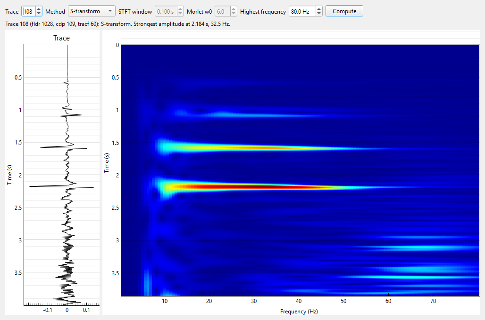

# Multicomponent data and well logs

## Multicomponent data (3C and 4C)

Three-component (3C) geophones record the vertical motion and two horizontal motions. Four-component (4C) shear
surveys record two orthogonal shear sources on two orthogonal horizontal receivers. The Multicomponent steps (flow
editor, category **Multicomponent**, or Processing > Apply one step) rotate the horizontal components, measure the
polarisation of the motion and filter by it.

**How SeisDesk tells the components apart.**
- A header holds the component code. By default this is the SEG-Y trace identification code `trid`:

  | trid | Component |
  |---|---|
  | 12 | vertical (Z) |
  | 13 | crossline (horizontal, 90 degrees anticlockwise from inline) |
  | 14 | inline (horizontal, along the sensor azimuth) |
  | 15, 16, 17 | rotated vertical, transverse, radial (written by the rotation) |

  If your files carry the component in another header, give that header and its codes in the step.
- The traces of one station and one shot are matched by **match keys**, `fldr,tracf` by default. When the channels
  are numbered per component (channel 1 = Z, 2 = inline, 3 = crossline of station 1, and so on), use `fldr,gx`
  (or `fldr,gx,gy`) instead. Traces without all their components pass unchanged.
- For 4C shear data there is no SEG-Y code for the source orientation, so the default is a header `comp` with codes
  1, 2, 3, 4 for XX, XY, YX, YY: the first letter is the source, the second the receiver. Set it with
  Geometry > Header formula, or in the shot table.

Check the codes in the header table (Geometry > Header table) before you run a step: the most common problem is a
file where `trid` is 1 on every trace.

### Horizontal rotation to radial and transverse

**Horizontal rotation (3C)** turns the inline and crossline components into:
- **radial**: along the direction from the source to the receiver, positive away from the source;
- **transverse**: 90 degrees anticlockwise from radial, seen from above.

After rotation, P and SV energy (P-to-S converted waves, Rayleigh waves) sits on the radial component and SH energy
(Love waves, SH reflections) on the transverse. This is the first step for converted-wave (PS) processing. It is also
the test of sensor orientation: a correctly rotated line has little coherent energy on the transverse component.

| Parameter | Meaning and choice |
|---|---|
| Rotation | *source-receiver azimuth*: from sx, sy, gx, gy for each trace (needs the geometry). *fixed angle*: one angle for all traces. |
| Fixed angle | Angle from the inline axis to the new radial axis, anticlockwise (degrees) |
| Sensor azimuth | Direction of the inline sensor axis, degrees anticlockwise from the survey x axis (0 when the inline component points along +x, the usual case for a 2D line) |
| Component header, codes | `trid`, 14 inline, 13 crossline |
| Match keys | Headers equal for the components of one station (`fldr,tracf`, or `fldr,gx`) |

- The rotated traces get the codes 17 (radial) and 16 (transverse).
- The angle used is written to header `hrot_az`.
- A receiver at the source position has no azimuth. It is rotated by the sensor azimuth only, and the log says how
  many there were.


### Alford rotation of 4C shear data

**Alford rotation (4C shear)** (Alford 1986) is for shear-wave splitting studies, for example fractured reservoirs or
stress-aligned cracks.
- In an azimuthally anisotropic layer, a shear wave splits into a fast and a slow wave polarised along the symmetry
  axes. The off-diagonal components XY and YX then carry energy.
- The step finds, in a time window, the angle that minimises the off-diagonal energy and rotates all four
  components to it.
- After rotation, XX and YY are the fast and slow shear waves. The delay between them measures the strength of the
  anisotropy; the angle gives the fast direction.

| Parameter | Meaning and choice |
|---|---|
| Component header, codes | `comp` with 1, 2, 3, 4 = XX, XY, YX, YY |
| Match keys | `sx,gx`: the two source orientations are often separate records, so match by position |
| Window start, end | The shear arrivals of the layer you analyse; 0 = whole trace |
| One angle per gather of | Empty: an angle for every station. A key (for example a receiver line) pools the stations of a gather for a steadier angle |
| Put the fast shear wave on XX | Compares the arrival times of the rotated XX and YY and adds 90 degrees if YY arrives first |

- The angle (degrees anticlockwise from the acquisition x axis) is written to header `alford_az`.
- The log gives the range of angles and the off-diagonal energy before and after. A good fit drops it to a few
  per cent.
- For layer stripping, rotate and correct the shallow layer first, then analyse the next window.

### Polarisation analysis and polarisation filter

**Polarisation analysis (3C)** computes the covariance matrix of the vertical, inline and crossline components in a
sliding window (Jurkevics 1988). From its eigenvalues l1 >= l2 >= l3 and main eigenvector it outputs one attribute
per run:

| Attribute | Meaning |
|---|---|
| rectilinearity | 1 - (l2 + l3) / (2 l1): about 1 for linear motion (P and S body waves), about 0.5 for circular motion (ground roll) |
| planarity | 1 - 2 l3 / (l1 + l2): about 1 when the motion lies in a plane |
| azimuth | Direction of the main motion, degrees from the inline axis towards the crossline axis |
| incidence | Angle of the main motion from the vertical (0 = vertical motion, near-vertical P reflections) |
| largest eigenvalue | Energy in the window |

The output has one attribute trace per station, with the headers of its vertical trace. Display it with a colour map
(Rainbow) and a fixed scale: rectilinearity runs from 0 to 1.

**Polarisation filter (3C)** multiplies all three components by a weight:
- The weight is the rectilinearity raised to a **power**: 2 is a moderate filter, 4 a strong one.
- Optionally the weight also keeps only **near-vertical** motion (P reflections), or only **near-horizontal**
  motion. This uses the incidence limit, with a 15-degree taper beyond it.
- Linear body waves pass. Elliptical ground roll and incoherent noise are attenuated.

| Parameter | Meaning and choice |
|---|---|
| Window | 1-2 periods of the waves to separate: 0.05 s at 20-40 Hz, longer for low-frequency ground roll |
| Rectilinearity power | 2 (moderate) to 4 (strong) |
| Direction | *any*; *near-vertical* to keep P reflections; *near-horizontal* for shear or surface waves |
| Incidence limit | 30-40 degrees for P reflections |

**Pitfalls.**
- Too short a window gives noisy attributes. Too long a window mixes neighbouring events.
- Interfering events of different polarisation look elliptical and are attenuated too.
- Use the filter on raw shots before stack, and compare with an f-k or tau-p filter.


## Well logs: synthetic seismogram, well tie, Backus and Gassmann

The well-log window (Tools > Well logs and synthetic seismogram) loads the logs of one well from a LAS file. It makes
a synthetic seismogram, ties it to a seismic trace at the well, and offers two rock-physics tools: Backus averaging
and Gassmann fluid substitution.

**Step by step.**
1. **Load LAS...** reads a LAS 2.0 (or 1.2) file:
   - Curves, units and NULL values are read; NULL values become gaps.
   - Depth may be in metres or feet.
   - Wrapped files (WRAP YES) are not supported: save the log unwrapped.
2. Check the curves SeisDesk chose. It recognises the usual mnemonics:

   | Curve | Mnemonics recognised |
   |---|---|
   | Sonic | DT, DTC, DTCO, AC, ...; or a velocity curve VP |
   | Density | RHOB, RHOZ, DEN, ... |
   | Shear | DTS, DTSM, ...; or VS |

   - The units decide the conversion: us/ft or us/m for slowness, m/s or ft/s for velocity, g/cc or kg/m3 for
     density.
   - Without a density log, choose *(Gardner from Vp)*.
   - Without a shear log, choose *(mudrock line from Vp)* (Castagna et al. 1985).
3. **Time-depth.** Two-way time comes from integrating the sonic from the top of the log.
   - The unlogged section above it is given by **velocity above the log**. Its top sits at
     2 z_top / velocity.
   - **Load checkshots...** corrects the sonic times: give a table of depth (m) and time, one-way or two-way, in ms
     or s. The drift between the checkshot times and the integrated sonic is interpolated in depth and added.
4. Choose the **seismic** dataset (a stacked or migrated time section) and the **x position of the well**. The trace
   nearest to that position is used.
5. **Compute synthetic and tie.** SeisDesk then:
   - computes the impedance (Vp x density) and the reflection coefficients at every log sample;
   - places them at their two-way times, at the seismic sample interval;
   - convolves them with a zero-phase Ricker wavelet of the chosen peak frequency (match the dominant frequency
     of the seismic, from the spectrum window).

   The readout gives the **best shift** (positive: the seismic events come later than the synthetic) and the
   **correlation** at that shift, found within the maximum shift. The synthetic track is drawn with the shift
   applied. If the reversed polarity correlates better, the readout says so: check the polarity convention of the
   data.
6. **Export** the synthetic (time, reflectivity, synthetic, tied time) or the time-depth table (depth, two-way time,
   one-way time in ms) as CSV.


| Setting | Recommended value |
|---|---|
| Velocity above the log | The average velocity from the datum to the top of the log, or use checkshots |
| Ricker peak | The dominant frequency of the seismic at the target |
| Max shift | 50-150 ms; a larger best shift usually means a datum or time-depth problem |

**Pitfalls.**
- The depth of the log must refer to the seismic datum. Logs measured from the kelly bushing need the KB elevation
  above datum subtracted (or a checkshot table in the same reference).
- Washouts make bad density and sonic values, so edit or smooth them first.
- A correlation below about 0.5 means the tie is not reliable.

### Backus averaging and Thomsen parameters

The **Backus / Thomsen** tab replaces finely layered isotropic logs by the equivalent transversely isotropic (VTI)
medium (Backus 1962), over a moving depth window.
- It plots the Thomsen (1986) parameters epsilon (P anisotropy), delta (near-vertical P moveout) and gamma (SH
  anisotropy) against depth, with the vertical velocities Vp0 and Vs0 of the averaged medium.
- Use them to judge how much layer-induced anisotropy to expect in velocity analysis (eta, from epsilon and delta)
  and in depth migration.
- The **averaging length** should not exceed about a third of the shortest wavelength, which is the slowest shear
  velocity divided by the frequency (Liner and Fei 2006). The tab shows this suggested maximum for the current log
  and Ricker frequency.
- Identical layers give zero anisotropy. Alternating fast and slow layers give positive epsilon and gamma.

### Gassmann fluid substitution

The **Gassmann** tab predicts the logs, and the synthetic, when the pore fluid changes, for example brine to gas
(Gassmann 1951).
- The dry-rock bulk modulus comes from the measured logs. The shear modulus does not change. The density changes
  with the fluid density times the porosity.

| Input | Typical values |
|---|---|
| Porosity | A porosity curve (PHIE, PHIT, NPHI; percent is recognised) or a constant |
| Zone top and bottom | The reservoir interval; bottom 0 = the whole log |
| Mineral bulk modulus | Quartz 36.6 GPa, calcite 70.8 GPa, clay about 21 GPa |
| Fluid 1 (in the logs) | Brine 2.8 GPa, 1.09 g/cc |
| Fluid 2 (substituted) | Gas 0.04 GPa, 0.25 g/cc; oil about 1.0 GPa, 0.8 g/cc |

**Substitute** plots Vp, Vs and density before and after, and the synthetic before and after. A gas sand lowers Vp
and density and slightly raises Vs. Samples with porosity up to 1 % keep their values.


---

# Flows and batch processing

## The flow editor

**Processing > Flow editor** (F5) has three columns:

1. **Processes:** every step, by category. Type in the search box to filter. Double-click a step, or select it and
   click **Add to flow >**, to insert it after the selected step.
2. **Flow:** the ordered steps.
   - Untick a step to skip it without deleting it.
   - **Up** / **Down** reorder, **Duplicate** copies a step with its parameters, **Remove** and **Clear** delete.
   - **Start from a template...** loads a ready-made sequence.
3. **Parameters:** the form of the selected step, with its description and an optional note. Values are checked as
   you type: an invalid value is outlined in red and the old value is kept.


**Templates:**
- Marine 2D: shots to migrated stack.
- Land 2D: complete sequence (QC to migrated stack): automatic editing, despike, mutes, exponential gain,
  surface-consistent amplitude and deconvolution, band-pass, refraction statics, velocities and smoothing, NMO,
  residual statics, diversity stack, f-x deconvolution, migration.
- Land 2D: statics, velocities, stack.
- Refraction: first breaks and layer depths.
- DMO: NMO, DMO, inverse NMO, NMO, stack.
- Residual moveout and anisotropic stack.
- Prestack time migration (Kirchhoff).
- Post-stack depth migration.
- Prestack depth migration (Kirchhoff).
- Time to depth conversion.

Some template steps are off by default and carry a note, for example streamer geometry, which is needed only for
files without coordinates.

## Running a flow

1. Choose the **Input** dataset.
2. Optionally type an **Output** name. The default is "input > flow name".
3. **Run flow** runs every ticked step. **Run to selected step** stops after the selected one, which is useful to
   inspect intermediate results.
4. **displayed gather only (parameter test)** runs on the gather in the viewer only.
5. The progress bar and the log follow the run. **Cancel** stops at the next progress check.
6. The result appears in the Project panel and is displayed.

Velocity picks, pick sets and depth models created by a flow, such as automatic velocity picking, the depth model or
automatic first breaks, are added to the project when the flow finishes.

## Saving flows and running them in batch

- **Save flow...** writes the flow as a JSON file, and **Load flow...** reads it back. The current flow is also saved
  with the project.
- The command-line program runs saved flows without the window, for example on many lines in a script:

```
seisdesk-cli processes                         (list every step)
seisdesk-cli processes nmo                     (the parameters of one step)
seisdesk-cli info line1.sgy                    (summary of a file)
seisdesk-cli run flow.json line1.sgy line1_stack.sgy --velocity velocity.txt
seisdesk-cli run mute.json line1.sgy out.sgy --picks mute=mute.json
seisdesk-cli synthetic land test.sgy           (a synthetic test line)
```

`seisdesk-cli` is available when SeisDesk is installed from its source code (`pip install .` in the source folder).
The Windows installer contains the graphical program.

# End products

| Product | How to make it | How to save it |
|---|---|---|
| Stacked section | CMP stack | File > Export dataset as SEG-Y (or the Write SEG-Y step) |
| Time-migrated section | Phase-shift or Kirchhoff time migration | Export as SEG-Y |
| Depth section | Split-step or Kirchhoff depth migration, or time-to-depth conversion | Export as SEG-Y (the sample interval is in metres) |
| Image gathers (velocity check) | Kirchhoff migration with output "image gathers" | Export as SEG-Y |
| Stacking velocities | Velocity analysis | Velocity > Save velocity picks (text: CMP, t ms, v m/s, eta) |
| Interval velocity / depth model | Build depth model | Velocity > Save depth model |
| Velocity field figure | Velocity > Show velocity field | File > Save display as image, or a screenshot of the dialog |
| Refraction layer model | Picking tool, straight-line fits | Copy tables (velocities, intercept times, thicknesses, depths) |
| First-break table (for tomography) | Picking tool | Export picks (CSV) with source/receiver x and elevations |
| Reflection velocities and Dix layers | Picking tool, hyperbola fits | Copy tables |
| Horizons | Picking on the section | Export picks (CSV): CMP, time per horizon |
| Statics | Elevation, refraction or residual statics | Kept in headers `sstat`, `gstat`, `tstat` (ms) and written with SEG-Y |
| Refraction statics model | Refraction statics (delay-time inversion) | Refraction statics window: Export station table (x, elevation, delay, thickness, base of weathering, static) and Export x-static table |
| QC lists | Automatic trace editing | The log lists the edited FFID/channel pairs; headers `qc_rms` and `qc_flag` |
| Figures for reports | Any viewer or tab | File > Save display as image (PNG) |
| The complete work | | File > Save project (folder) |

SEG-Y export writes IEEE floats with standard rev 1 headers:
- coordinates and elevations are re-scaled with the SEG-Y scalars;
- the recording delay is in `delrt`;
- the CMP coordinates are in bytes 181-188.

The sections open in any interpretation package.

# Worked example A: a land line with refraction and reflection (SEG-2)

This example processes a land 2D line recorded with a seismograph as SEG-2 files, one per shot. To practise first,
make the synthetic land line with File > New synthetic dataset.

**1. Project and data**
1. File > New project, then File > Save project and choose an empty folder, e.g. `Line1_project`.
2. Put the shot table `geometry_line1.csv` and the topography file `topo_line1.txt` into that folder.
3. File > Open SEG-2 shot files of a line, and select all the `.dat` files of line 1.
4. Check the log: number of shots (FFIDs), traces per shot, sample interval and record length.

**2. Geometry**
1. Geometry > Land geometry from shot table (CSV) and topography. Choose the table and the topography file, leave the
   CMP bin at 0 (half the geophone spacing), and click OK.
2. Viewer: Gather FFID, X axis offset. Check that the first breaks start at zero offset at every shot.

**3. Quality control and spectrum**
1. Press F9 (Survey QC). Check the elevation profile and stacking chart, the fold, and the amplitude grid for dead
   channels, weak shots and noisy traces.
2. Step through the shots with Page Down.
3. Run **Automatic trace editing** (action *zero*), then **Despike**. Kill any remaining bad channel by hand with
   **Kill traces** (key `tracf`).
4. Zoom on a shot below the first arrivals and above the ground roll, and press F8. Note the usable band and the
   suggested corners.

**4. Refraction analysis**
1. Picking tool: New... "first breaks". In Automatic first breaks set the fastest and slowest velocities (e.g. 300
   and 5000 m/s), then click Pick all gathers.
2. Check and correct the picks shot by shot.
3. Split each shot into phases with the break (N) at the crossovers: direct, refractor 1, refractor 2.
4. Fit: straight lines. Tick Pool all gathers for the line average, and untick it to see each shot.
5. Copy tables; note the velocities and the layer thicknesses and depths.
6. Export picks (CSV) if you want to run refraction tomography in other software. To apply the resulting statics, see
   step 6.

**5. Reflection processing, first pass** (Flow editor; start from template "Land 2D: complete sequence (QC to
migrated stack)", or the shorter "Land 2D: statics, velocities, stack")
1. Untick any **2D geometry** step: the geometry is already set from the shot table.
2. Mute: replace the linear mute with **Mute (picked phase)** on a "top mute" pick set, or set the linear mute to the
   first-break velocity of the deepest refractor plus a margin.
3. Ground roll: **Linear tau-p filter** (cut velocity above the ground-roll velocity, e.g. 600-1000 m/s), or the
   **Ground-roll cone mute**.
4. **Surface-consistent amplitude correction**, then **Exponential gain** or **t-power**.
5. **Surface-consistent deconvolution** (design window below the mute, smoothing 5 Hz, pre-whitening 1%), or the
   single-trace **Deconvolution** (operator 0.1-0.15 s, gap one sample or the autocorrelation zero crossing).
6. **Bandpass** with the corners from step 3.
7. **Sort** cdp,offset.
8. Test on one shot (displayed gather only), then run the steps up to the sort.

**6. Statics**
- **Refraction statics (delay-time inversion)** from the picks of step 4: phase "refractor 1", V1 from the direct
  wave, datum just below the base of the weathering. Check the base of weathering in the results window and export
  the station table for the report.
- Or **Elevation statics:** datum and replacement velocity from step 4.
- Or **Apply statics from an x-static table** computed by tomography in other software (mode *remove*).

**7. Velocities, NMO, residual statics, stack**
1. Velocity analysis (F6) on the CMP-sorted data: pick every 20-30 CMPs (supergather ± 2 or 3).
2. NMO.
3. **Residual statics:** window over the main reflections, maximum shift about 10 ms, 3-4 iterations.
4. A second velocity analysis if the events changed noticeably, then **Smooth velocity field**.
5. NMO and **CMP stack** (method *diversity* if some traces stay noisy).
6. **f-x deconvolution** on the stack (gather key empty) against random noise.

**8. Migration and depth**
1. **Phase-shift** or **Kirchhoff** time migration of the stack.
2. **Build depth model** from the picks (Dix, smoothing 100-200 m), then **split-step depth migration**, or
   **time-to-depth conversion** of the migrated stack.
3. Check the depths against the refraction depths and any borehole information.

**9. Products**
- Export the stack, the migrated section and the depth section as SEG-Y.
- Save the velocity picks and the depth model.
- Save display images for the report.
- Save the project.

# Worked example B: a marine 2D line

Practise first with File > New synthetic dataset > Marine streamer line.

1. **Load:** File > Open seismic file (SEG-Y). Check the shots in the viewer.
2. **Geometry:**
   - With coordinates: Geometry > 2D geometry, bin = half the group interval (12.5 m for 25 m groups).
   - Without coordinates: Geometry > Streamer geometry first (shot interval, near offset, group interval), then 2D
     geometry.
3. **Spectrum:** press F8 on a shot (zoomed below the direct wave). Note the band.
4. **Pre-processing flow** (template "Marine 2D: shots to migrated stack"):
   - **Mute (linear velocity):** v = 1500 m/s, t0 = 0.05-0.1 s (direct wave).
   - **Bandpass**, e.g. 4-8-60-80 Hz.
   - **t-power** n = 2.
   - **Deconvolution:** spiking, operator 0.16 s; or predictive with a gap just below the water-bottom period.
   - **Sort** cdp,offset.
5. **Velocities:**
   - Automatic velocity picking (every 30-50 CMPs) as a start.
   - Then Velocity analysis (F6) to check and edit, staying on the primaries and away from the slow multiples.
   - Check Velocity > Show velocity field.
6. **NMO, Radon demultiple** (q_cut between the primaries and the multiples), **CMP stack**.
7. **Time migration:**
   - Phase-shift (post-stack); or Kirchhoff prestack time migration on the CMP-sorted data before NMO.
   - With image gathers, check the flatness and run residual moveout if needed.
8. **Depth:** Build depth model (Dix), then split-step or Kirchhoff prestack depth migration.
9. **Export** the SEG-Y sections and velocity files; save the project.

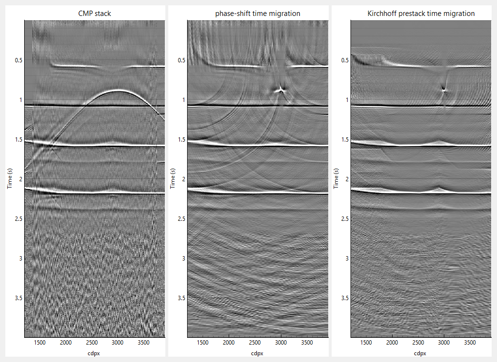

# Troubleshooting and questions

**The display is blank or shows only wiggles.** SeisDesk 0.1 is built with a Qt version known to draw correctly. If you
run it from source, do not use PySide6 6.9.x, which does not paint pyqtgraph images. Use 6.8 or 6.10 or newer.

**"CMP numbers (cdp) are not set; run a geometry step first".** Velocity analysis, NMO, stacking, Radon and DMO need
CMP numbers. Run a geometry step (chapter 4).

**SEG-Y reads with garbage amplitudes or zero traces.** Try the other byte order in the Import dialog. Check the sample
interval: set it in the dialog if the binary header is wrong.

**"FFIDs missing from the shot table".** The FFIDs of the loaded shots must match the table's `ffid` column. Add a
`file` column with the SEG-2 file names so the rows are matched by file name instead.

**Packed SEG-2 samples.** Version 0.6 reads format code 3 directly. Older versions require exporting the records
from the seismograph software
as 32-bit integers or floats.

**First-break picks jump to noise before the arrivals.** Raise the slowest velocity or lower the margin to narrow the
search window, raise the energy window, or band-pass the data first.

**The layer table says a branch "is not faster than the layer above".** The phases are not in order of increasing
velocity, or a phase contains picks of two branches. Check the breaks and the picks of each phase.

**The velocity analysis picks multiples.** Pick the primary trend by hand, using the dashed guide of the neighbouring
CMP and the Dix interval velocity (magenta), and avoid slow maxima. Run Radon demultiple after NMO with the primary
velocities.

**The depth section bends near the line ends.** The velocity picks at the line ends are uncertain (short offsets, low
fold). Remove or edit those picks, and rebuild the depth model with more smoothing.

**The program runs out of memory.** Datasets are held in memory: a line of 30,000 traces × 2,000 samples needs about
240 MB per dataset, and every processing step keeps its result. Delete intermediate datasets you no longer need
(right-click > Delete), or run long flows with only the final result kept.

**A step is slow.** Kirchhoff migration and DMO are the heaviest. Test on part of the line (Select traces, or
"displayed gather only") and reduce the aperture or the maximum frequency.

**Where is my work saved?** Only when you save the project (Ctrl+S). Exports go where you choose. Relative file names in
parameters are resolved in the project folder (or `Documents\SeisDesk` before the first save).

# Cross-reference to Yilmaz, Seismic Data Analysis

The table maps the main processing topics of Öz Yilmaz's *Seismic Data Analysis* (SEG, 2001) to the SeisDesk steps
that cover them.

| Topic | SeisDesk |
|---|---|
| Field data, demultiplexing, reformatting | SEG-Y, SU and SEG-2 input; header table |
| Geometry, CMP binning, 3D binning | 2D geometry, land geometry from a shot table, streamer geometry, 3D binning |
| Trace editing, polarity, quality control | Kill traces, reverse polarity, automatic trace editing, despike, Survey QC |
| Gain recovery: spherical divergence, programmed gain, AGC | Spherical divergence, t-power, exponential gain, AGC, trace balance |
| Surface-consistent amplitude correction | Surface-consistent amplitude correction |
| Muting: top, bottom, surgical | Picked mute, linear-velocity mute, surgical zone mute, ground-roll cone mute, NMO stretch mute |
| Frequency filtering, time-variant filtering | Ormsby and Butterworth band-pass, notch, time-variant band-pass, spectral whitening |
| Spectral analysis, autocorrelation | Spectral analysis window (amplitude spectrum, band, autocorrelation, f-k) |
| Deconvolution: spiking, predictive, prewhitening | Deconvolution (spiking / predictive) |
| Surface-consistent deconvolution | Surface-consistent deconvolution |
| Coherent noise: f-k filtering, slant stack (tau-p) | f-k fan filter, linear tau-p filter, ground-roll cone mute |
| Random noise: f-x deconvolution, median filtering, trace mixing | f-x deconvolution, median filter, trace mixing |
| Multiple attenuation: predictive deconvolution, parabolic Radon | Deconvolution (predictive), Radon demultiple |
| Field and elevation statics, datum correction | Elevation statics, statics from headers |
| Refraction statics | Refraction statics (delay-time inversion), statics from an x-static table |
| Residual statics (surface consistent) | Residual statics |
| NMO, stretch mute, velocity analysis (semblance, CVS, CVG) | NMO, velocity analysis, automatic picking, constant-velocity stacks and gathers, eta (VTI) |
| Velocity field, Dix conversion | Velocity field display, smooth velocity field, build depth model |
| DMO | DMO (Hale) |
| Residual moveout | Residual moveout correction |
| CMP stacking, diversity stacking | CMP stack (live, sqrt, fold, median, diversity) |
| Time migration: Kirchhoff, f-k (Stolt), phase shift | Kirchhoff time migration (pre- and post-stack), Stolt, phase shift |
| Depth migration, prestack depth migration | Split-step depth migration, Kirchhoff prestack depth migration, image gathers |
| Time-depth conversion | Time to depth and depth to time conversion |
| First-break picking, refraction interpretation | Automatic first breaks, multi-phase picking, intercept-time layer model, refraction statics |
| Wavelet processing: phase rotation, zero- and minimum-phase conversion | Phase rotation, zero-phase conversion, minimum-phase conversion |
| Wiener shaping filters, deterministic (signature) deconvolution | Wiener shaping filter, signature deconvolution |
| Homomorphic deconvolution, complex cepstrum | Homomorphic (cepstral) deconvolution |
| Vibroseis correlation, Klauder wavelet, minimum-phase conversion | Vibroseis correlation, Klauder wavelet to minimum phase, convolve with a sweep |
| Trace interpolation, spatial aliasing, data regularisation | Trace interpolation (f-x, Spitz), fill missing or dead traces (POCS) |
| Refraction statics: reduced-time displays, intercept times | Viewer reduction velocity, Linear moveout (reduced time) |
| Refraction imaging: GRM time-depths, refraction convolution section | Refraction convolution section |
| Wave-equation datuming (before and after stack) | Wave-equation datuming (Kirchhoff, prestack; zero offset, stacked) |
| Linear moveout, ground-roll analysis, dispersion | Linear moveout (one velocity or dynamic), MASW window |
| Finite-difference migration (15/45-degree equations, implicit schemes) | Finite-difference depth migration (45/65 degrees) |
| Depth migration by split-step, phase shift plus interpolation and Fourier finite difference | Split-step, PSPI and Fourier finite-difference depth migration |
| Prestack depth migration by wavefield extrapolation (shot profile) | Prestack wave-equation depth migration (shot profile) |
| Gaussian-beam migration | Gaussian-beam migration (post-stack) |
| Anisotropy: VTI moveout, eta, anisotropic DMO and migration | Eta scan in the velocity analysis, NMO with eta, residual moveout scan (eta mode), anisotropic DMO by migration to zero offset, VTI phase-shift migration, Kirchhoff time migration with eta |
| Residual moveout analysis of image gathers | Residual moveout semblance scan, residual moveout correction |
| 3D migration: one-pass post-stack, prestack time | 3D phase-shift, 3D Stolt and 3D Kirchhoff time migration (small volumes) |
| Migration from topography (no flat datum) | Kirchhoff depth migration with recording surface = topography |
| Forward modelling by the wave equation (acoustic and elastic finite differences) | Acoustic finite-difference modelling (2D), elastic finite-difference modelling (2D) |
| Ray-trace and Kirchhoff modelling of reflections, model checking | Ray-traced reflection synthetics, Kirchhoff modelling from a depth model |
| 3C recording, horizontal component rotation | Horizontal rotation (3C) to radial and transverse |
| Shear-wave splitting, 4C rotation | Alford rotation (4C shear) |
| Polarisation analysis and filtering | Polarisation analysis (3C), polarisation filter (3C) |
| Synthetic seismograms, well ties | Well-log window: synthetic seismogram, checkshot correction, tie to a seismic trace |
| Layer-induced anisotropy | Backus average with Thomsen epsilon, delta and gamma |
| Rock physics, fluid substitution | Gassmann fluid substitution with synthetic before and after |
| Complex trace attributes (Hilbert transform, envelope, instantaneous phase and frequency) | Hilbert transform, instantaneous attributes |
| Time-frequency analysis, spectral decomposition | Time-frequency analysis window; spectral decomposition (S-transform, Gabor, Morlet) |
| Eigenimage (Karhunen-Loève) filtering | Eigenimage (SVD) filter |
| Signal and noise separation by slant stacks | Harlan signal/noise separation |
| Marine ghosts | Deghosting (source and receiver, vertical incidence or tau-p) |
| Coherence-weighted stacking | Phase-weighted stack |

# Working with the v0.4 tools

The examples in this chapter use synthetic data. Their screenshots show the actual Windows dialogs, populated by
the processing routines during the installer build. They demonstrate operation, not expected resolution on field data.
Parameter defaults are starting points: set sampling, geometry, velocities and analysis windows for your survey.

## Multiple refraction and reflection events

Open **Picking > Picking tool** (F7), make a named pick set and add a separate phase for each event. For example,
use `direct`, `refractor 1`, `refractor 2`, `reflection A` and `reflection B`. Select the **Event type** for each
phase. A new phase stops the preceding branch; it does not erase it. Page Up/Down changes gather. Snapping can
follow an onset, peak, trough or zero crossing within the chosen search window.

Direct/refraction types enter refraction layer analysis; reflection, multiple, mute and horizon types are kept
separate. A labelled multiple is an interpreted event, not an automatically predicted SRME model. Review automatic
first breaks before assigning refractors. First-arrival tomography uses the earliest eligible arrival per trace,
not all later branches simultaneously.

Picks retain trace identities through sorting, subsetting and project saving. Equal offsets can therefore hold
different times on different traces. Older coordinate-only pick files remain readable, but an ambiguous equal-offset
match is rejected instead of assigning the same pick to several traces. Re-pick or reload identity-bearing JSON in
that case. CSV retains its original first four columns and adds trace identity and event type.

## First-arrival tomography and GRM

1. Set source and receiver coordinates and elevations, then review a first-break pick set in F7.
2. Choose **Tomography > First-arrival traveltime tomography** in the processing menu. Select the pick set and
   eligible phases. Choose a gradient, refraction-layer or project-model start.
3. Set grid spacing, maximum depth and positive velocity bounds. Use a small first run, then inspect
   **Tools > Refraction tomography results**: model, ray coverage, observed/predicted arrivals and RMS history.
4. Compare starts and regularisation settings. Cells without rays are unconstrained. The coordinate reference is
   depth below the highest ground elevation, not depth below each individual receiver.
5. For tomostatics, choose the data-with-tomostatics output, replacement velocity, datum and integration base.
   Review the source/receiver static headers before applying the shifts. Positive shifts move data later.

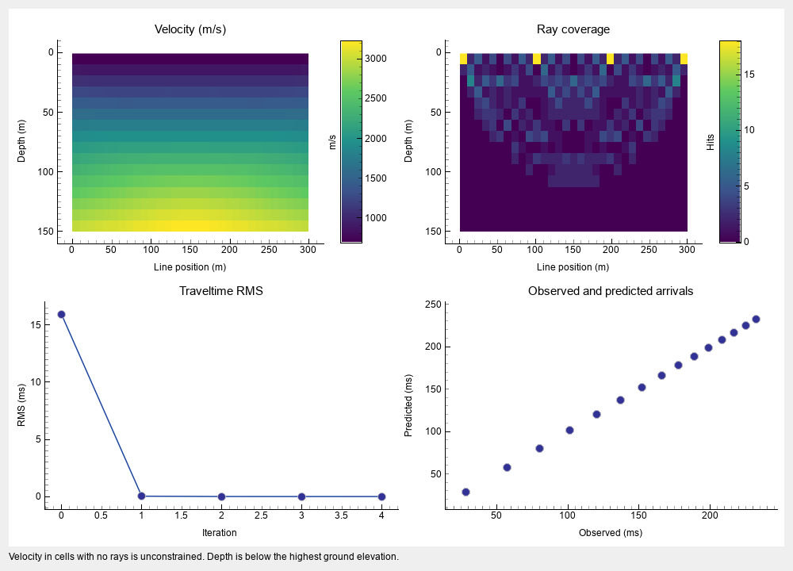

**Generalised reciprocal method (GRM)** requires forward and reverse shots picking the same refractor, an appropriate
reciprocal time and an overburden velocity. Try several XY separations, then open **Tools > GRM candidate XY results**.
Inspect the velocity function, time-depth function and depth estimate. The automatic score is a diagnostic;
the flattest/straightest function is not sufficient evidence of the correct refractor on its own. GRM statics require
positions inside the reciprocal overlap; extrapolation outside that overlap is refused.

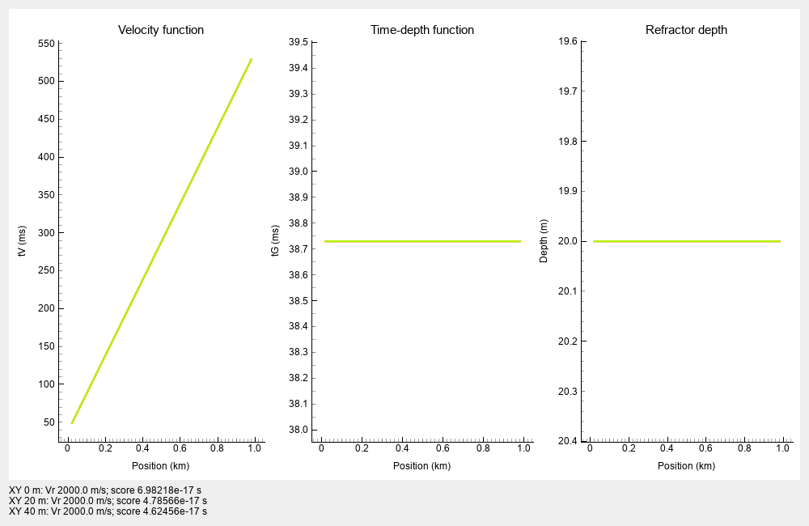

## Acoustic RTM and FWI

Both tools solve the 2D constant-density acoustic equation in the frequency domain with PML absorbing borders.
RTM correlates forward source and adjoint receiver wavefields. FWI uses the exact discrete adjoint velocity gradient
with bounded L-BFGS-B updates, optional source estimation and optional Laplace damping. The solver uses a five-point
stencil; the interface enforces at least ten grid points per shortest wavelength for the requested frequencies and
velocity range. Smaller cells increase the sparse-factorisation cost substantially.

For **Full-waveform inversion**, start with shot gathers in seconds/metres and a plausible project interval model.
Sources and receivers must have valid 2D coordinates and supported flat recording levels. On land, prepare the
recording datum first. Use calibrated, consistent amplitudes; AGC is generally unsuitable for the waveform objective.
Source estimation solves one complex scalar per shot/frequency; it cannot correct missing elastic physics or
arbitrary time-dependent gains.

Choose frequency groups from low to high, for example `3,4;4,5;5,6`, and bounds that include the starting model.
Set the iteration limit and regularisation, then run on a small subset. Missing low frequencies and a poor starting
model can cause cycle skipping. The optional illumination scaling is a fixed change of optimisation variables;
it does not change the objective gradient inconsistently between iterations. Cancellation is checked between
frequencies and shots; an active sparse factorisation must finish before cancellation takes effect.

Open **Tools > Full-waveform inversion results** to compare starting/final models on the same colour scale and
inspect objective histories and each stage's termination message. A lower objective does not establish geological
uniqueness. Save the resulting depth model and output velocity dataset. Diagnostic histories are session results.

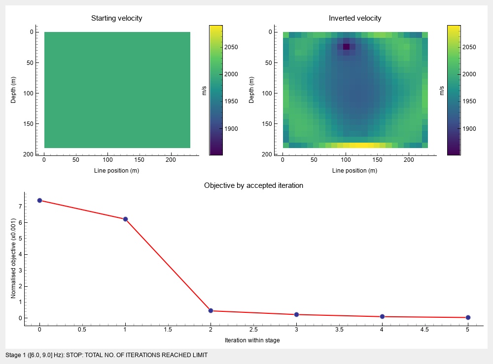

Run **Reverse-time migration** on the original reflection shot data using the selected model. Restrict frequencies
to those resolved by both the acquisition and the model grid. Illumination normalisation and Laplacian filtering
change image amplitudes; this output is not calibrated true-amplitude AVO. No free-surface multiples, elastic
conversions or 3D propagation are included in this acoustic implementation.

## Residual moveout, velocity slices and Fowler panels

The MVA input is a **depth** common-image gather dataset with `cdp`, `cdpx` and `offset` headers, plus the model used
for migration. A stacked depth section has insufficient offset information. Scan coherent horizons over a limited
depth window and choose either the vertical update or straight-ray tomography. The scan uses
`z(h)^2 = z0^2 + a h^2`, with half-offset h; for a flat constant-velocity reflector, positive a indicates that the
migration velocity was too high.

Open **Tools > Residual-moveout velocity update results** to review the change and coefficients. Then select the
**original time-domain data**, re-migrate using the updated model, and compare image gathers. The update output is
a velocity section, not re-migrated seismic. The straight-ray linear residual is only an internal diagnostic;
this approximation assumes small velocity errors and locally flat reflectors.

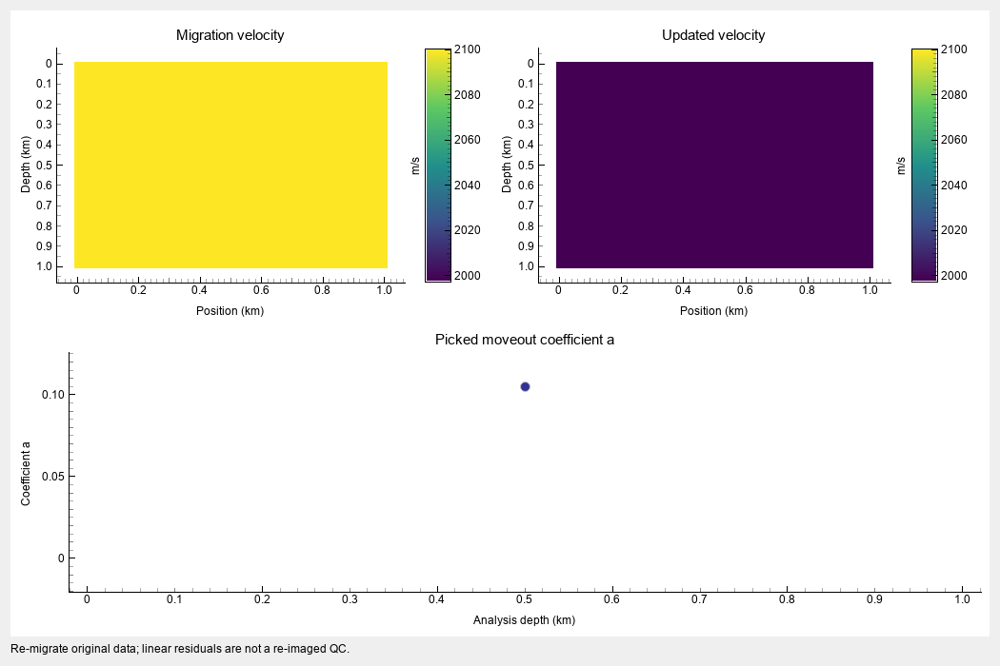

**Velocity semblance at one time along the line** produces a CMP-by-velocity slice. Open its Tools result window and
click a cell to read CMP, velocity and semblance. Optional writes update the project velocity picks, so save the
preceding picks before comparing alternative scans.

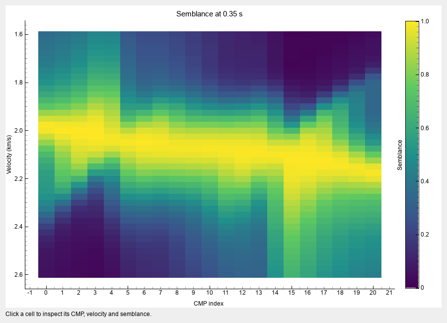

**Fowler analysis** builds constant-velocity NMO/DMO stacks, smooths their coherence and selects a velocity at each
CMP/time. Inspect each trial using **Tools > Fowler velocity panels**. Automatic picks are a starting interpretation;
low-coherence regions are not reliable velocity estimates. The eta option affects NMO only; this Fowler DMO remains
isotropic. Reduce CMP count, time range or trial count when the panel-memory limit is reached.

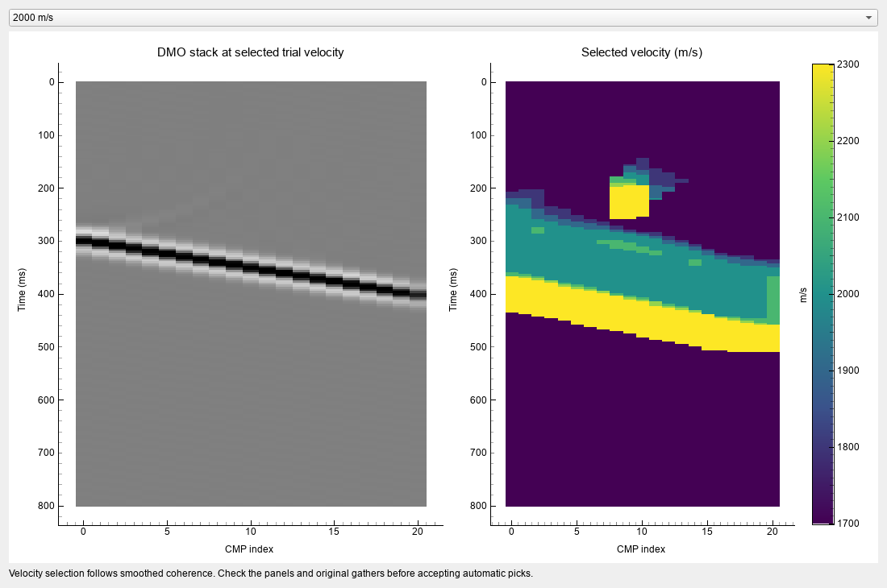

## Extended well ties and deviated wells

Load the LAS file in **Tools > Well logs and synthetic seismogram**, select the log curves and seismic trace, and
compute the initial synthetic and bulk shift. Changing input curves, frequency, trace or datum invalidates the
previous synthetic so an export cannot silently reuse a stale tie.

The **Wavelet and time tie** tab offers statistical extraction with a constant-phase scan and deterministic Wiener
extraction from reflectivity. Set wavelet length and prewhitening, extract, and inspect the wavelet and spectrum.
Automatic stretch/squeeze uses a strain bound. Manual tie pairs are `bulk-shifted synthetic time:seismic time` in
seconds, separated by commas. Times must remain monotonic. The readout gives correlation, maximum strain and the
implied interval-velocity change. A better correlation alone is not evidence that the geological match is correct.

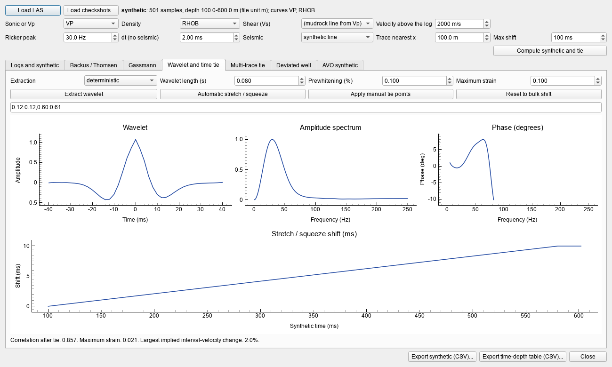

The **Multi-trace tie** tab inserts repeated synthetic traces into the nearby seismic panel. Exported synthetic
times and time-depth CSV both include the current bulk shift and time warp. Recomputing the synthetic starts a new
tie; save an accepted CSV before changing inputs.

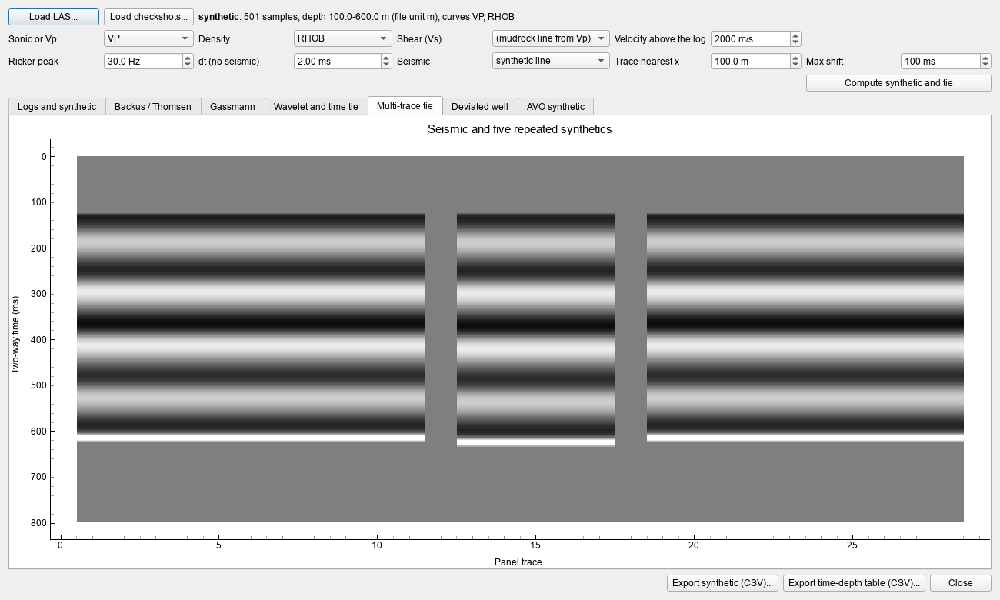

In **Deviated well**, load MD (metres), inclination and azimuth (degrees). Supply wellhead map coordinates, KB
elevation and seismic datum elevation. The minimum-curvature path gives TVD and horizontal coordinates. Select
the MD at which to project onto the seismic and press **Update path and choose nearest seismic trace**. Inspect
the reported map distance. Logs use TVD below the seismic datum when the checkbox is enabled; checkshots must use
the same depth reference. A 1D synthetic requires increasing TVD and rejects horizontal/upgoing intervals.

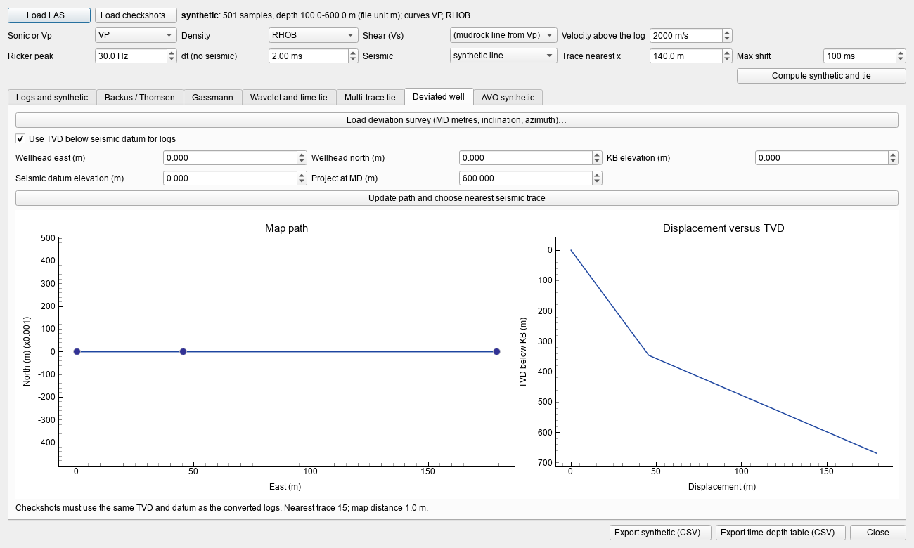

The **AVO synthetic** tab computes a 0-40 degree angle gather using exact isotropic Zoeppritz P-P, Aki-Richards or
two-term Shuey reflectivity. Select an interface depth to inspect its intercept/gradient. Log-derived density and
Vs estimates affect these results; measured curves are preferable when available.

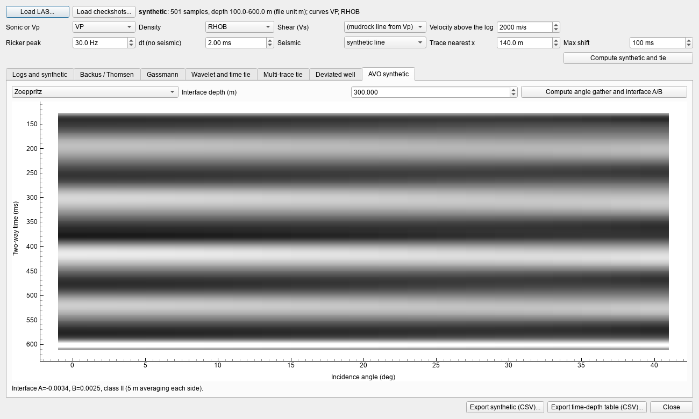

## AVO and multiple attenuation

For seismic AVO, use amplitude-preserved NMO-corrected CMP gathers and suitable RMS picks. **Angle gathers** use
Dix interval velocities and a straight-ray incidence-angle approximation. Restrict the usable angles, then make
angle stacks or fit intercept/gradient attributes. Attribute output is selected per run. The Tools crossplot shows
point density and a fitted background trend; quadrant labels are guides, not a fluid classification by themselves.

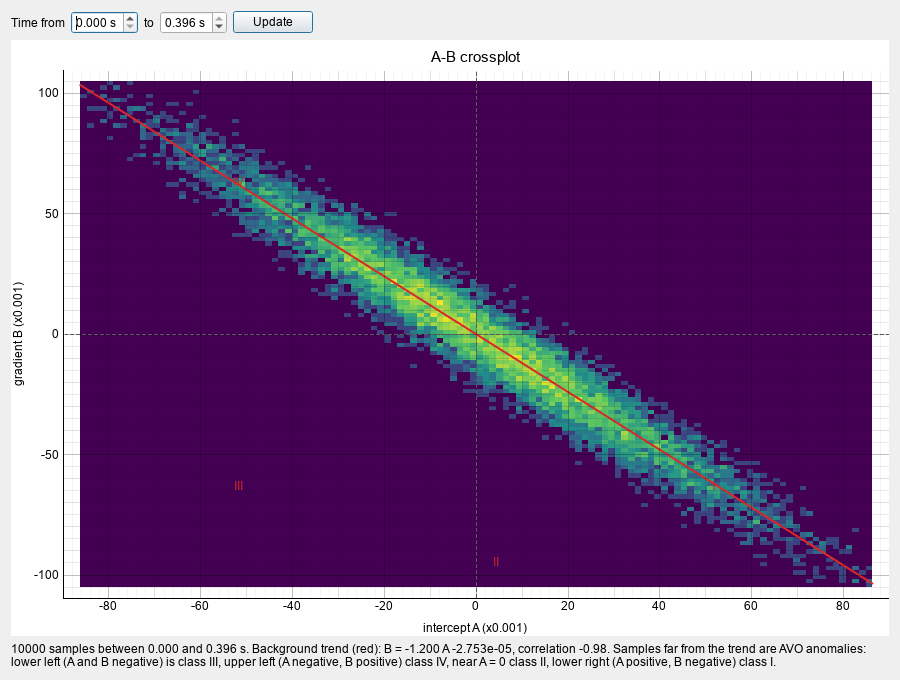

Use **Hyperbolic Radon** on uncorrected CMP gathers to separate moveout velocities; inspect its velocity panel or
multiple model before subtraction. **Tau-p deconvolution** applies prediction filters in slowness space with a
water-period-dependent gap. **SRME** predicts a time-convolution model on regular co-located 2D source/receiver
grids with t0=0. Reciprocity and near-offset filling are limited approximations. Export the predicted model,
inspect its event timing and aperture, then run **Adaptive subtraction** on the original data with that model file.
The two files must have matching traces and timing. Matching filters can remove primary energy where a model
overlaps primaries, so compare input, model and residual on the same display scale.

## Deconvolution and panel diagnostics

**Time-variant deconvolution** designs prediction-error operators in overlapping windows (`0.1-1.0,0.8-2.0`, in
seconds) and blends their filtered outputs between window centres. Each design window needs enough live samples
for the operator length. **Gabor deconvolution** estimates a smoothed time-frequency wavelet amplitude and divides
by its zero- or minimum-phase spectrum. Select stabilisation and a supported output band; this can broaden usable
spectra but cannot restore information below the noise floor.

**View > Trace statistics and similarity** shows histogram/quantiles and per-trace summaries with CSV export.
Similarity uses at most 256 evenly sampled traces. **View > 2D panel spectrum (k1-k2)** displays the Fourier panel
spectrum. For time data the sample axis is Hz; for depth data it is cycles/metre. The rectangular panel filter
supports both domains. Radial filtering requires a depth section because both axes must have the same spatial units.

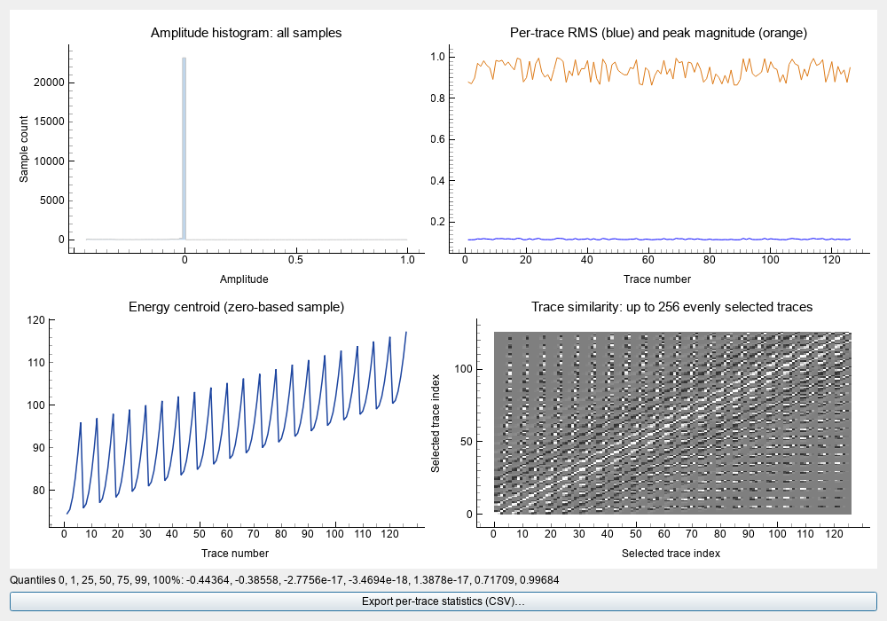

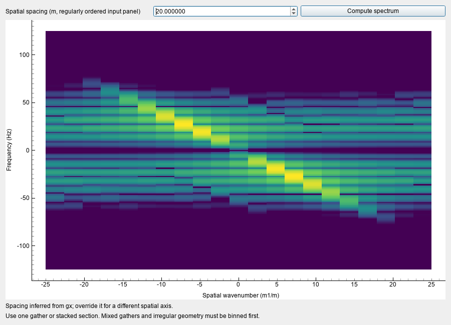

Structure-oriented smoothing scans local dip and averages along coherent events; small gaps can be interpolated.
The fractional derivative removes the DC component for nonzero order. Reciprocal summation preserves component
identity and records fold. Header/dataset arithmetic requires compatible sampling and geometry.

## GPR, geometry and advanced methods

Use **File > Open GPR file (DT1)** with its matching HD file. The reader uses HD `TOTAL TIME WINDOW / (samples - 1)`
for the sample interval, applies trace/global time-zero corrections and aligns the traces onto a common axis.
Different acquisition conventions can be supplied through `read_dt1(..., sample_interval_ns=...)` in batch Python.
Times stay in seconds internally; axes and cursor readouts show nanoseconds. The direct-wave removal tool offers
moving mean/median subtraction or peak alignment. Save a project to retain this timing; ordinary SU/SEG-Y export
is rejected for sub-microsecond sampling.

Other utilities include WGS84 longitude/latitude to UTM, azimuth and midpoint headers, flex binning, enlarged bins,
floating-datum statics and constant-velocity streamer-motion compensation. UTM requires one zone and hemisphere;
check the original coordinate units. Flex binning creates new trace identities for borrowed traces. Near-surface
zone extract/shift is a gated header-time shift, not a full near-surface velocity-stripping workflow.

**Interval model to RMS picks** integrates the project model; **TI dip-NMO table** is a homogeneous weak-anisotropy
calculation. **Tau-p NMO** needs an existing slowness panel with p in seconds/metre. **Offset continuation** takes
NMO-corrected regular common-offset input to a smaller offset using a high-frequency log-stretch operator; it
tapers outside its validity region and does not perform general survey reconstruction.

**3D Kirchhoff depth migration** uses source/receiver coordinates and a laterally invariant v(z) table. Retain
inline/crossline bin headers and inspect small test volumes first. **3D DMO** uses regular orthogonal common-offset,
common-azimuth volumes. Shot-profile depth migration also offers 45/65-degree finite-difference extrapolation.
Post-stack Gaussian beams support acoustic VTI eta with delta=0; their amplitudes and beam spreading remain approximate.

**Converted-wave** processing provides asymptotic or sample-dependent CCP binning, PS NMO/DMO, Vp/Vs from matching
PP/PS horizons and flat-layer PS ray synthetics. Confirm radial-component polarity and gamma=Vp/Vs before stacking.
**VTI elastic FD** models coupled P-SV waves with epsilon/delta; **TI ray synthetics** use weak-anisotropy group
kinematics. **REM acoustic modelling** uses Fourier spatial derivatives and a Chebyshev time propagator.
**Goupillaud modelling** includes internal multiples for equal-two-way-time layers with a transparent upper boundary.
Point/line scatterer and impedance/reflectivity tools provide additional controlled synthetics.

Sliding **Shear-wave rotation (linear transform)** requires matching XX/XY/YX/YY records at each station. Open its
Tools result window to inspect the time-varying rotation. Angles are modulo 90 degrees; fast/slow identification
and layer stripping require further interpretation.

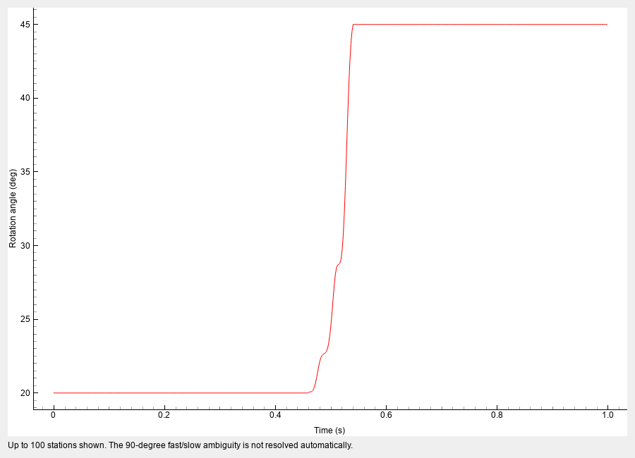

## Saving and reproducing a run

Save the project after accepting picks, flows or a model. Project folders preserve trace identities and timing.
Output datasets carry processing histories. From v0.5, diagnostic arrays under `context.results` are saved in
`results.npz` inside the project, including coverage and convergence histories. Projects saved by older releases
without these arrays require re-running the
saved flow to regenerate those plots. Save an updated model under a new filename when comparing alternatives.
The v0.4 flow templates include setup notes and leave data-dependent inversion steps disabled until configured.

For algorithm background, see the [Seismic Unix source tree](https://github.com/JohnWStockwellJr/SeisUnix),
[Pratt's frequency-domain inversion tutorial](https://www.geophys.geos.vt.edu/hole/ccss/prattCCSS.pdf) and
[Fomel's log-stretch offset-continuation derivation](https://sepwww.stanford.edu/data/media/public/docs/sep107/paper_html/node84.html).
These are references for method families; SeisDesk implementations and supported options are described above
and in the generated parameter appendix.

# SU execution, joint arrivals and 3D acoustic jobs (v0.5)

## Running real Seismic Unix programs

Open **Processing > Seismic Unix programs and file jobs**. Choose `local` for an installation accessible on the
current host, or `wsl` on Windows. For WSL, enter its Linux bin directory, for example `/opt/cwp/bin`, and optionally
the distribution name. **Find installed programs** lists executable programs; **Show program help** displays SU's
own documentation. Install SU separately using the upstream instructions at
[Seismic Unix](https://github.com/JohnWStockwellJr/SeisUnix/wiki).

For a survey already stored as SU, select input/output files and enter a pipeline such as:

```
sugain tpow=2 | sufilter f=5,10,60,80
```

File jobs stream through the installed programs without loading the survey into SeisDesk memory. Every stage's
exit status is checked. Failed or cancelled jobs preserve any previous output file; stage logs and `job.json`
remain in a sibling job folder. **Cancel job** requests termination of the pipeline. A configurable timeout prevents
an unattended job from running indefinitely.

To process the selected GUI dataset, add **Seismic Unix pipeline (installed SU)** in the flow editor. Choose the
byte order used by the SU installation: native x86 builds usually use little endian; SUXDR builds use big endian.
This bridge exports a temporary SU file and imports the result. External programs can stack, duplicate and alter
traces, so the output receives new trace identities; existing identity-based picks are not silently reassigned.

Arguments and pipes are parsed literally. Shell variable expansion, loops and redirections are not interpreted in
the pipeline box. An existing shell script can be an explicit stage, `bash /path/flow.sh`; for dataset processing
it must consume SU from stdin and emit SU on stdout. Other scripts can be adapted to this contract or run as file
jobs. Script paths and parameter-file paths must exist on the execution host. WSL paths are Linux paths.

Command-line equivalents:

```
seisdesk-cli su-programs --bin-dir /opt/cwp/bin
seisdesk-cli su-programs sugain --bin-dir /opt/cwp/bin
seisdesk-cli su-run input.su output.su --pipeline "sugain tpow=2 | sufilter f=5,10,60,80"
```

## Joint use of multiple refractions and reflections

Keep separate named phases in the pick set and assign the appropriate event types. Open **Tools > Joint
refraction / reflection tomography**. Unlike first-arrival tomography, this process retains all matched phase/trace
pairs, including several arrivals on one trace. In v0.6, click **Configure arrivals and interfaces**. Select the
phases, choose first/reflection/head paths, set the timing uncertainties, and edit or drag the boundaries.
Use the same interface name for reflected and head-wave branches on the same physical boundary. The **Show
definitions text** option retains access to JSON and JSON-file inputs for scripts and reproducible flows:

```json
{
  "first break": {"kind": "first", "uncertainty_ms": 2},
  "refractor 1": {"kind": "head", "depth": 40, "uncertainty_ms": 3},
  "reflection 1": {"kind": "reflection", "depth": 100, "uncertainty_ms": 4},
  "reflection 2": {"kind": "reflection", "points": [[0, 150], [1000, 180]], "uncertainty_ms": 4}
}
```

Names must match the pick set exactly. Depths are metres below the highest ground elevation, in the same datum as
the starting model. Interface points must cover the whole line. A `first` branch follows the shortest path. A
`reflection` branch minimises the two bent legs above the assigned interface. A `head` branch also traverses the
faster side of its assigned interface; subcritical or unresolved head-wave legs raise a diagnostic instead of
being silently treated as first arrivals. Pick uncertainties weight the inversion.

Use **Tools > Joint tomography results** to inspect model coverage, convergence and observed/predicted arrivals
coloured by phase. Results retain a separate RMS for each phase. Interfaces are quantised onto the ray grid.
The default still updates velocity with fixed interfaces. The optional depth updates below extend this to a
bounded search over the assigned interfaces. General elastic, converted-wave, multiple-reflection and multipathing
inversion are not provided by this process. Assess resolution using alternative starting models and interface
geometries. A smaller misfit does not establish a unique model.

### Updating interface depths (v0.6)

Enable **Update interface depths** in the joint-tomography flow step. **Update velocity** controls the alternating
slowness update; turn it off when using an independently determined velocity model. **Move velocity layers with
interfaces** is a separate option: it remaps layer contrasts as boundaries move, even when velocity updates are
off. Turn both velocity options off to hold every velocity cell fixed.

The interface editor provides flat depths or 2–20 x,z controls. A shared interface name ties the geometry, depth
bounds and fixed/movable state across phases. Bounds are optional absolute depths in metres. The flow step's
**Maximum depth change** additionally limits each control relative to its initial depth. Interfaces may not cross,
touch the surface, or reach the bottom row. Different phases on one boundary must share its interface name.

The search tries successively smaller positive and negative depth changes, down to one depth-grid cell. Every
candidate re-traces all selected arrivals; only a lower uncertainty-weighted data misfit is accepted. Choose a
**Largest interface search step** at least as large as dz. This is a bounded coordinate search, not continuous
shape-derivative inversion. It can stop at a local minimum and does not supply statistical confidence intervals.
The ray grid, coverage and velocity-depth trade-off limit the recovered depths.
The joint process defaults to a radius-five ray stencil for improved angular coverage. Reducing the stencil or
using very different horizontal and vertical spacings can bias depths even with noise-free picks; compare results
across grid/stencil refinements before interpreting small depth changes.


Results show the actual grid-sampled starting interfaces as dashed lines and final interfaces as solid lines. Project saves retain both
geometries, every accepted update, phase residuals, ray coverage and the stopping reason.


### Small public land checks

The Sirente RFL 1 archive (Torrese and colleagues, 2019, DOI **10.17632/9rrjbnvmkm.1**, CC BY 4.0) contains 26
small SEG-2 reflection records. All 312 native traces match ObsPy's scaled samples exactly. An operator comparison
uses the original coordinate headers, equal-midpoint groups and a constant 2000 m/s velocity; NMO/stack correlation
with SU exceeds 0.999999. This velocity is a processing control, not an interpreted earth model. The original
coordinates disagree with the repository's acquisition description, so they are not treated as surveyed truth.
Original SKEW fields are preserved but not applied in this sample comparison.

The published pyGIMLi Koenigsee example supplies 63 sensor positions and 714 first-arrival picks. SeisDesk fits 571
picks and reserves 143 before inversion. Held-out RMS decreases from 3.61 to 0.69 ms. These data test arrival
prediction; they contain no raw waveforms or known subsurface velocity ground truth. This is not a validation of
automatic first-break picking, complete land processing, or geological accuracy.

Reproduction scripts and detailed evidence are stored under `tools/validate_land_sample.py` and `validation`.

## Full 3D velocity models and acoustic jobs

**Velocity > Create 3D velocity model** builds a gradient model with optional velocity boxes. Specify node counts,
spacings and origins in **z, y, x** order. Positions and depths are metres; velocities are m/s. Save a `.npz`
model. **Inspect 3D velocity model** provides three movable orthogonal slices. A model imported from Python has
`values[nz,ny,nx]`, `spacing=(dz,dy,dx)`, `origin=(z0,y0,x0)` and `reference_elevation`.

The recording depth is `reference_elevation - elevation`, with source depth added for buried sources. All source
and receiver coordinates must lie inside the grid. Each shot header value must represent exactly one source.
For land data, use a consistent datum/model and appropriate near-surface corrections. The sponge is not a
topographic free surface, and the solver does not model ground-roll physics.

The **Full 3D acoustic processing** submenu contains modelling, RTM and FWI for the selected dataset. For larger
files, open **Processing > 3D survey file job**. It reads one shot at a time from SEG-Y or SU and stages shots on
disk. Choose the input, model, operation and job directory; configure the source waveform, compute resources and
inversion settings; then run. This avoids loading the complete survey waveform matrix into the GUI. A modelling
file job opens the first output shot as a preview; every predicted shot remains in the job directory.

The new engine solves the isotropic constant-density acoustic equation in a fully varying v(z,y,x) grid. It uses
a symmetric second-order spatial stencil, trilinear source/receiver sampling and an exact discrete adjoint. It is
separate from the older 2D frequency-domain operators and layered 3D Kirchhoff migration.

Time steps satisfy a conservative CFL bound fixed by the configured maximum velocity. Records are sampled at
their original times. Disk checkpoints store two wavefield states per block; reverse propagation recomputes each
block. The block length trades RAM against checkpoint storage. The per-worker memory limit and free disk space
are checked before allocation. Require at least ten grid points per shortest source wavelength; the coarse-grid
override exists for discrete numerical diagnostics and should not be used to justify field accuracy.

The default source is a 5 Hz Ricker acceleration pulse peaking at 0.3 s. A source file has two columns: time in
seconds, and acceleration amplitude. Its contents are copied into the job directory. Field FWI needs a suitable
source signature and starting velocity; a nominal Ricker pulse is not a universal field-data source estimate.
RTM uses zero-lag correlation and saves illumination, with relative amplitudes. FWI uses a bounded, optionally
smoothed velocity gradient and line search; a step is accepted only if it reduces the same discretised objective.
The job history reports an unsuccessful line search rather than claiming convergence.

## CPU, CUDA and distributed execution

The standard Windows installer includes the CPU engine and local process workers. CUDA execution requires a
Python environment on the compute host with SeisDesk, compatible `cupy-cuda12x` (or the CuPy build appropriate to
that host), CUDA libraries and a GPU. It is not bundled into the standard CPU installer. Dask execution similarly
requires the optional distributed installation, `pip install -e '.[distributed]'`, on the controller and workers.
Do not install a CUDA wheel without matching it to the compute host's CUDA environment.

A Dask scheduler address enables shot distribution. All workers must run the same SeisDesk version and access
the job directory at the same path. GPU workers must advertise `GPU=1` and be assigned a device. One local CUDA
worker is allowed; use appropriately assigned distributed workers for several GPUs. Parallelism is across shots:
the model and a checkpoint block still need to fit on each worker. This is not MPI spatial domain decomposition.

For a Slurm allocation such as Athena, invoke the same file-job engine within the allocation:

```
seisdesk-cli volume-job parameters.json survey.sgy job-directory --mode rtm
```

`parameters.json` contains the parameter names shown in the GUI, including `model`, `device`, `frequency`,
`source_delay`, `padding`, `block`, `memory_gb`, `vmin` and `vmax`. Relative model/wavelet paths are resolved from
the parameter file's folder. Set `device` to `cuda` inside a GPU allocation. The job directory retains staged
inputs, source signature, predictions, final model, image/illumination where applicable, and `job.json` with the
objective history. Keep this directory with the project: diagnostic job references contain its paths.

## Joint arrival tomography in 3D

Use **Tools > 3D arrival tomography** on a time-domain survey. Pick each direct, refracted or reflected event
as a separate named phase; several phases can belong to the same trace. Create a starting volume with
**Velocity > Create 3D velocity model**, then choose its `.npz` file in the tomography form. Explicit `sx, sy, gx, gy`
headers are required in metres. Depth is positive down: source depth is model reference elevation minus `selev`
plus `sdepth`; receiver depth is reference elevation minus `gelev`.

**Configure arrivals and interfaces** opens a table: select phases, path types and timing uncertainty without
editing JSON. First arrivals search the complete ground volume. Reflected legs remain above their assigned
interface. Head waves include a nonzero segment along its faster side; subcritical or unreachable paths are errors.
Interfaces are fixed planes (depth at model x0,y0 and dz/dx, dz/dy slopes) or `.npy` depth surfaces of shape `(ny,nx)`.
The optional ground surface uses the same shape and depth datum; without one, ground is at model z0.


The solver uses a shortest-path graph through the full `v(z,y,x)` model, with weighted bounded slowness updates.
Stations and interfaces snap to grid nodes; exported diagnostics include each station's snapping distance. Assess
stability with a finer grid and larger ray stencil. The memory budget checks the estimated graph footprint before
allocation; crop/coarsen the model if it does not fit. This process runs on the CPU.

The uncertainty CSV is optional: columns `trace_id,phase,uncertainty_ms` override individual selected picks;
other picks retain their branch uncertainty. Unknown or repeated CSV identities are rejected. Zero uncertainty is
invalid. Set **Timing-noise uncertainty fits** to zero to disable uncertainty, or 3–100 to refit Gaussian time
perturbations with a reproducible random seed. Three fits are useful only as a quick diagnostic; small ensembles
give unstable quantiles. These intervals condition on fixed interfaces, starting solution, assigned paths, grid
and regularisation. They do not estimate total geological uncertainty or interface-depth uncertainty.

Open **Tools > 3D tomography and arrival QC results** for weighted convergence, every arrival's observed/predicted
time and residual, and orthogonal slices of velocity, ray coverage, standard deviation and 5th/95th percentiles.
Residuals over three supplied timing standard deviations are flagged for review and remain in the inversion.
Uncertainty values without final ray coverage are masked. Inspect coverage when judging the velocity volume;
uncovered velocities can reflect the starting model and regularisation.


Each run creates a unique `tomography3d-*` folder under the project work directory with `velocity.npz` and
`arrival-qc.csv`. Save the project to retain all diagnostic arrays, phases, coordinates and uncertainties.
The results window can export the model and table again after reopening the project, even if that run folder moved.
The existing 2D joint tomography step separately supports interface-depth updates; 3D interface updates, converted
waves and arbitrary multi-bounce path families are not included in this step.

## Whole-survey 3D and 5D interpolation

Use **Tools > 3D / 5D survey interpolation** or the **Interpolation** palette. **3D stack** uses midpoint
`cdpx,cdpy,time`; **5D prestack** uses midpoint y,x, full signed offset y,x, and time, derived from `sx,sy,gx,gy`.
Set midpoint and full-offset bin spacings, reference coordinates and maximum allowed mismatch. Inputs outside
the tolerance are rejected. The output box spans the observed bins along each axis, and **Maximum output distance**
limits generated traces by Euclidean distance in spacing-normalised coordinates. This controls gap size but does
not prove adequate acquisition support or reconstruction accuracy.

Every present trace is observed by default, including traces whose samples are all zero. To exclude dead traces,
select an explicit live header, where values greater than zero mean observed. Duplicate bin locations fail by
default. Select **mean** only when averaging those traces is scientifically appropriate. Single observed bins retain
their exact float32 samples and trace identities; averaged bins receive new identities and `bin_fold` records their
input count. Predicted traces receive `interp=1` and their nearest-observation distance in `interp_distance`.

POCS applies decreasing Fourier thresholds over two or four spatial dimensions at each frequency, restoring
observations after every iteration. Frequency blocks bound spatial FFT work memory; the full complex output spectrum
uses a temporary disk file that is removed on completion or cancellation. The input/output trace arrays still need
RAM. The allocation estimate and available temporary disk space are checked before transformation. This CPU method
uses a binned periodic Fourier representation; it is not NUFFT, MWNI, guided de-aliasing or wave-equation interpolation.
Large gaps, sparse offsets, curved events, aliasing and nonstationary amplitudes require careful testing.

Output XY geometry is assigned to the selected bins; original trace coordinates are stored in project diagnostics.
New station IDs and nonconstant elevations/statics are unknown (zero), with `geometry_inferred=1`; supply/rebuild
these before shot-domain or elevation-sensitive processing. Use **Tools > Survey reconstruction coverage** to inspect
recorded and generated fold maps. Assess prediction quality by removing a representative set of real traces and
comparing their reconstructions with the withheld samples. The bundled example uses analytic multidimensional plane
waves with scattered missing traces; it is a controlled software check, not a field-scale amplitude benchmark.


Method references: [Moser, shortest-path ray tracing](https://doi.org/10.1190/1.1442958),
[Abma and Kabir, Fourier POCS](https://doi.org/10.1190/1.2356088), and
[Trad, five-dimensional interpolation geometries and limitations](https://cseg.ca/wp-content/uploads/2014-03-RECORDER-Five-dimensional_interpolation.pdf).

## Workstation CPU and CUDA processing

Use **Processing > Workstation CPU / CUDA devices** to detect GPUs on the local computer and run a small CUDA
kernel check. Select **CPU**, **NVIDIA GPU (CUDA)**, or **Automatic — CUDA when usable**, choose the GPU index,
then save the choice. The project retains this default for new 3D steps and local survey jobs. Existing saved flow
steps keep their explicit settings; each 3D process also exposes its device and GPU index directly.


Two Windows installers are built. The standard installer provides CPU processing. The **CUDA installer**, whose
filename ends in `-CUDA-setup.exe`, includes CuPy and matching NVIDIA CUDA 12.8 runtime libraries, NVRTC and headers.
Install a current NVIDIA driver compatible with the workstation GPU and this runtime. A separate system CUDA
Toolkit is not required for the CUDA edition. **Run CUDA check** checks real kernel compilation and execution on
the selected GPU; detecting a device alone is not the same as passing that check.

Local GPU processing does not require Athena or SSH. CUDA currently accelerates full-volume 3D acoustic modelling,
RTM and FWI, including their wavefield, adjoint, gradient and imaging operations. Other steps retain their documented
CPU or external-engine implementation. A GPU choice does not convert every process into a CUDA implementation.
One local shot worker uses the selected GPU; distributed multi-GPU work continues to use the separately configured
Dask backend. GPU indices are relative to the devices visible to the process.

Explicit CUDA selection fails with a reported error if the device, driver or runtime cannot run. Automatic selection
checks CUDA and logs its reason if it chooses CPU. Job diagnostics record the actual backend and GPU details. Before
propagation, the job checks its estimated wavefield/checkpoint-block memory against the selected GPU's free memory.
Decrease the model/block size or select another GPU if the memory check fails.

Source installations on Python 3.11 or newer can use `pip install -e ".[cuda]"` to install the CUDA dependencies.
Python 3.10 uses the compatible CuPy 13.6 backend and requires a matching CUDA toolkit environment, as used by the
Athena validation environment. The packaged Windows edition uses Python 3.11 and CuPy 14.2.
See the upstream [CuPy installation guide](https://docs.cupy.dev/en/stable/install.html) for runtime and driver setup.

## Remote jobs from the desktop

Open **Processing > Remote processing (SSH / Slurm)**. In **Job inputs**, choose the SEG-Y/SU input,
3D model and operation. In **Compute host**, enter an existing OpenSSH alias, an absolute remote job directory,
the compute environment's Python executable, any environment modules, and the Slurm account and resource request.
Use **Check connection** to verify authentication and the required Python packages. Profiles can be saved and
loaded as JSON. They store paths and resource settings; SSH keys and passwords remain in OpenSSH.


**Bundle inputs and submit** copies the survey, model, optional source wavelet and the desktop build's Python
source into a ZIP64 bundle with a SHA-256 inventory. Transfer and extraction are streamed. Each submission uses
a new job directory and saves a local `remote-job.json` before contacting the scheduler. The compute environment
needs NumPy, SciPy and segyio, plus a compatible CuPy installation for CUDA; it does not need a separately installed
copy of SeisDesk. Scientific execution is launched inside the Slurm allocation.

For CUDA, include the cluster's CUDA toolkit module in the profile as well as Python. The Athena validation
environment uses `Python/3.10.4, CUDA/12.4.0`. A CuPy wheel alone does not supply every required CUDA library.
The connection check inspects the Python environment on the login host; the GPU is checked when the compute job runs.

The current GUI launcher requests **one node and zero or one GPU**. CPU shot workers must fit within the CPU and
memory request; CUDA uses one local shot worker. Clear any desktop Dask scheduler address. The job-directory field
in the input form is replaced with the isolated remote output directory. This launcher does not provide multi-node
or spatial domain decomposition.

In **Jobs and results**, select a job to refresh its scheduler state and recent logs, request cancellation, or
download its output. Active selected jobs refresh once per minute. Closing the window leaves submitted jobs
running. Save the project to retain its job list, or use **Open saved job** with the durable local record. A failed
connection does not prove the job failed: refresh the saved job before creating another submission.


Downloads verify the result archive and individual files. Completed jobs open a dataset in the project; every
predicted shot, model and diagnostic remains in the downloaded folder. Job JSON paths and preview metadata are
mapped to that folder; the original manifest and `path-map.json` preserve the origin of those paths. Failed jobs
can return logs and partial outputs. A scheduler time limit or hard cancellation may prevent result packaging;
the available scheduler state and log tail remain accessible through **Refresh status**.

Equivalent headless controls are available:

```
seisdesk-cli remote-submit parameters.json host-profile.json local-job-records
seisdesk-cli remote-status local-job-records/JOB_TOKEN/remote-job.json
seisdesk-cli remote-fetch local-job-records/JOB_TOKEN/remote-job.json downloaded-results
seisdesk-cli remote-cancel local-job-records/JOB_TOKEN/remote-job.json
```

Submission and accounting follow Slurm's [sbatch](https://slurm.schedmd.com/sbatch.html) and
[sacct](https://slurm.schedmd.com/sacct.html) interfaces. A successful submission is distinct from a successful
compute job; the saved record retains both scheduler exit codes and the application outcome.

## Validation and remaining limits

The CPU suite checks interpolation/Laplacian adjoints, source adjoints, velocity finite-difference gradients,
checkpoint-block consistency, parallel shot equivalence and decreasing FWI objectives on controlled cases.
Athena A100 checks compare CPU and CUDA predictions, gradients, images and illumination, and exercise full GPU
jobs. Separate integration checks exercise actual CWP/SU executables. These are numerical and integration checks,
not a substitute for independent end-to-end field benchmarks.

The 3D engine has no elastic, variable-density, anisotropic, free-surface or attenuation inversion. The legacy
limits below still apply to their named operators, including 2D SRME, gather-wise interpolation and layered
Kirchhoff 3D migration. Survey-scale runtime, modelling adequacy and interpretation must be assessed for the
actual acquisition and bandwidth. The software does not claim that every industry processing method is covered.

# Limits retained by the v0.4 operators

- **Computing:** these earlier operators use CPU NumPy/SciPy. The separate v0.5 acoustic engine supports CUDA.
  Finite-difference modelling,
  prestack wave-equation migration and 3D migration are the slow steps: test them on a few shots or a small cube
  first.
- **Refraction:** intercept-time layer fits assume flat layers. GRM needs reciprocal coverage of the same refractor;
  tomography uses first arrivals and a finite-direction shortest-path grid. Neither resolves unconstrained deep
  cells from surface data alone. Inspect coverage and sensitivity to the starting model.
- **FWI/RTM:** 2D constant-density acoustic frequency-domain wavefields; five-point finite differences, PML borders,
  no elastic physics, free surface, 3D inversion or attenuation inversion. Sparse CPU factorisation limits model size.
- **MVA:** locally flat horizons and small model errors; vertical scaling or straight-ray differential tomography.
  The reported linear residual reduction is not a substitute for re-migrating the original shots.
- **SRME:** regular 2D co-located source/receiver grids and zero start time. Limited reciprocity/near-offset filling
  cannot reconstruct missing long offsets or crossline aperture. This is not general 3D marine SRME.
- **SEG-2:** all five standard sample encodings are read. Different sample intervals require external resampling;
  SKEW interpretation remains an explicit instrument-dependent choice, and records are cut to a common end time.

Additional method limits:

- Zero- and minimum-phase conversion of the data wavelet assume the current phase (minimum or zero); a mixed-phase
  data wavelet needs a known wavelet file or homomorphic deconvolution.
- Homomorphic deconvolution is sensitive to noise and phase unwrapping: its amplitude spectrum is reliable, its phase
  only approximate. It needs many traces and a short wavelet.
- Vibroseis: no vibrator ground-force or harmonic-distortion handling, no slip-sweep separation; the correlation uses
  one sweep (or pilot) per gather.
- f-x interpolation assumes regularly spaced traces and locally straight events; POCS works on one 2D gather at a time
  (no 3D or 5D regularisation) and fills only gaps a few traces wide reliably.
- Wave-equation datuming uses one constant near-surface velocity, measures obliquity from the vertical (not from the
  local slope of the topography), and falls back to vertical-ray shifts where sources or receivers are too sparse for
  the Kirchhoff operator.
- The refraction convolution section pairs one forward and one reverse shot per receiver; it does not stack several
  pairs, and it takes a single reciprocal time per pair.
- The MASW window computes and picks dispersion curves and gives a wavelength-rule Vs estimate; it does not invert
  dispersion curves for a layered Vs model.
- The reduced-time display pauses picking; picks are made in true time.
- The wave-equation migrations are 2D and assume a flat recording surface. Acoustic RTM/FWI and the shot-profile
  extrapolators are isotropic. The post-stack Gaussian-beam option supports acoustic VTI eta with delta=0.
  On land, apply statics or datuming to a flat datum first.
- The prestack wave-equation migration outputs a stacked image only, without offset or angle gathers. Check residual
  moveout with Kirchhoff PSDM image gathers.
- Gaussian-beam migration is post-stack only and simplified: one beam width for all frequencies, real traveltimes and
  no KMAH phase.
- The 45- and 65-degree finite-difference equations under-migrate steeper dips. All finite-difference schemes show
  some numerical dispersion at high frequencies on coarse trace spacing.
- **Anisotropy:**
  - VTI only (vertical symmetry axis); no tilted (TTI) or orthorhombic media.
  - The phase-shift migration uses the acoustic VTI approximation and one v(t), eta(t) for the whole line.
  - Kirchhoff time migration and the anisotropic DMO let velocity and eta vary along the line.
- **Anisotropic DMO** is a 2D Kirchhoff migration to zero offset: slow on long lines, and steep dips alias at coarse
  CMP spacing.
- **Earlier 3D operators** are limited to small volumes held in memory. Kirchhoff depth migration uses a laterally
  invariant v(z), not a full 3D velocity model. The 3D log-stretch DMO uses regular orthogonal common-offset and
  common-azimuth volumes; its high-frequency approximation tapers unreliable low-frequency/large-dip components.
  The 3D phase-shift method uses one velocity function.
- **Migration from topography:**
  - It uses first-arrival (shortest-path) traveltimes, accurate to about 1 %, with one arrival per point (no
    multipathing).
  - The air above the ground is filled with the velocity just below it.
- Earlier wave-equation modelling is 2D; use the separate v0.5 acoustic solver for full 3D. Point-scatterer synthetics
  can use 3D source/receiver geometry but do not solve the
  full 3D wave equation. VTI elastic FD models coupled P-SV motion using epsilon and delta; gamma/SH is not modelled.
  Weak-VTI ray synthetics use approximate group kinematics and isotropic reflection amplitudes.
- REM acoustic modelling uses Fourier spatial derivatives and a Chebyshev time propagator with sponge boundaries.
  Its band-limited spatial sampling and output sampling still limit accuracy; large time steps do not remove aliasing.
- Finite differences use explosive point sources only. The elastic free surface uses the vacuum method, which needs a
  finer grid than the body waves for accurate ground roll. Runtime grows quickly with frequency and model size.
- Kirchhoff modelling and ray-traced synthetics give primary reflections only, with approximate amplitudes. Ray
  synthetics need a layered model. The minimum-time ray method follows the fastest paths, so near the critical
  distance its times can follow refracted rather than reflected paths.
- Models are homogeneous layers or the project depth model; a velocity gradient inside a layer needs several thin
  layers.
- Converted-wave steps assume a chosen constant Vp/Vs or PS moveout function. Depth-variant CCP binning is a
  sample-dependent stack, not an elastic migration. Review component polarity and conversion-point geometry.
- Alford rotation uses one angle per station/window. Sliding LTT estimates angles through time, modulo 90 degrees;
  neither automatically resolves fast/slow axes or performs layer stripping.
- The polarisation filter treats each station on its own; no multi-station polarisation (no 3C f-k filtering).
- LAS 2.0 and 1.2 files only, unwrapped (WRAP NO). No LAS 3.0, DLIS or LIS.
- Well ties use a 1D convolutional earth model. Wavelet extraction and time warping can improve correlation without
  proving a unique geological tie. AVO synthetics assume isotropic elastic layer interfaces; strong/post-critical
  contrasts require particular care with real-valued reflection amplitudes. Horizontal/upgoing well intervals are
  rejected for the 1D TVD synthetic.
- Gassmann assumes a homogeneous mineral, connected porosity and low frequency; no mixing of several minerals or
  fluids.
- Deghosting assumes a flat sea surface and one source and one receiver depth per shot gather (the median of the
  gather) in the tau-p mode; the tau-p mode uses the offsets as the slant-stack axis and the same slowness for source
  and receiver.
- The Harlan separation shrinks the local tau-p panel with a soft or hard threshold; it does not estimate the full
  signal and noise distributions of the original method. Inside a window the traces are assumed to be evenly
  spaced, and the signal is limited to the highest frequency given.
- The eigenimage filter flattens with one linear moveout velocity or one dip per run.
- Spectral decomposition extracts one frequency per run; the time-frequency window shows one trace at a time. On
  depth sections the frequency attributes are in cycles per metre.

- **GPR:** DT1 is read with the corresponding HD header (or explicit sampling override through the Python reader).
  Times remain seconds internally and display in nanoseconds. Standard SU/SEG-Y microsecond headers cannot retain
  sub-microsecond sampling; export is rejected instead of changing units silently. Save a project to retain GPR data.
- **Input timing:** one dataset has one sample interval and start time. Mixed intervals, delays and lengths need an
  explicit target interval and alignment window in the import dialog. The original timing remains in trace headers.
- **Storage:** datasets are held in memory. Save the project before closing to retain datasets, picks and diagnostic
  arrays. External file-job outputs remain in their job directories; keep those directories with the project.

The appendix lists every processing step with all its parameters, their defaults and allowed values.

## Field import, survey geometry and layered surface waves (v0.10)

### Mixed-rate and variable-length records

In **File > Open**, a nonzero **Resample to interval** performs actual sample resampling with anti-alias filtering.
It does not relabel the time axis. **Strict** keeps a common input axis, **intersection** uses the common time overlap,
**union** retains the full span with zero padding, and **zero** starts at shot time zero and ends at the earliest trace end.
Alignment requires an explicit positive target interval. SEG-2 multi-file import offers the same choices; SKEW remains
an explicit instrument-dependent option. Original interval, delay, sample count and end time are retained as
`input_dt_s`, `input_t0_s`, `input_ns`, and `input_end_s`. Padding is not an observed signal or an arrival pick.

The resampler uses a finite Kaiser sinc kernel (32 lobes, beta 8.6). Decimation cuts off at 95% of the target Nyquist;
content near that limit is attenuated. Zero extension affects edges, so inspect events near record boundaries.
Decimation over 64:1 needs stages. The default input/output allocation limit is 1024 MiB; large surveys need partitioned
import. Variable-axis SEG-Y supports revision 0/1, IBM32/IEEE32/int32/int16/int8, extended text headers and either byte
order. Other SEG-Y layouts use the existing uniform-axis reader or external conversion. Exact microsecond intervals
and millisecond starts must be representable for the current SEG-Y/SU writers; otherwise save a project.


### SEG-D and SPS

The SEG-D dialog imports revision 2.0/2.1 demultiplexed disk records in the nine standard encodings. It uses explicit
trace-extension sample counts, base/subscan intervals, first timing words and sample skew. MP descaling yields mV;
instrument response has not been removed. Select a channel set or include auxiliaries explicitly. Channel-set, sensor,
edit and source/receiver survey identifiers remain in headers. Tape wrappers, absent trace sample counts, revision 3
and proprietary extended descriptors need external/vendor conversion; the reader reports these cases.

**Geometry > SPS survey geometry** loads S, R and X fixed-column files (2.0/2.1 layout). It matches FFID/channel to
source and receiver line/point/index identities, supports descending receiver numbers and consecutive component groups,
and rejects missing or overlapping relationships. Filter by tape when FFIDs repeat; line-sequence headers disambiguate
records where supplied. Repeated channel numbers across SEG-D channel sets require selection first. H201 supplies grid
units to metres, or enter the factor explicitly. Other SPS lengths are metres. CRS/datum descriptions are retained;
no coordinate transformation is assumed. Receiver group elevation accounts for burial depth. Offsets are unsigned
horizontal distances; run 2D geometry to obtain signed line offsets. Optional SPS static-header copying does not shift
samples. Blank corrections are retained as unknown, and KL/PM points are flagged non-live.


For batch import into a project folder:

```text
seisdesk-cli import survey.sgy project-folder --dt-ms 2 --window intersection
seisdesk-cli import field.segd project-folder --sps-source source.sps --sps-receiver receiver.rps --sps-relation relation.xps
```

### Layered dispersion inversion

Open **Tools > Layered surface-wave inversion**, or transfer the current MASW picks with **Invert layered Vs model**.
Edit the layer table and Vs bounds; the last row is the half-space with thickness zero. Optionally fit finite-layer
thickness within bounds. The pick table accepts Rayleigh or Love, phase or group velocity, mode number (0 fundamental)
and per-pick velocity standard error. MASW picks enter as fundamental Rayleigh phase velocity; review those labels.
CSV pick import accepts `frequency_hz,velocity_ms,sigma_ms,mode,wave,kind`; the MASW export's `phase_velocity_ms` is
also accepted. Separate modes remain separate observations.

The forward calculation uses disba/CPS layered elastic dispersion; bounded multistart fitting estimates Vs and optional
thickness. It assumes horizontal isotropic solid layers and a traction-free surface. Vp/Vs, density, mode labels and
layer count remain fixed. There are no fluid layers or lateral variations in this inversion. Several local starts help
search but do not establish uniqueness. The fit tab shows observations with error bars, predicted modes, residuals in
standard-error units and initial/final profiles. Always inspect solver termination and residual patterns.

**Noise refits** perturb picks with their Gaussian errors and refit from the optimum. Saved ensembles, 5th/95th
percentiles and standard deviations describe conditional measurement-error sensitivity; they omit structural and
mode uncertainty. Use enough draws to assess interval stability. Cancellation waits for the current forward evaluation
and retains any previous result. Save the project to retain picks, bounds, model and QC; export the NumPy bundle for
all model arrays and metadata. The first run compiles the CPU kernels and can take longer. These methods run on CPU.


The saved-flow process `surface_wave_inversion` accepts the pick CSV and a model CSV with columns
`thickness_m,vp_ms,vs_ms,density_kgm3,vs_min,vs_max,h_min,h_max`. The model and diagnostics persist in project results;
the input gather samples are unchanged by model inversion.

## Joint 3D boundary and velocity updates (v0.11)

**3D arrival tomography** can now update reflecting and refracting boundaries. Select **Update selected interface
depths** in the processing form, then use **Configure arrivals and interfaces > Shared boundaries and depth bounds**.
Give phases on the same physical boundary one shared ID with identical geometry, bounds, control shape and update
selection. Uncheck **Update** to keep a boundary fixed. At least one selected reflection/head-wave boundary must be
active; first arrivals constrain velocity but do not have assigned interfaces.

One depth control applies a uniform vertical shift. A 2 × 2 through 5 × 5 control grid permits bilinear depth shifts
over the original surface; rectangular grids are also accepted in saved flows. There are at most 64 active controls.
**Maximum interface control shift** bounds each control around its original value. Absolute depth bounds and a
one-cell minimum separation apply across entire surfaces. Boundaries cannot cross one another or the ground.
Choose broader control spacing where acquisition gives little lateral information.


The solver re-traces every candidate, accepts only lower uncertainty-weighted travel-time error, and optionally
alternates velocity updates. The largest search step is halved down to the depth-grid spacing. Interfaces and station
positions remain discretised on the ray grid: small apparent boundary features and zero uncertainty can be numerical
resolution effects. Refine the grid/stencil and compare predictions before interpreting depth precision.

**Remap velocity layers with moving boundaries** linearly maps velocity columns between the old and new sampled
boundary anchors. This moves layer contrasts and can smooth them. Disable it to keep an independently known velocity
volume fixed. **Also update velocity** controls the subsequent slowness inversion. These are separate choices:
disabling velocity inversion still permits remapping if that option remains selected.

The joint result retains all phase/trace picks, initial/final nominal and sampled boundaries, accepted updates,
per-arrival residuals and interface contact counts. From the results window select **Inspect interfaces** to view
depth/change/contact maps, orthogonal depth sections and conditional uncertainty. Export a fitted nominal surface
as `.npy` for another run, or export all boundaries, control shifts, contact masks and uncertainty in one `.npz`.
Projects persist the same diagnostic arrays; processing also saves `interfaces.npz` beside the fitted velocity model.


Timing-noise refits perturb the observed times with the configured independent Gaussian errors and refit interfaces
and the selected velocity updates from the optimum. All draws keep the original control-shift and absolute-depth
bounds. The saved control ensemble, depth standard deviations and 5th/95th percentiles are conditional on assigned
phases, boundary topology, control grid, ray discretisation and regularisation. They do not quantify phase mistakes,
alternate geological structures or total velocity/depth ambiguity. Depth summaries are masked where final rays have
no boundary contacts; predicted surfaces outside these contacts are extrapolations. Fixed boundaries have no fitted
depth uncertainty. A zero spread is not evidence of exact depth recovery, especially on a coarse ray grid.


The search runs on CPU. It currently supports ordered single-valued depth surfaces with one assigned reflection or
head-wave boundary per phase; overturning boundaries, converted/multiple-leg path families and field-scale 3D
validation remain outside this addition. The existing CUDA acoustic modelling/RTM/FWI operators remain available.
