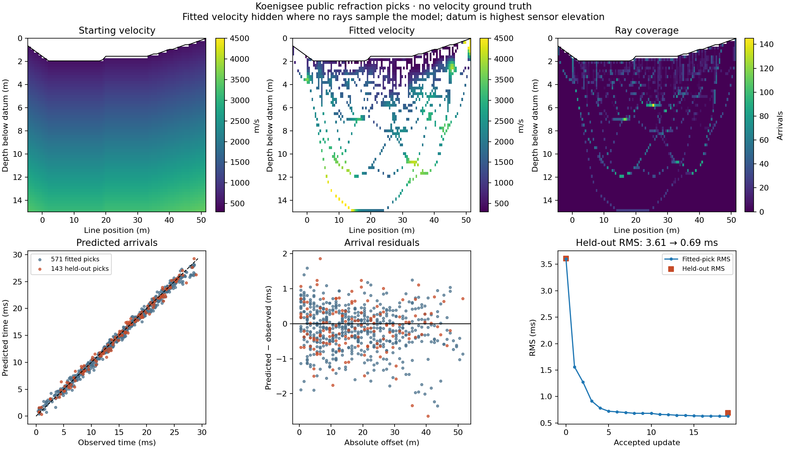

# SeisDesk v0.6 validation

This milestone adds bounded 2D interface-depth updates, a visual arrival/interface editor and broader SEG-2
input support. It does **not** complete the expansion listed in [development status](../../DEVELOPMENT_STATUS.md).
The final numerical suite passed on Athena. The Windows build passes its full suite and packaged self-test,
including the final display corrections identified in screenshot review.

## Public land data

The final land checks passed on Athena CPU allocation `3489391` on 3 November 2026, using source revision
`30a888d80af891ebe8da884fc2a0e0487222ac0d`. They used Python 3.10.4,
NumPy 2.2.6, SciPy 1.15.3, ObsPy 1.4.2 and the isolated real SU build documented in the v0.5 validation record.
The same allocation passed **46 targeted tests with no skips**, including the CLI workflow. Test counts from
overlapping environments must not be summed. The initial 43-test run was expanded after adding independent
analytical-interface and picked-flow/persistence checks.

Windows build 41579321977 passed
**303 tests**, with seven skips, followed by the frozen executable's seismic and two-worker 3D checks. The skips
were two CUDA tests, one optional Dask test, two installed-SU tests and two independent ObsPy reader comparisons.
The new ObsPy comparisons passed on the Athena CPU allocation above. The other five passed on Athena in the
v0.5 validation of the unchanged 3D/SU engines; their evidence is not described as a new v0.6 GPU run.

The final Windows build 41580143865,
revision `de5fbc6f58202e8e1612a8fdea9e1b9d22870219`, also passes tests, GUI rendering, packaging and the frozen
executable's checks. It adds correctly centred model pixels and consistent phase/interface colours; the
numerical source remains `30a888d`. The installer and manual are attached to that successful build.
Raw results: [final Windows XML](windows-results-de5fbc6.xml), [Athena CPU XML](athena-cpu-results.xml)
and [land measurements and provenance](land-report.json).

### Sirente land reflections

[Torrese and colleagues (2019), DOI 10.17632/9rrjbnvmkm.1](https://data.mendeley.com/datasets/9rrjbnvmkm/1),
RFL 1, CC BY 4.0: a 1,125,807-byte RAR with 26 SEG-2 records, 312 traces, 2,048 samples per trace and 0.5 ms
sampling. The archive SHA-256 is `6da41e85c0f0256eab1e6322724bc9537ed24b27499f2df6525d74657b0ba0b3`.

- All native scaled trace samples equal the independent ObsPy reader's samples exactly.
- Streaming reads and actual SU amplitude scaling pass their comparisons.
- Original midpoint coordinates are grouped for an operator comparison, with a constant 2,000 m/s velocity.
  Native NMO versus SU: correlation 0.999999596, relative L2 difference 0.00096677.
  Native stack versus SU: correlation 0.999999599, relative L2 difference 0.00096680.
- The source description specifies 2 m acquisition spacing and a 6 m near offset, while the original headers
  differ. Header coordinates are retained, not treated as surveyed truth. SKEW is preserved but not added to
  DELAY in the comparison. This checks sample decoding and operators, not geological interpretation or timing calibration.

### Koenigsee land refraction

The [official pyGIMLi Koenigsee example](https://www.pygimli.org/_examples_auto/2_seismics/plot_04_koenigsee/)
provides 63 sensor positions and 714 published first-arrival picks. Credit: pyGIMLi development team.
The 9,844-byte file SHA-256 is `cf8f6c8c79fd0f60984eefc61aff67b567b0c875f8f5c663fe904cdbf0d0414a`.

One pick in five is reserved before fitting: 571 training picks and 143 held-out picks. A 0.5 m by 0.25 m grid
uses measured sensor elevations, a 500 m/s surface velocity plus 200 1/s starting gradient, and bounded
300–4,500 m/s inversion. Training RMS falls from 3.60 to 0.63 ms; held-out RMS falls from 3.61 to 0.69 ms.
The predeclared held-out limits are 1.5 ms and 70% of initial RMS. Every accepted training update decreases RMS.



This dataset contains picks, not raw waveforms or subsurface velocity ground truth. It does not validate automatic
picking, geological uniqueness or a complete land processing sequence. The held-out records share the acquisition
with the training records; this is not a test on an independent survey.

## Reproduction

`python tools/fetch_land_benchmarks.py FIELD_DATA` downloads both small files, with exact hash checks. Add
`--extract` on macOS or Windows with libarchive's `tar`; on Linux supply `--tar /path/to/bsdtar`, or extract
`sirente-rfl1.rar` in an archive manager. Raw data are not committed to this repository.

On a compute allocation with ObsPy and SU available:

```sh
python tools/validate_land_sample.py "FIELD_DATA/RFL 1_raw_data_SEG2" FIELD_DATA/koenigsee.sgt OUTPUT --su-bin /path/to/su/bin
python tools/render_land_validation.py OUTPUT
```

`tools/athena_v06_validate.sh` runs the targeted numerical/workflow suite followed by both land checks. Its account,
partition and filesystem paths must match the compute host. Windows CI runs the full application suite, renders
the new windows and builds/tests the packaged executable before producing an installer and manual.

## Interface-depth evidence

Tests cover two distinct reflected boundaries, fixed and bounded sloping interfaces, a shared reflection/head-wave
boundary with velocity remapping, alternating velocity/depth updates, independent analytical reflection times,
multiple picked arrivals on one trace, and saved-project result recovery. An independent analytical probe
demonstrated depth bias with radius-three rays on stretched grids; radius-five rays reduced its RMS from
0.76 to 0.31 ms and recovered both depths within one vertical cell. The joint process now defaults to radius five.
The analytical regression explicitly compares both resolutions without relaxing its error limits. All numerical
checks pass. Desktop controls and final corrected screen rendering pass the Windows checks.

Every accepted update lowers the uncertainty-weighted data misfit. This is a local coordinate search over a
quantised ray grid. Grid spacing, ray stencil and acquisition coverage limit accuracy; no confidence intervals,
uniqueness, 3D interface inversion, or general multiple/converted-wave inversion are claimed.
